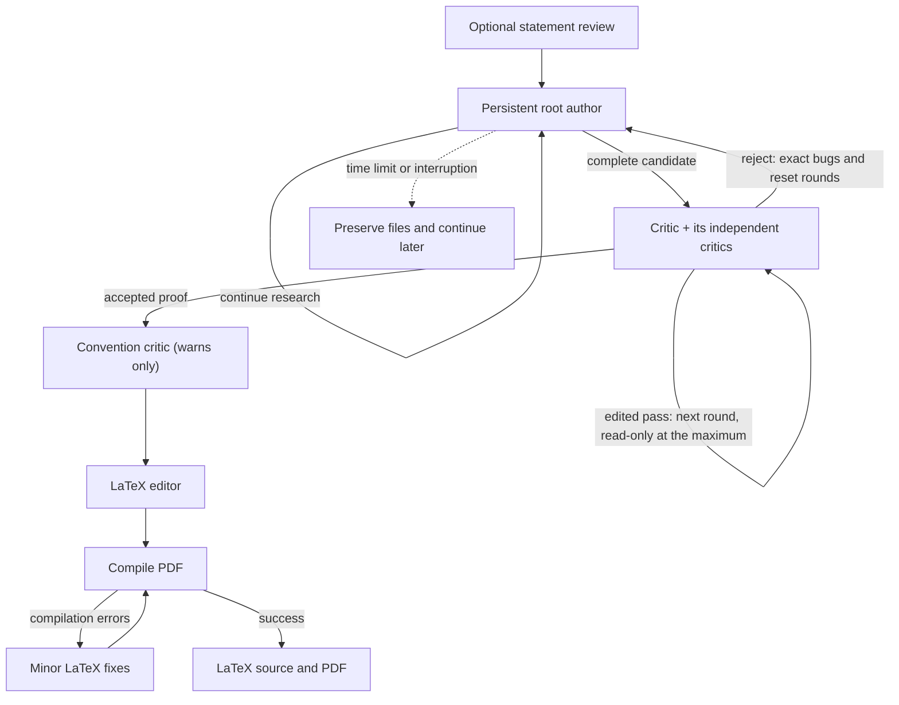

# TCS Prover

A local web UI that gives a persistent root author LLM a mathematical statement,
lets it explore approaches (with independent subagents when **Author subagents**
allows them), checks its candidate through a critic loop, and
produces a complete LaTeX document and compiled PDF.
Algorithmic tasks can be entered as statements too.

The author instructions live directly in
[`workflows/author_critic.yaml`](workflows/author_critic.yaml). The author and
its goal, continuation, compaction, resume, and repair prompts focus on proving
the exact statement, without requiring research notebooks or a file layout.
A critic verifies the result with independent critics as its subagents, a
convention critic checks once that the accepted proof does what the user most
likely wants, and the LaTeX writer presents it.

On macOS and Linux, authors can submit `PROOF_FILE: proof.md` after writing a
complete proof in their working directory. Windows authors submit the complete
proof inline because secure file-reference handoff is not available there. Before review, the controller captures the file contents,
saves the actual candidate, and gives every critic call `proof.md`, `statement.md`,
and a manifest with SHA-256 hashes in a fresh workspace of its own. The critic's
subagents and the convention critic only read that snapshot. The critic (the
coordinator of its subagents) makes its fixes in its writable copy of
`proof.md` in small edits and answers with only its verdict, the bugs it could
not fix and the bugs it fixed, so no answer has to hold the whole proof, and the
proof is not repeated in its prompt; whether it changed the proof is decided by
comparing that copy with the captured candidate. A complete inline proof uses the same
snapshot path. Repairs capture the new candidate; a stale
author file is never substituted for a coordinator's edits. Historical critics
can read the snapshot with shell tools, with external file
access, networking, native search, and MCP disabled; there the snapshot stays
read-only and the coordinator returns the complete proof in its answer. Missing,
linked, unsafe, non-UTF-8, empty, or larger-than-8-MiB proof files, and proofs
larger than 8 MiB or than the critic model's context window (when its settings
record one), are refused before review: the job pauses at the proof author with
the reason, which names the file and the cause, never its content (for example
`proof.md: file not found`, `proof.md: not UTF-8 text at byte 6`, or the
proof's size beside the limit), and resumes the author automatically after a
minute. The resumed author is told that reason, after any open critic feedback,
and asked to submit the complete proof again. With the critic stage off, a
proof file that cannot be read is refused the same way before writing. A
`PROOF_FILE` line is a pointer only in a short message (at most 1,500
characters without it). Beside a complete inline proof it is dropped and the
inline proof is reviewed, unless the named file holds a different proof (its
own title or spacing does not count): then the handoff is refused with a reason
that asks for one of the two. Pointers whose intent is clear are accepted:
`PROOF_FILE proof.md`, Markdown emphasis around the marker, words around the
path (`proof.md (complete)`, `see proof.md`), equivalent paths such as
`proof.md` and `./proof.md`, and links after the first blank line.

In a run, expand **Critic review inputs and decisions** (beside **Run settings**;
it appears once the critic has reviewed a submission). Each round shows the
coordinator's one output, the **Coordinator decision**: a **Clean pass** (the
proof is unchanged), a **Pass with fixes** (the critic changed the proof, with
whether another review round follows or the revision was accepted at the round
limit) or **Rejected**; then **Fixed:** with the bugs it fixed, **Critical
bugs:** with the bugs it could not fix (each when there are any), and, for a
round that changed the proof, a collapsed **Show changes to the proof** with the
diff. The round that accepted the proof also shows the **Convention critic**
(see [Critic loop](#3-critic-loop)). The coordinator's exact input and its raw
decision stay below, collapsed; the critic result in the activity log shows the
same parts. A round shows one decision and not the independent critics' own
reports: the critic starts them as its subagents, receives all their reports
and makes the one decision. While a round runs, a small progress line says what
the critic's event stream shows of its critics ("Critic 1 of 3 finished ·
Critic 2 of 3 working", or only "The critic has started its independent critics
(3 requested)" where Codex does not report each one; see [Critic
loop](#3-critic-loop)). A round of a paused or stopping job says so instead
("Paused before the critic decided. On Resume, the round starts again with fresh
independent critics.") and shows no progress line, and a convention critic that
had not answered says it was paused, stopped or interrupted. A job from before
the **Author subagents** setting, whose critic ran its independent critics
itself, is described that way, and its run settings name no subagents. Retries
and repeated round numbers retain separate history. The workflow rail
distinguishes rejection, active review, and approval; the search panel
distinguishes the latest request from cumulative failed requests.

Critic history groups each author's submission into a **review cycle**, with
rounds and request retries inside it. A round that was interrupted and then
resumed (by **Resume** or a restart) stays one round, marked **resumed**, and
keeps the interrupted input as an earlier attempt. A **pass with fixes** starts
another round; a **clean pass** accepts the unchanged proof. At the round limit,
one last round that cannot edit (the **final check** on the round badge) checks
the latest revision: it passes it unchanged or rejects it. Older runs may show a
**pass with changes accepted at the review limit**, which accepted the latest
revision without another critic round. The workflow rail, timeline, and
expandable metadata show these outcomes separately. Missing historical
transition evidence is shown as unknown.

Every model runs through one of two local agent harnesses: the Codex CLI
(default) or the Claude CLI. They provide the author session and the model
calls. The author keeps the same conversation while it works; files preserve its
assignment, attempt history, and proved results across interruptions or context
compaction. GPT-6.1 Sol with Max reasoning and Standard generation are the
defaults for every role. Claude models, and API models served by your own
OpenAI- or Anthropic-format endpoint, are additional options in the same model
menus; see [Model providers](#model-providers).


## Install and run

Requires Python 3.11+, the Codex CLI, and a TeX distribution with `latexmk`
and `pdflatex` available on `PATH` (for example, TeX Live, MacTeX, or MiKTeX).
Install Codex CLI through this
[official website](https://learn.chatgpt.com/docs/codex/cli). The Claude CLI is
needed only for Claude models and Anthropic-format API models.

```bash
codex login
git clone https://github.com/yonggangjiang/tcs-prover.git
cd tcs-prover
python3.11 -m venv .venv
.venv/bin/python -m pip install -r requirements.txt
python web_ui.py
```

`web_ui.py` uses this checkout's `.venv` when present, even if `python` points
to an older system or Conda interpreter. Each checkout needs its own environment;
switching branches does not copy an environment from another worktree.

One server serves a runs folder. Running `python web_ui.py` again while it runs
opens its URL (`--no-browser` prints it) instead of starting a second owner of
the same jobs. When another program holds port 8765, the server takes a free
port and prints its URL. The browser session token is kept in the private state
folder (`.tcs-prover/sessions/`), so tabs left open keep working after a restart
on the same port. Ctrl-C, closing the terminal, logging out and `kill` (SIGTERM)
close the server gracefully: working authors pause for a restart, other running
stages are interrupted, and both continue automatically about a minute after the
next start. A second Ctrl-C stops everything at once. A workflow YAML file that
cannot be read, with no earlier readable version, stops the start with a message
naming the file and line.

When `.experiment-control/current-run.json` selects a current batch, the same
command opens its existing dashboard. It checks the authenticated local server
before opening the browser and does not start a second owner of running jobs.
`python web_ui.py --no-browser` prints the current dashboard URL. A temporarily
unreachable controller produces an error instead of restoring duplicate jobs.
The selection contains version `1` and absolute `runsRoot`, `controllerStatus`,
and `dashboardStatus` paths; it is local machine state and is not committed.

The home page shows folders under `runs/` as batch cards, including their problem
counts, start dates, and status. Click a card to see its problems, then open a
problem to inspect its reasoning and outputs. **All batches** takes you back to
the folder cards. Jobs stored directly under `runs/` appear in their own card.

The current First Proof batch is marked **Current**:
`firstproof-batch3-search-v4`. Its ten workspaces remain under that folder.
Previous batches are available for read-only browsing; opening them does not
resume jobs or change their saved files. Batch selection is included in page
links so repeated problem names stay associated with the correct run. All run
folders remain in their original locations.

The Web UI opens locally with 6.1 Sol, Max, and Standard defaults for
the reviewer, proof author, critic, and LaTeX writer. The provider setup below
is needed only when you select Claude CLI or API models for one or more roles.

## Model providers

Each role under **Advanced settings** selects a **Source**, then a **Model**,
then its reasoning effort and other settings. Sources include **Codex CLI**,
**Claude CLI**, and each saved API-key connection. The model menu shows only
that source's models. Each model offers the reasoning levels it supports, and every launch or resume checks
locally that the selected models can start: Claude models need `claude` on
`PATH`, and API models need a saved key. `runner/providers.py` is the single
registry of model ids, harnesses, and efforts.

### Codex CLI (default)

`gpt-6.1-sol` (GPT 6.1 Sol, the default), `gpt-6-astra`, `gpt-6-sol`, and
`gpt-6-luna` use your ChatGPT login (`codex login`). They offer `low` through
`max`. **Ultra** is no longer offered: it was Max plus Codex's own proactive
task delegation, which had no count; subagents now follow the run's **Author
subagents** and **Independent critics** settings (see
[Subagents](#subagents-what-the-cli-enforces-and-what-only-the-prompt-says)). A
saved job, script or flag that says `ultra` runs as `max`, and the activity log
says so once ("Ultra is no longer offered; this run uses Max"). **Fast** speed
applies to these models only. The older `gpt-5.6-sol`, `gpt-5.6-terra`, and `gpt-5.6-luna` ids are
still accepted for saved runs and scripts.

### Claude CLI

Install [Claude Code](https://code.claude.com/docs), run `claude` once, and log
in with your Claude subscription. The menus offer `claude-fable-5-1` (Claude
Fable 5.1), `claude-opus-5-5`, `claude-sonnet-5-5`, and `claude-haiku-5-5`, with
the efforts `low`, `medium`, `high`, `xhigh`, and `max`; a saved `ultra` runs as
`max`. Fast does not apply: Claude models always run at standard speed.

Every Claude process receives an explicit tool list and no MCP servers, user
settings, skills, plugins, hooks, or `CLAUDE.md`, and it never waits for a
permission prompt. The proof author's file tools are confined to its run folder,
and its shell runs in the Claude sandbox (macOS, or Linux with `bwrap` and
`socat`; elsewhere the author gets file tools only), which reaches the internet
in a live run and has no network with a web cutoff (see [What a run's model can
read and write](#what-a-runs-model-can-read-and-write)). The
sandbox can neither read nor write TCS Prover's private state in `.tcs-prover/`;
on macOS the shell reads only its run folder and private temp folder (see
[What a run's model can read and write](#what-a-runs-model-can-read-and-write)).
Neither the file tools nor the shell can change the controller's files in the run
folder, `related-works/` or the `.codex`, `.agents`, `.git` and `.aws` folders.
The statement reviewer, the critic's subagents and the convention critic only
read; the critic and the LaTeX writer also edit their own copy of `proof.md` or
`latex-source.tex`. Only the critic, and the author when **Author subagents** is
1 or more, get Claude's subagent tool (Task); its number is limited only by the
prompt, since Claude Code has no setting for it. Web-search tools follow
the job's search mode. Claude has no native goals, so the harness asks the
author to end each turn with a short structured status and continues the
conversation until it reports the goal complete; pause, resume, live
instructions, context compaction, and critic repairs work as with Codex.
With **Concise** or **Detailed** reasoning summaries, the activity log shows
Anthropic's summarized thinking; Claude has a single summary level, so both
settings show the same summaries, and **Status only** shows none.
Claude Code waits out 429 and 529 responses within the same request
(`CLAUDE_CODE_RETRY_WATCHDOG`), and while it retries a request by itself the
activity log shows a **Claude API retry** line, for example "status 529,
retrying in 32 s (attempt 3 of 10)"; a stalled request's heartbeat says so too.
If a Claude CLI offers a tool beyond the explicit list (Claude's subagent tool
counts as one tool under either name, Task or Agent), the attempt ends and the
next one denies that tool with `--disallowedTools`; a tool that this does not
remove stops the job for safety.

Claude Code keeps a saved conversation for `cleanupPeriodDays` (30 days by
default) after its last activity, and any Claude Code run with default settings
deletes older ones. TCS Prover therefore keeps a private copy of each Claude
author conversation in `.tcs-prover/claude-transcripts/` and puts it back when
Claude no longer has the conversation. When the conversation cannot be reopened
(no copy, a missing saved ID, or the same refusal three times in a row), the
author continues by itself in a new conversation in the same run folder: it
starts from the resume prompt and, after a rejection, the critic's last report;
after a submission that was refused before review, the author is also told why,
until it submits again. The time budget continues, and the activity log shows
**Conversation replaced**. A Claude CLI left behind by an earlier runner that
still holds the conversation is stopped first. To keep conversations longer,
set for example `"cleanupPeriodDays": 365` in `~/.claude/settings.json`.

### API connections

**Advanced settings → API connections** saves an endpoint and API key once,
then discovers every model available through that key. Start with the base URL
and key; a request source and display name can be added later. Saving a
connection does not ask you to choose or type a model ID.

| Field | Meaning |
| --- | --- |
| Format | **OpenAI** (Responses API) or **Anthropic** (Messages API). |
| Base URL | For example `https://api.openai.com/v1` or `https://api.anthropic.com`. HTTPS is required except for `localhost`; credentials, query strings, and fragments are rejected. So that the host shown and tested is the host the CLIs contact, the URL must be plain ASCII (an international domain name in its `xn--` form) without backslashes, a percent-encoded host, an IPv4 address other than four decimal numbers, or `.`/`..` path segments. |
| API key | Stored only on this computer and never shown again. Editing a connection with an empty key keeps the saved key while the format and base URL stay the same; changing either requires entering the key again. |
| Request source | Optional client name sent as the `User-Agent` header, so routers that log it can identify your requests. Use up to 200 printable ASCII characters; the default is `TCS-Prover`. |
| Display name | Optional local source label; the default is the endpoint's host. It is not sent to the API or used as the request source. |
| Context window | Optional: the context window in tokens (at least 1,024) of this connection's models, for models the CLI does not know. Runs pass it to the CLI, which then keeps the conversation within it, compacting it in time. It applies to every model of the connection. |
| Max output | Optional: the most output tokens one response may have, smaller than the context window. The Codex CLI compacts the conversation early enough to leave room for it (it has no setting for the output limit itself); the Claude CLI asks for at most this many. Empty fields keep the CLI's defaults. |

**Save connection** loads the endpoint's model catalog before saving. A failed
connection or empty catalog leaves the previous saved settings intact. Each
role can then select that saved key under **Source**, select one of its models,
and choose the supported effort and other settings. Roles can share one key
while using different models. **Load models** on a saved connection refreshes
its choices. Renaming a connection or reordering its catalog preserves selected
model identities; two saved keys for the same URL remain distinct sources.

Authentication is selected automatically: OpenAI-compatible endpoints receive
`Authorization: Bearer <key>`, and Anthropic endpoints receive `x-api-key: <key>`.
Existing saved custom authentication headers are replaced with the format's
standard header while retaining the key for the same endpoint. If an endpoint
reports **401 · Missing API key**, check that the format, endpoint, and key match
the service's requirements. The request source labels the client independently
of authentication, and applies to model discovery, connection tests, and model
requests.

**Test connection** loads the model catalog without generating an answer. It
uses `<base URL>/models` (OpenAI) or `<base URL without /v1>/v1/models`
(Anthropic, with `anthropic-version: 2023-06-01` and pagination). Discovery has
one 30-second deadline, follows no redirect, and shows the HTTP status, latency,
and the provider's message with the key removed. Testing unchanged saved
settings records the result on that connection. **Edit** fills the form with
its saved settings but never its key. **Remove** deletes the connection, key,
and model choices; new role menus return to the default model, while saved jobs
retain their selected IDs and show a warning until the connection is restored.
Removing a connection is blocked while a running job, or a job waiting to start
or resume, uses one of its models: edit the connection instead, or delete that
job first. Changing its format is blocked while jobs use it. Editing a tested
setting marks the displayed result as out of date. Under each role menu a chip
names its CLI or API format and host.

A test of one model (`POST /api-models/test` with its `api:<id>` selection ID
and wire `model`, or with unsaved settings) sends a request shaped like the ones
runs send: streamed (server-sent events), offering one tool and asking for a
JSON answer at the format's highest effort (or the `effort` given), with the
connection's max output, to `<base URL>/responses` (OpenAI) or
`<base URL without /v1>/v1/messages` (Anthropic). When the endpoint refuses it
with an HTTP 4xx other than 401, 403 or 404, one minimal request
(`Reply with OK.`) follows, and the result says whether the endpoint refuses
only the shape of run requests.

OpenAI-format models run through the Codex CLI as an isolated custom provider
with a private Codex home under `.tcs-prover/codex-homes/`, so your ChatGPT login
is neither used nor sent to the endpoint. A `codex` launcher that replaces
`CODEX_HOME` cannot run them; put the native Codex binary on `PATH`. Their
structured roles return JSON by a prompt contract with validation, retried
until the answer is valid (see [Automatic retries](#automatic-retries)),
and live web search uses the endpoint's hosted search tool, which some endpoints
reject. Anthropic-format models run through the Claude CLI with a private
configuration folder per run folder under `.tcs-prover/claude-homes/`
(`CLAUDE_CONFIG_DIR`), so your Claude login, its keychain entry and
`~/.claude.json` are never read, and they get the same tools as Claude models,
including subagents and web tools. A `claude` launcher that drops
`CLAUDE_CONFIG_DIR` cannot keep that folder: TCS Prover checks this once per run
with a `--bare` start that reads no login and makes no request, and otherwise
runs them in bare mode, where the author has only the sandboxed shell, Read, and
Edit tools and the activity log says why. They show messages and tool activity
but no reasoning summaries, because a gateway may return raw reasoning, which is
never displayed. API models offer `low` through `max` and always run at standard
speed. Terminal options accept each discovered model's stable `api:<id>`
selection ID. A connection ID identifies the saved key rather than selecting a
model. Older configurations keep their original `api:<id>` model selection as
an alias, so existing jobs can continue.

The controller returns `model_sources` for source menus and `model_catalog` for
model menus; each model row carries its `sourceId`, `sourceLabel`, and wire model
name. `/api-models` lists `connections`, each with `models` containing the wire
`id`, display `label`, and stable selection `modelId`. Saving without a model
fetches the catalog on the server; client-supplied model lists are ignored.

Keys are stored in `.tcs-prover/api-models.json` in this checkout: an
owner-only file in an owner-only folder that Git ignores (`TCS_PROVER_API_MODELS`
selects another path; a relative path is resolved against this checkout). The
browser receives only a key hint such as `…abcd`. Keys never enter process
arguments, run folders, transcripts, logs, or error messages: the runner reads
the store itself and gives the key only to the CLI process, through its
environment (Codex, whose model shell commands never inherit it) or an
owner-only settings file under `.tcs-prover/claude-settings/` that is deleted
when the process exits (Claude). **Stop** interrupts the runner before ending it
(Windows ends it at once) and then removes any such file the runner left; one
left by a process killed some other way is removed when the next runner or
server starts. Every transcript record is also cleaned of the keys
the runner knows (any value of at least 8 characters), so a gateway error or a
command that echoes a key shows `[redacted]`.

An entry of the store that TCS Prover cannot use (edited by hand, or saved by
another version) is listed under API connections with the reason, **Repair**
(the form, which saves it under its id, so jobs that name its models find them
again) and **Remove**; the other connections keep working and can still be
saved. A store that
cannot be read (a damaged file, or one another program is writing) is reported
instead of being shown as empty: running jobs keep the settings they read last,
and waiting jobs try again every minute. At startup the server also checks the
private folder `.tcs-prover` (it may be a symbolic link to a folder you own,
which is then made owner-only) and names a folder it cannot use. Copies of a
CLI login made for one call (historical runs) are deleted when the call ends.

Model sandboxes cannot read or write this private state: the Claude Bash sandbox
everywhere it runs and, on macOS, the Codex sandboxes of every role (through the
confined permission profile described in
[What a run's model can read and write](#what-a-runs-model-can-read-and-write)).
Sandboxes of API models also cannot read your Codex or Claude login files. On
Linux and Windows the Codex sandboxes keep Codex's default read access to your
files, so a Codex role's shell there could read the key store; there, store API
keys only if the models you run with Codex CLI may see them. Each job records
the non-secret settings of its API models under `apiModels` in
`job-settings.json`. A connection used by a running job, or by a job waiting to
start or resume, cannot be removed, and its format cannot change while jobs use
it. A saved job keeps its selected model. If its connection is missing anyway
(removed by an older version, or from the store by hand), a waiting job checks
every minute and continues once you add its endpoint and key again with the same
format and base URL, exposing the job's saved model in the discovered catalog;
the controller restores its previous source and selection IDs. Its display name
may differ. A new connection never takes a saved job's source ID with another format.

### What a run's model can read and write

On macOS every model process of a run is confined to its own folders: the
proof author (and its replies while paused), the critic and its subagents, the
LaTeX writer and its repairs, and the statement reviewer.

- **Read:** its workspace (the author's run folder, or for a continuation the
  source run's folder it works in; for the other roles their call's own folder,
  such as the critic's proof snapshot), its private temp folder, the system, and
  the read-only software folders that commands need: `/opt/homebrew`,
  `/usr/local`, `/opt/local`, `/Library/TeX`, the Command Line Tools, python.org
  Python, Perl, and `~/.elan` and `~/opt/anaconda3`, each only if it exists
  (plus Codex's or Claude Code's own programs).
- **Write:** only its workspace and its private temp folder. In the run folder
  the controller's files (`job-settings.json`, `pause.json`,
  `checked-statement.md`, `prompts/`), `related-works/` and the `.codex`,
  `.agents`, `.git` and `.aws` folders stay read-only for every role, Codex or
  Claude. The statement reviewer, the critic's verify visits and the paused
  author's replies write nothing in their workspace.
- **Neither:** other runs, the TCS Prover checkout and its private state, your
  home folder, other volumes, `/tmp`, `/var/tmp` and the shared temp folder.

`$TMPDIR` names the private temp folder. The author's is
`runs/.controller/<run>/tmp/`, kept for the whole run and deleted with the job;
each attempt of every other call gets a fresh one that is removed when the
attempt ends, and a Claude shell uses a short `/tmp/tcs-prover-…` folder of its
own (Claude Code needs a short path there), removed when the CLI ends; one that a
killed process left behind is removed at the next start. In a web-cutoff run
every model process gets a fresh one of its own (see [Web cutoff and removed
models](#web-cutoff-and-removed-models)). Downloads and scratch files therefore
go to `$TMPDIR` or the run folder, not `/tmp`; macOS `mktemp` ignores `$TMPDIR`,
so use `mktemp -p "$TMPDIR"`.

**Network.** In a live run (Web cutoff off) every model process can reach the
internet: the proof author (with its subagents), its replies while paused and
its progress summary at the time limit, the statement reviewer, the critic with
its independent critics (its subagents) and its final verification, the
convention critic, and the LaTeX writer and its repairs, Codex or Claude. A
process with a shell reaches any host from it: the proof author, and with Codex
also the author's replies and progress summary, the critic and its subagents,
its final verification, the convention critic, and the LaTeX writer and its
repairs (on Linux and Windows not the final verification and the convention
critic, see below). The statement reviewer, and with Claude every role but the
proof author itself (its replies and progress summary included), have no
shell; they reach the internet only through their web search tools. Your Codex
settings do not change this: the `network_access` of `[sandbox_workspace_write]`
no longer applies, and neither do its writable roots and `/tmp` settings. A
Claude shell reaches every host through the proxy of Claude's sandbox, which
`curl`, `git`, `pip` and most other programs use by themselves (`HTTPS_PROXY`,
`ALL_PROXY`); a program that ignores these settings, such as `nc` or `ssh`, gets
no direct connection, and a name lookup outside the proxy fails.

With network access the commands of every Codex role can also reach other
programs on this computer: services on `localhost`, and any Unix socket whose
path they know, even in a folder they cannot read. No model process, on any
platform, is given `SSH_AUTH_SOCK`, `SSH_AGENT_PID` or `GPG_AGENT_INFO`, but a
command can still use a socket at a fixed path, such as gpg-agent's in
`~/.gnupg`, or list the sockets that your programs have open with `lsof`, your
SSH agent's among them. Claude's sandbox refuses `localhost` and Unix sockets.
To run without network, use a web cutoff: with `-1` or a timestamp no model
process has network access (see [Web cutoff and removed
models](#web-cutoff-and-removed-models)).

The live Codex author also runs without your Codex MCP servers, plugins and apps,
which would run outside its sandbox, and without image viewing (as the other
roles already do); the rest of your Codex settings, such as the model provider
and login, still apply. Before the author's first turn, at every start and
retry, TCS Prover checks its sandbox without a model: one command run by Codex in
that sandbox must read (and, except for a reply, write) the run folder and write
the private temp folder, and must not read the controller's folder or the
checkout, list the folder that holds the run, or write `/tmp`; it needs no
network. The activity log
shows **Sandbox checked** when it passes. If the check cannot run or fails, the
author is not started; the attempt is retried every minute like a failed model
call, with the reason in the activity log.

To let models use another toolchain, add its installation folder to
`TOOLCHAIN_FOLDERS` in `runner/confinement.py`. Add only software, never a folder
that holds your data: every run can read it.

On Linux and Windows the Codex sandboxes keep Codex's legacy modes, which can
read your files, and the Claude shell keeps its default reads; every start of a
run then notes in its activity log: "Run confinement is enforced on macOS only;
this run's model can read files outside its folder." There the Codex author,
its replies while paused and its progress summary at the time limit, the critic
with its subagents, and the LaTeX writer and its repairs follow the same network
rule. Only the legacy read-only mode of Codex's one-off calls (`codex exec`) has
no network setting, so the commands of the critic's final verification (with its
subagents) and of the convention critic stay offline there even in a live run
(the statement reviewer has no shell); their native web search still works. The
Codex and Claude processes themselves, the LaTeX compile of live runs, what a
model sends out over the network and the local programs that a live run's model
processes reach (see above) are outside this confinement.

### Web cutoff and removed models

Web cutoff timestamps require Codex CLI models for every proof role, because
their isolation is specific to the Codex sandbox; Claude and API models are
rejected before launch. With a timestamp cutoff, the proof roles' menus disable their
Claude CLI and API groups and flag a chosen model that cannot run. DeepSeek V4
Pro is no longer supported: a saved run that names it restores with GPT 6.1 Sol
in that role and a warning under the job title, `job-settings.json` records the
replacement once, and an error-paused run resumes automatically with it. A role
that will not run again (the statement reviewer of an approved job, for example)
is not reported.

You can type your open problem into the text box and click “Check Statement.” The system will first revise the statement to remove ambiguities and handle corner cases, then ask you to approve or reject the revised version.

If you approve it, persistent reasoning will begin and continue until a solution
is found or the time limit is reached. The candidate passes through an
independent critic loop. Accepted proofs are then formatted as readable LaTeX.

Options for changing the default model, time limit, and other settings are under
**Advanced settings**. GPT-6.1 Sol (`gpt-6.1-sol`) at Max reasoning is the default for
every node.

**Advanced settings** include **Web cutoff** (labelled *Web search cutoff*), which is off for new jobs:

| Web cutoff | Cutoff value | Search behavior |
| --- | --- | --- |
| Off | Not used | Native web search enabled without a time restriction; every model process has internet access. |
| On | `-1` | Web-search tools disabled; no model process has network access. |
| On | UTC timestamp, e.g. `2026-10-02T14:13:12Z` | Author can search and read verified archives strictly before that instant. |

A timestamp cutoff currently requires macOS; elsewhere only Off and `-1` are
available. For a timestamp cutoff, turn off **Statement review** and use Codex CLI models for all
proof roles. Before model work, the
controller saves a separate policy and checks the native sandbox for both author
and structured roles. That sandbox also denies `/tmp` and `/var/tmp`; instead
each model process (the author, its replies, every critic or writer call) gets an
owner-only temp folder of its own in the run's controller folder
(`codex-home/tmp/`), made when the process starts and removed when it ends (one
that a killed process left behind goes when the run next starts a process). Its
`$TMPDIR` and `TMPPREFIX` name that folder in all of the process's commands, so
zsh heredocs (Codex runs the model's commands in zsh) and `mktemp -p "$TMPDIR"`
work. The checks probe it too: `$TMPDIR` must name the process's own fresh
owner-only folder, which must be writable, and `/tmp`, `/var/tmp` and a file
next to it in `codex-home/tmp/` must stay out of reach. macOS's `/bin/sh` and
`/bin/bash` ignore `$TMPDIR` for the heredocs in their own scripts (`bash -c`, a
script file) and use the current folder instead, so those work in the author's
folder but not in the critic's read-only one, unless the command first changes
to `$TMPDIR`. The sandbox grants no software folders: only the system's basic
commands run there, not `python3`, `git`, Perl or TeX. A failed check blocks
launch: the prepared job is held and names the cause. A check that could not
finish (a timeout, no connectivity for the controls, an early exit) runs again
every minute, before launch and before every model call; a proven violation stops
the run for safety. **Re-run preflight**
releases a held job once its checks pass. A problem no retry fixes (a moved or
missing policy, a pinned binary with no verified replacement, an isolated config
with settings TCS Prover does not write) holds the job with that message instead
of retrying it every minute; a moved checkout is adopted automatically and
recorded in the search audit log. Stopped or failed web-cutoff runs continue in
their own run folder under the same policy. The saved search mode and
cutoff are retained on resume; changing the defaults does not change existing
runs. Older main runs without a recorded search mode retain unrestricted search; an
explicit disabled mode or historical policy always takes precedence.

`-1` removes the web-search tools and turns off the network of every model
process; it is not the historical sandbox or a restriction on model training
knowledge. Timestamp mode also blocks shell networking and outside-file access
so the author cannot bypass the archive gate with `curl`.

The run page shows the exact statement, stage, active time, workflow limit,
local process health, model settings, and final or partial output. Its search
panel appears only when a cutoff is set and shows whether search is disabled or
restricted to archives (**Run settings** records every job's search mode).
For archive search it shows the saved cutoff, provider, author-only access, and
broker operation counts. Pending means an accepted call has no recorded terminal event; it does
not establish that the call is still running. Verified candidates are archive
checks, not the number of sources delivered to the model. These counters do not
replace the trajectory auditor or establish absence of model-training knowledge.

To update the dashboard while an older controller owns running jobs, use the
gateway without restarting that controller:

```console
python -m ui.live_gateway \
  --legacy-launch-status /absolute/path/to/launch-status.json \
  --legacy-runs /absolute/path/to/existing-runs \
  --new-runs /absolute/path/to/separate-new-runs \
  --status-file /absolute/path/to/dashboard-status.json \
  --port 8772
```

Open the `url` in the private dashboard status file. The gateway serves the new
assets, reads legacy metadata without restoring jobs, and forwards existing
job actions to their original controller. A separate controller handles new
jobs. The two run directories must not overlap. Keep the gateway running while
using it; the original controller remains responsible for the older batch.
Closing the gateway (Ctrl-C or SIGTERM) pauses the new controller's jobs as
closing the server does. A restarted original controller is found again through
its launch status file.
**Advanced settings → API connections** (listing, saving, removing, testing,
and refreshing model choices) goes
to the controller that handles new jobs.
An older server without the new search capabilities cannot enable historical
search through the updated frontend. Operators can set `TCS_PROVER_UI_AUTH_HOME`
to the local Codex login directory; only its authentication file is copied.
Set `TCS_PROVER_UI_RETRIEVAL_STATE` to an existing controller's retrieval-state
directory to share host pacing across old and new historical jobs. Both are
trusted local settings and cannot be supplied by the browser.

## Run a folder from the Web UI

On the home page choose **New problem**, select the proof stages you need,
click **Run a folder…**, and choose a folder
containing text statements. Any file extension or none is accepted, including
`.md`, `.txt`, and `.tex`. Each non-empty, top-level text file starts its own
parallel proof job using the selected author, critic, and writing stages and
their current model and prompt settings. Statement review is skipped. The browser asks for
confirmation before starting the jobs. All of them share the rate and usage
limits of the same CLI logins and API keys. Files are read as UTF-8 text.
Hidden files (names starting with `.`), the system files `Thumbs.db`,
`ehthumbs.db`, and `desktop.ini`, and subfolders are ignored; empty files,
binary files (containing a NUL byte) and files too large for one statement
(over 8 MB or 2,000,000 characters) are skipped and listed in the confirmation.
The job list shows each source filename, including after a server restart.

Related works listed in the composer (see [Related works](#related-works)) go
with the folder run: they are saved once, in a store of that folder run kept by
TCS Prover outside every job's folder, and every job of the run finds them in
its own `related-works/` folder as hard links to that one copy (no extra disk
space; where a hard link is impossible, that job gets its own copy and its
activity log says so). While the jobs of a folder run can still take related
works, the batch page lists the run under **Batch related works**: **Add
files…** and **Add a note** there add works to every job of that run, queued
ones included, and each running or paused author is told about them. A job of
the run can still add works of its own on its page.

A batch accepts at most 200 statements, 2,000,000 characters per statement, and
8 MB for the complete request; the browser checks this before sending. Every
request that creates a job has the same 8 MB limit, also through the live
gateway. Historical batches accept at most 10 statements and check every sandbox
before starting any of them. Split larger folders into smaller batches. A job
that cannot be created or started (for example on a full disk) stops none of the
others: the result names it, and TCS Prover tries it again every minute.

### Running jobs

**Models & API → Running jobs** sets how many jobs may run at once on this
computer (`0`, the default, means no limit; saved in `.tcs-prover/settings.json`).
Beyond it, the jobs of a folder run wait in a queue (**Queued** on their cards)
and start in order as running jobs finish or pause; automatic retries wait for a
free slot too. TCS Prover starts queued jobs and automatic retries at most one
every 2 seconds, longest-waiting first, so jobs that came due together reach the
provider spread out. **Start now** starts a queued job at once, and a job you
start or resume yourself always starts. The queue survives a restart, and a
terminal folder run follows the same limit. A reply of a paused author (see
[Talking to a paused author](#talking-to-a-paused-author)) starts without
waiting for a slot or for the 2-second spacing, but takes a slot while it is
written.

## Terminal runs from Markdown

On a server without a browser, put the complete statement in any UTF-8 Markdown
file. Paragraphs, quotes, mathematical backslashes, and line breaks can be
copied into the file without escaping. Then pass the file directly to
`web_ui.py`:

```bash
python3 web_ui.py statement.md
```

This sends the entire file directly to the proof author, exactly like turning
off **Statement review** and keeping the other three stages on. It does not start an HTTP server or
open a browser. With no command-line overrides, it uses the same defaults as the
web UI: 3 independent critics per critic round, no author subagents, a maximum of 2 consecutive edited
critic passes (then one last review that cannot edit), no total workflow time
limit, 6.1 Sol and Max for all proof roles, the built-in role prompts, and
Standard generation speed. The activity log requests concise public reasoning
summaries by default.

### Optional settings

Put overrides after the file or folder. The requested single-dash spelling,
double-dash camelCase spelling, and conventional double-dash kebab-case spelling
are all accepted. For example:

```bash
python3 web_ui.py statement.md -criticRounds 6 -thinkingHours 36
python3 web_ui.py statement.md --author-model gpt-6-astra --speed-mode standard
```

| Option | Default | Meaning |
| --- | --- | --- |
| `-criticRounds N` | `2` | Maximum consecutive edited critic passes; then one last critic round that cannot edit must pass the latest solution unchanged or reject it. `1` to `100`. An unchanged pass accepts immediately. Rejection returns to the author and resets the count. |
| `-criticCount N` | `3` | Independent critics the critic starts as its subagents on each proof version before it decides: `1` to `10`. Every critic round, including the last one that cannot edit, starts this many fresh critics. |
| `-authorSubagents N` | `0` | Subagents the proof author may start at a time, for example to explore other approaches or check calculations: `0` to `10`. `0` gives it no subagent tool. |
| `-thinkingHours HOURS` | `0` | Total elapsed-workflow limit in hours: `0` (the default) for unlimited, or any positive number. Reaching it pauses the proof author; the critic and LaTeX steps after a submission always finish, so an approved proof is never cut off. Recorded work is retained when time runs out. |
| `-authorModel MODEL` | `gpt-6.1-sol` | Author model: Codex CLI `gpt-6.1-sol`, `gpt-6-astra`, `gpt-6-sol`, or `gpt-6-luna`; Claude CLI `claude-fable-5-1`, `claude-opus-5-5`, `claude-sonnet-5-5`, or `claude-haiku-5-5`; or a discovered model's `api:<id>` selection from **Advanced settings → API connections**. The older `gpt-5.6-sol`, `gpt-5.6-terra`, and `gpt-5.6-luna` are still accepted so saved runs and scripts keep working, but the Web UI no longer lists them. |
| `-criticModel MODEL` | `gpt-6.1-sol` | Critic model; same choices as the author. |
| `-writerModel MODEL` | `gpt-6.1-sol` | LaTeX writer model; same choices as the author. |
| `-reasoningEffort LEVEL` | `max` | Fallback effort for all three roles: `low`, `medium`, `high`, `xhigh`, or `max`. The retired `ultra` is still accepted and runs as `max`; the Web UI offers each model only the levels it supports. |
| `-authorEffort LEVEL` | shared effort | Override only the author effort. |
| `-criticEffort LEVEL` | shared effort | Override only the critic effort. |
| `-writerEffort LEVEL` | shared effort | Override only the LaTeX writer effort. |
| `-speedMode MODE` | `standard` | `standard` for normal speed or `fast` for ChatGPT's accelerated generation (up to 2× on 6.1 Sol and Astra, 1.5× on the other models; Fast can draw credits faster). Fast applies to Codex CLI models only; Claude CLI and API models always run at standard speed. |
| `-reasoningSummary LEVEL` | `concise` | Public activity-log summaries: `none`, `concise`, or `detailed`. This never exposes private chain-of-thought. Claude CLI models show Anthropic's summarized thinking for both `concise` and `detailed`; Anthropic-format API models show no reasoning summaries. |
| `-authorPromptFile PATH` | built-in prompt | Load a UTF-8 author prompt; it must contain exactly one `[STATEMENT]`. |
| `-criticPromptFile PATH` | built-in prompt | Load a UTF-8 critic prompt. |
| `-finalPromptFile PATH` | built-in prompt | Load a UTF-8 LaTeX prompt. |

Prompt-file paths are resolved from the terminal's current working directory.
Run `python3 web_ui.py --help` to see every spelling and allowed value.

## Automatic retries

Every failed model call is retried automatically every minute (plus up to five
seconds, so that many jobs do not retry in the same instant), with no attempt
limit, so a job keeps going through provider outages without you. This covers
the statement reviewer, the proof author, the critic, the LaTeX editor and its
compilation repairs, parallel independent requests, and the replies of a paused
author (see [Talking to a paused author](#talking-to-a-paused-author)). A failure is anything
that interrupts a call: a provider error such as "model at capacity",
overloaded, 429 or 5xx, a dropped stream, a CLI crash or non-zero exit (or a
failed turn reported with exit code 0), a CLI that is missing for a moment
(for example while it updates itself), a call whose CLI has stalled, a login
or usage-limit error, and an answer that cannot be used (empty, not valid
JSON, the wrong shape, or failing a workflow `require` rule, such as a critic
that returns no proof). A structured call (reviewer, critic, LaTeX editor) is
never stopped while it works: an attempt is stopped only after its CLI has
written nothing for an hour (every output line counts), also when the total
time limit is unlimited, and is then retried like any other failure. Codex
writes nothing while a critic waits for its subagents, and the longest wait it
allows is an hour, so while such a wait is open the attempt is stopped only
after two hours of silence. No author attempt runs past the total time limit, and
the statement review's retries end at the job's total time limit in the same
way; the critic and LaTeX steps after a submission always finish.

Each failed attempt of a structured call adds a Diagnostic card to the
activity log (long texts keep their beginning and their end), and its full
provider messages and CLI error output, keys removed, are appended to
`model-failures.log` in the run folder; the card names the file, and a failure
that repeats the previous one exactly is logged in one line. The retry notice
quotes the provider line that names the cause (else the CLI's own error line,
or its newest line). At every start of the runner (a new job, Resume, or an
automatic resume) TCS Prover runs `codex --version` or `claude --version` for
the CLIs the job's models need (no model call) and names their path and
version in the activity log; a missing or broken CLI, and one that changed
since the job last started (`cli-versions.json` in the run folder remembers
them), are named too. A CLI
that fails to start in the same way three times in a row is shown as "Codex CLI
missing or incompatible" (or Claude's) while the retries continue, until it
works again.

Some causes need you although the job keeps retrying: an expired CLI login, a
usage limit, or an API key the endpoint rejects. The Overview then lists the job
under **Needs your attention** with what to do (for example *Codex login needed:
Log in to the Codex CLI again (codex login)*), its card and its page say so, and
the retries go on, so the job continues by itself once that is fixed. **Models &
API → Running jobs** can also show a browser notification when a job first
needs you, while TCS Prover is open in a tab.

Failures that no retry can fix are not retried: a configuration error (for
example a missing API key, or a Claude model in a web-cutoff run), a workflow
rule that cannot be evaluated on a valid answer (a problem of the YAML, not of
the model), a safety refusal (a CLI that offers unexpected tools, ignores an API
model's private Codex home or continues a different conversation, or a changed
web-cutoff policy) and programming errors.
A critic or LaTeX step pauses at that step with its exact input: after a
configuration, workflow-rule or safety error it waits for **Resume**, after
any other error (for example a programming error, or a runner that was killed)
it resumes automatically after a minute. The proof author pauses with such an
error too. So does a model that does not exist or that your account cannot use
(**Model unavailable**) and, for an API model, an endpoint that refuses the
requests as invalid with HTTP 400 (**Request rejected by the API endpoint**);
both list the job under **Needs your attention**. An error-paused job whose API
connection's settings then change resumes by itself; one whose built-in model
is unavailable waits for **Resume**. An API model store that cannot be read for
a moment is retried like any failure. An author stopped by a safety check, or a Codex author whose
saved thread ID is missing, is not resumed automatically: the job says why and
waits for you (**Resume**, or **Continue proof author** for a missing thread
ID). A saved conversation that its CLI no longer has is not such a failure:
Claude's is put back from its private copy when possible, and otherwise the
author continues in a new conversation (see below and [Claude CLI](#claude-cli)).
When Codex reports that its code-mode tool runtime is unavailable, the session
never continues after the warning, but the attempt is retried: a live run
continues the same thread with the classic shell tool, and a web-cutoff run,
which needs the audited tool set, shows **Author needs attention** and checks
again every minute.

The proof author continues in a new conversation of the same run, with a
**Conversation replaced** notice, when Codex no longer has its saved thread,
refuses to reopen it three times in a row with the same error that is not a
provider failure, or when the provider reports that the conversation no longer
fits the model's context (Codex or Claude). The new conversation starts from
the resume prompt (which restates the original author prompt) plus any open
critic feedback and, after a submission that was refused before review, the
note on why (the `handoff_refused` prompt) until the author submits again; the
critic rounds and the time budget are kept. No rollout or transcript is copied.

An author that stops responding is treated as a failed model call as well: a
running turn with no event for 30 minutes gets a cheap check (Codex
`thread/goal/get`, a Claude control request), and an unanswered check (after 1
minute), or a request Codex leaves unanswered for 10 minutes, ends the attempt,
so the retry reopens the same thread. A Codex turn that ends with the goal
still open, followed by no new turn for 1 minute, is continued with the
continuation prompt. Requests Codex sends to TCS Prover (approvals, user input,
MCP elicitations) are declined or answered with a JSON-RPC error, and the turn
continues. Codex's own reconnect attempts appear as **Codex is reconnecting
(2/5)…**, and in live runs the app-server's whole redacted error output is
kept in `codex-app-server.log` in the run folder.

A retry keeps everything the failed attempts knew, without piling up notes:

- Structured calls persist their CLI session (Codex without `--ephemeral`,
  Claude with `--session-id`). Once an attempt has produced model output (for
  example a critic read the proof), the next attempt forks
  that session (`codex exec fork <id>`, `claude --resume <id> --fork-session`,
  with the same model, effort, sandbox, schema and settings) and adds a short
  note; after an unusable answer the note says in plain words what was wrong,
  for example "the solution field must not be empty", and quotes the model's
  own explanation. A critic that rejects without listing bugs is asked to keep
  its verdict and list them. A fork that fails before producing anything is
  deleted, and the next retry forks the same session again, so an outage adds
  nothing to the conversation. While no attempt has produced output, when the
  CLI no longer has the session, when the conversation no longer fits the
  model's context, when the critic's proof snapshot disappeared, and in
  web-cutoff runs (which never persist sessions), the retry sends the exact
  saved input again in a new conversation.
- The author's retry starts a new CLI process that reopens the same thread or
  session. An instruction the model never received is sent again; a turn that
  the model received but answered with nothing is first removed from the
  conversation (Codex `thread/revert`, Claude `--resume-session-at`) and its
  instruction sent again; after a turn in which the model worked, a short note
  asks it to continue. A retry that fails before it reopened the conversation
  keeps the thread and the pending instruction for the next one.

The structured sessions live only while their call runs: TCS Prover deletes
them when the call ends (`codex delete --force`, which also removes the threads
of subagents, or the Claude transcript files). Until then they are where each
CLI keeps its sessions: Codex under `$CODEX_HOME/sessions` and its state
database (an API model's private Codex home for OpenAI-format API models),
marked so that Codex never builds memories from them; Claude under `projects/`
in its configuration folder (for Anthropic-format API models the run's private
folder under `.tcs-prover/claude-homes/`, or `~/.claude` in bare mode).

During the wait the job stays running, and the run page, the activity log and
the terminal say why, for example "Model call failed (model at capacity) —
retrying in 1 min (attempt 7, retrying for 6 min)" with the provider's message
(keys removed). The wait does not consume the workflow time budget, no author
attempt starts after the time limit is reached, **Stop** ends a wait at once, and
**Pause** (offered while the proof author works) pauses the job instead of
retrying. Only the first retries of one call stay pinned in the activity log;
later ones stay in the recent window and in `transcript.jsonl`.

## How to use checkpoints

If a proof author still ends up paused by an error (for example when its runner
process itself ended), TCS Prover retries the saved conversation after 1 minute,
and a failed resume attempt is retried every minute; a terminal run does the
same. A critic or LaTeX step that fails outside its model call (for example a
runner that was killed, or a failure while preparing its files) pauses at that
step with its exact input and is resumed there, in the same run folder, the
same way. A file write that fails, for example on a full disk, is first retried
in place every minute, keeping the step's result. Retry times survive server
restarts and do not require an open browser tab. The paused job shows its next retry time; **Keep paused** cancels
automatic retries, and **Resume** retries immediately. User-requested pauses
and stops, exhausted workflow time limits, safety stops and a Codex author
whose saved thread ID is missing do not trigger this error retry, and
neither does a model whose settings are incomplete (a CLI that is only missing
for a moment is retried). Saved work and the original time budget are
preserved.

Work that a restart, crash or reboot interrupted continues the same way: an
author resumes its saved conversation, and a critic or LaTeX step starts again
from its exact saved input (the reviewed candidate, the final input, or
`latex-source.tex`, which is compiled again), about a minute after the next
start. A run that another TCS Prover process still owns (a terminal run, or a
runner left by a crashed server) is shown as running elsewhere, unchanged,
until that process ends; then this server takes it over. A run whose saved
checkpoint or settings are damaged stays listed with a warning: its checkpoint
is rebuilt from the transcript and unusable settings fall back to the defaults.

TCS Prover writes durable artifacts while a job progresses. When the Web UI is
started again, it scans `runs/*/transcript.jsonl`, restores the historical job
cards, and lists every resumable critic checkpoint found in those run folders.
It also discovers prepared workspaces with `preparedRun: true` in
`job-settings.json`. **Start prepared run** opens a fresh author session in that
exact folder, using its saved prompts and workspace; no earlier session
or elapsed budget is inherited.
You do not need to keep the old browser tab open.

A saved proof candidate contains the checked statement and latest complete
argument. Continuing it starts a fresh critic round from that candidate in a
new job: the critic starts new independent critics on it and repairs the
argument itself (see [Critic loop](#3-critic-loop)).

To continue from the Web UI:

1. Stop the old server if it is still running, then run `python3 web_ui.py`.
2. On the home page, open the job's batch and find the job by its full start/finish time.
3. Click the continuation button beside the checkpoint you want (the job's own
   page also lists it under **Continue from saved work**).
4. Confirm the action. TCS Prover creates a new job and opens it immediately.

Saved run inputs and transcripts are preserved. The new job copies the selected candidate,
role prompts, model choices, reasoning efforts, speed, critic-round maximum,
number of independent critics, and workflow time limit. A saved role that names
the removed DeepSeek V4 Pro restores with GPT 6.1 Sol and a visible warning; an
error-paused job with such a role resumes automatically with it. A role whose API
model was removed reports it before any new request starts; an error-paused job
then checks every minute and continues once the model is configured again.

A statement review that fails returns to the statement it revised, with the
error and your feedback filled in again (a first review returns to the draft);
**Retry statement review** on the batch list runs it again in the same job from
`review-input.json`. A review that a server restart interrupted starts again by
itself.

Very old runs that predate `job-settings.json` can restore only choices visible
in their transcript. A role that never ran has
no recorded model choice and therefore uses the current default when resumed.
The continuation confirmation names these unknown legacy roles before a new
paid request starts.

A checkpoint exists only after a complete artifact has been written. It cannot
restore the middle of an in-flight model response or its private reasoning. If
a process stops between two checkpoints, continuation begins from the most
recent checkpoint listed on the job card.

### Continue a manually stopped job

Jobs stopped with the Web UI's **Stop** button remain visible as **Stopped at
statement review**, **proof author**, **critic**, **LaTeX editor**, or **failure summary** after the
server is restarted. On the batch list, or under **Continue from saved work** on the job's own page,
use the stage-specific continuation button. A stage that ended with an error
offers the same button:

| Stopped stage | Button | Continuation boundary |
| --- | --- | --- |
| Statement review | **Retry statement review** | Starts a new review request from `review-input.json`, including the current statement and feedback, plus the saved prompt and role settings. Older runs without this artifact warn that only their original draft and no feedback can be recovered. |
| Proof author, repair, or interrupted failure summary | **Continue proof author** | Reuses the saved prompt, workspace, and user instructions. It resumes the author conversation when available and otherwise restarts from its saved public input. Visible partial text is not treated as a complete proof. |
| Critic | **Continue critic** | Starts a fresh critic round from the latest saved candidate, with new independent critics and their coordinator. |
| LaTeX editor | **Retry LaTeX editor** | Retries the single editor call with the saved accepted solution or standalone LaTeX source. Older jobs without an exact final input fall back to their latest critic checkpoint. When the job saved `latex-source.tex`, **Retry LaTeX compilation** compiles that source again instead, without another editor call; compiler errors go to the LaTeX repair step. |

These continuation actions create a new run folder while preserving the source
job's saved inputs and transcripts. Author continuation reuses its existing
workspace. An in-flight request or inaccessible private reasoning cannot be
recovered as a completed answer. Review and final requests retry from their
exact saved public input. The author resumes its existing conversation when
available, or starts a fresh conversation from its saved public input. Historical runs created before
`manual-stop.json` are recognized from their existing `Stop requested`
transcript entry.

### Command-line fallback

Continue a stopped author in its saved workspace with a new time budget:

```bash
python3 web_ui.py --resume-research runs/YOUR_PREVIOUS_RUN
python3 web_ui.py --resume-research runs/YOUR_PREVIOUS_RUN --thinking-hours 24
```

This opens a continued browser-visible job while preserving the source job's
saved inputs and transcripts. The author updates its existing research workspace;
saved settings remain in
effect unless explicitly overridden. The full initial assignment is preserved
rather than reconstructed from a short summary. Critic and finalization
checkpoints retain their separate review artifacts.

If a run contains `SOLUTION.md` or `saved-candidate.md` but no checkpoint button
is available, open a new critic job explicitly:

```bash
python3 web_ui.py --resume-critic runs/2026-08-26_16-33-26_example
```

This loads the saved complete proof, checked statement, and role prompts into
a new browser-visible job, whose critics start afresh. An unchanged pass
advances to the LaTeX editor; edited passes repeat until the configured maximum,
and then one last round that cannot edit must pass the latest solution unchanged.
A critic rejection returns the exact candidate
and bug report to the normal proof-author repair loop; the harness workflow is
not shortened or replaced.

## Parallel folder runs

Passing a folder starts an independent proof for every top-level `.md` file in
that folder:

```bash
python3 web_ui.py statements/
python3 web_ui.py statements/ -criticRounds 6 -authorSubagents 3
```

The lookup is case-insensitive (`.md` and `.MD` both work), deterministic, and
non-recursive. All matching files and shared settings are validated before any
job starts. The jobs then run concurrently, up to the running-jobs limit (see
[Running jobs](#running-jobs)), and every override applies to every file. Be
aware that a large folder can therefore use many simultaneous model jobs and
credits. A file whose job cannot be created or started (for example on a full
disk) stops none of the others: it is tried again every minute.

Terminal output is concise by default: it reports only the current workflow
step, diagnostics, errors, and the start/finish result for each input file.
Prompts, model events, reasoning summaries, tool activity, and proof bodies are
not printed. They remain available in each proof's complete `transcript.jsonl`
and other artifacts under its separate directory in `runs/`. Pass
`--verbose-events` to restore the full public JSONL event stream; folder events
then include an `inputFile` field. A failed job does not cancel its siblings.
The exit status is `0` when every proof succeeds, `1` for invalid input or any
failed or paused proof, and `130` after Ctrl-C. The first Ctrl-C (or SIGTERM)
takes queued jobs out of the queue (they stay as prepared jobs that the Web UI
can start), pauses each working proof author in its saved conversation and
stops the other stages; each unfinished file then prints how to continue it, for example
`python3 web_ui.py --resume-research runs/YOUR_RUN`. A second Ctrl-C stops
every job and its subprocess tree at once. Closing the terminal leaves the
jobs running.

## Read a transcript as a human narrative

`transcript.jsonl` is the complete machine-readable event log and is deliberately
verbose. The local browser viewer organizes workflow stages, public reasoning
summaries, model messages, subagent/tool activity, critic checks, and final or
failure results without app-server protocol noise:

```bash
python3 transcript/view_transcript.py runs/2026-08-03_16-20-24_example/
python3 transcript/view_transcript.py runs/2026-08-03_16-20-24_example/transcript.jsonl
python3 transcript/view_transcript.py                       # newest run
```

The UI provides stage and activity filters, full-text search, root-only and
compact views, expandable long entries, critic verdict cards, automatic
full-file loading with pause/resume, and live updates. It binds only to local
host and protects its local API with a random per-launch token.

For terminal or file output, use the text mode:

```bash
python3 transcript/view_transcript.py RUN --text
python3 transcript/view_transcript.py RUN --text --follow
python3 transcript/view_transcript.py RUN --output readable.txt
```

In text mode, prompt bodies are hidden by default because they are long; add
`--prompts` to show them. Use `--stage solve`, `--stage critic`, `--root-only`,
`--no-tools`, or `--max-text 0` to adjust the view. Run
`python3 transcript/view_transcript.py --help` for all options. Both views display the
public reasoning summaries retained by TCS Prover, not private chain-of-thought.
They read incrementally, so even very large transcripts do not need to fit in
memory.

The new-problem form has four independent stages: **Statement review**,
**Author**, **Critic**, and **Writing & polishing**. All are on by default;
click a stage to turn it off or on, keeping at least one selected. Selected
stages run in that order. Include the computational model, problem description,
and asymptotic goal in the statement for algorithmic tasks. With **Author** off,
include the complete candidate proof in your input for the critic or writer.

Select only **Statement review** to check a problem without proving it, only
**Author** to obtain a candidate proof, only **Critic** to check and repair an
existing proof, or only **Writing & polishing** to polish and compile an existing
theorem and proof. Author followed by writing also works with the critic off.
Disabled stages make no model requests and require no model settings or credentials.

**Advanced settings** control each node's model, reasoning effort, prompt, public activity-log
detail, time limit, critic-round limit, and number of independent critics. The
log can show status only or request concise or detailed model-generated
summaries. Jobs run in parallel. **Prompts & responses** displays the exact
application prompts and returned model text.
Private records and outputs are stored under `runs/`.

New jobs read the author, critic and convention critic prompts from `workflows/author_critic.yaml`
and the final editor prompt from `workflows/clean_up.yaml` at launch. YAML edits
take effect without restarting the server, even if the browser page was already
open. An edit that cannot be read leaves the last readable version in use, with
a warning on the job page, until the file is fixed. The prompt editor refreshes these defaults when opened. **Apply to this
job** changes only that job; prompts are never remembered in browser storage or
carried into the next new job. Continuing an existing job preserves its saved
prompt and research workspace. Use a new job for a changed author policy, or
explicitly approve a history-preserving migration of the existing instructions
and research records.

Every job card shows its full local start and finish date and time, including
seconds. Active jobs show that they have not finished yet, so repeated problem
titles remain distinguishable.

Every run shows its workflow sidebar, always with the whole workflow: Statement
reviewer, Proof author, Independent critic, Convention critic, and Writing &
polishing (LaTeX editor, Compile PDF). A stage not selected for the run is muted
and says **Not selected for this run**, and the routes only it uses are muted
too; the convention critic belongs to the critic stage. One mark shows where the
run is: **Now** with the step that works, **Paused here** with the cause (a pause
by you, a restart, or an error and when it retries), **Stopped here** at the time
limit (*Time limit reached (29.8 hours); you can continue*, or *· writing progress
summary* while that summary is written), **Waiting here** or
**Starts here** before the run continues, and **Ended here** with the reason (for
example *Accepted by the critic; writing not selected*, on the convention critic
that checked the accepted proof last, *Stopped by you*, or the error). While the
critic works, **Now** says what its event stream shows of its independent
critics, its subagents, never their text: *Critic 2 of 3 working · 1 of 3
finished* where Codex reports each one, *Critic working · independent critics
started (3 requested)* where it reports only the wait (see [Critic
loop](#3-critic-loop)), then *Critic coordinator deciding · all 3 critics
finished*; while a failed critic call waits to retry, *Waiting to retry a failed
model call; its 3 independent critics start again with it*, and the retried
attempt starts its critics, and their count, anew. A paused critic step names
the round it left open (*Candidate under review · cycle 2, round 1*), not an
earlier round's verdict. The convention critic's step points to the loophole
warning only while the page shows it (after **Ignore**, and in a saved batch
whose job kept none, it points to the critic review history), and in a finished
job from before the convention critic it says *Not run (older job)*. The server keeps this count, so it does not
depend on the page's window of recent events. The mark is always on a selected
step: a job prepared with only the critic starts at the critic, and a job stopped
while its PDF compiled ended at **Compile PDF**. A paused job of a saved
(read-only) batch, or one stopped at its time limit, states its cause too, and
offers no Resume or Continue. While the job
works, the status card also says when the last event arrived (*Last activity 2m
05s ago*) and, while something waits to retry, what waits and since when it
retries: a failed model call (*Waiting to retry a failed model call (retries
every minute since 14:02)*), a command that could not run, such as compiling the
PDF without TeX (*Waiting to retry a command that could not run …*), or saving
a file (*Waiting to retry saving a file …*); the time is the first failure of
that call, kept over every attempt.

The run overview displays the exact checked statement, the original
wording when it differs, current stage, active time and remaining workflow
budget, local process status, recent public activity, and saved model settings.
A finished result (a final answer, an accepted proof, a candidate with critic
feedback, or a failure report) appears in a readable output panel; an unfinished
run's own text is not shown there, since its progress summary says where it
stands (the text stays in `partial-output.md`). A finished job says what it produced and what was skipped: with
the critic on and **Writing & polishing** off, a passing proof is **Proof
accepted** (*The critic accepted the proof. Writing & polishing was not
selected for this run, so no PDF was made.*); with the critic off, the author's
proof is **Proof written (not reviewed)**; a compiled document is **Answer
ready**, a statement review alone **Review complete**. A finished process
without a final result is marked **Incomplete**. The batch list, its
**Complete** and **Incomplete** filters and their counts, and the job page use
one classification: every successful outcome is marked done and counted under
**Complete**; **Incomplete** counts the stopped, interrupted, failed and
needs-revision jobs. The sidebar's batch counts, the overview's batch cards and
its **Complete** total use the same classification (the server counts each
batch's finished jobs as complete or incomplete): only complete jobs get the
check mark and the green part of a batch's meter, and incomplete ones are
counted with a cross. A job stopped at its time limit is never shown or counted
as paused: everywhere (the job header, the status in the top bar, the batch
list with its own **Time limit** filter, the overview's **Time limit reached**
total, the batch rows, the sidebar counts and the header lines, also for saved
batches) it reads **Time limit reached**, with a clock, in a muted grey, and
you can raise the limit and **Continue** it. **Paused** (with the pause bars)
means a pause by you, a restart, an interruption or a pause after a failure.
After a server interruption, an unfinished author is restored as **Paused** and
continues its saved conversation in the same workspace, with its time budget,
about a minute after the start; **Keep paused** cancels that, and **Resume**
continues at once.
**Stop** ends the job at once: it interrupts the runner and its CLI processes so
they can remove private files, and kills any that remain after three seconds.

### Live instructions

While a proof author or author repair is running, **Guide the running proof
author** sends a live instruction into the running author session. It does not
discard the author's workspace or restart the problem. Instructions are queued
and delivered one at a time, in order, each once the author accepts it; one that
Codex refuses is offered again at its next turn. The box counts characters
(at most 12,000 per instruction) instead of cutting longer text. A continued
author receives every earlier instruction; when they do not fit in one
instruction, all of them are saved to `USER_INSTRUCTIONS.md` in its working
directory, which the restored instruction asks it to read. While the run is
paused, the same box asks the paused author a question instead (see [Talking to
a paused author](#talking-to-a-paused-author)). It is hidden while the run is
pausing, during statement review, critic review, failure summaries and final
LaTeX editing, and once the job is done. TCS Prover itself queues one live
instruction when related works are added while the author works (see [Related
works](#related-works)). An answer to the author's question is sent the same way
(see [Questions from the author](#questions-from-the-author)).

### Questions from the author

A Codex proof author can ask you a question while it works (Codex's
`request_user_input_async` tool). It does not wait for you: Codex tells it the
question was delivered, and it keeps working. While the author runs, the job page
shows its newest open question at the top of the job (below a convention critic's
loophole warning, when one shows), in a box headed **The proof author asks**:
each question, its options as buttons in order with the first one chosen, and a
field (**Or write your own answer**, or **Your answer** for a question without
options) whose text replaces the chosen option. A click on the
chosen option clears it, so that question is left unanswered. The box says
"The author keeps working while it waits; answering is optional." A call with
several questions shows each with its own options and field, and, when one of them
has options, the hint "Click a selected option again to leave that question
unanswered."

**Send** sends the answered questions, those with a chosen option or written
text, as one live instruction, through the same queue, delivery, retries and
record as one typed in the live instruction box: for one question
`Answer to your question "<title>": <answer>`, for several
`Answers to your questions:` followed by one line `"<title>": <answer>` per
answered question. The activity log shows it as **Live instruction queued**, and a
continued job keeps it among the earlier instructions. Send is refused, with the
reason, when the question is no longer open, the author is not running, every
answer is empty, or the text has a NUL character or is longer than a live
instruction (12,000 characters). **Dismiss** closes the question without sending
anything.

The box disappears when you send an answer or dismiss the question; when the
author asks a newer question, which replaces it; when the author stage stops
running (the proof goes to the critic, a pause by you, at the time limit or after
a failure, **Stop**, the end of the job, any other step); and when the author no
longer waits for it: the step in which it asked has ended and 10 minutes have
passed since it asked, whichever comes later. The box shows when that will be.
The server applies these rules, so every open page and the job list agree. If the
question closes or a newer one replaces it while you are writing an answer, the
page says "The author's question closed before your answer was sent; you can still
send it as a live instruction." while the author still works, and "The author's
question closed when the author stopped working; your answer was not sent." once
it has stopped (the proof went to the critic, a pause, or the end of the job),
when no live instruction can reach it. A Send that meets a different question than
the one on screen does nothing. In the activity log, **Author question closed**
says why an unanswered question closed (also when a newer question replaced it)
and **Author question dismissed** marks a dismissal. The job list marks a job
with an open question with a **Question** tag. A restart of TCS Prover pauses the
author without closing its question: the question shows again when the author
continues by itself, unless its 10 minutes are over by then. A question that
closed never comes back.

A question is never the author's answer. The runner does not take it as the final
answer of its turn or as a proof submission, it is left out of the saved partial
output, and the activity log labels it **Author question** (the transcript reader:
**Question to the user**). A question the paused author asks while it replies to
you is not shown in the box; its reply is its other text (its final answer, or else
its last other message), and only a turn with no other text shows the question as
its reply. Claude authors have no question tool, so nothing
changes for them.

### Pause and resume

**Pause**, beside **Stop**, interrupts the active author turn (Codex also pauses
its native goal), preserving the saved conversation and the author's workspace.
The author may finish its current step for up to 30 seconds (**Author
stopping**) before its CLI is stopped; the same grace applies when the time
limit is reached. A pause does not ask the model to produce a final answer or
spend another turn writing a summary: only a pause at the time limit gets an
automatic progress summary, and **Summarize progress** asks for one in any other
pause at the proof author (see [Talking to a paused
author](#talking-to-a-paused-author)). Wait for **Paused** before closing the UI
or changing your Codex or Claude CLI login. Then
click **Resume** on the inference page or job card: a fresh CLI process reopens
the same saved thread in the same run folder and appends to its transcript.
A reopened conversation receives the short `reopen` prompt instead of the full
resume prompt, and critic feedback it already received is not sent again; after
a reply in which the conversation was compacted, the next Resume sends the full
resume prompt.
If Codex no longer has the saved thread, the author continues in a new
conversation of the same run with a **Conversation replaced** notice; other
failures to reopen it are retried. A Claude author whose saved conversation is
gone continues in a new conversation of the same run too, with a visible notice
(see [Claude CLI](#claude-cli)). A pause before
the CLI created any thread or session starts that initial one on Resume.
Paused jobs also remain resumable after restarting the UI. Paused time and time
the machine spends asleep do not consume the remaining workflow time budget. Already saved conversation and file
content are retained; an interrupted response or file write may be incomplete.
Usage limits, network failures, and other model-call failures do not pause the
job: the author retries every minute in the same conversation and shows why (see
[Automatic retries](#automatic-retries)). A job that still pauses with an error
is resumed automatically after 1 minute; click Resume to retry at once. Resume,
and an automatic resume, wait while the paused author is writing a reply:
**Resume** is disabled until the reply is written or stopped.

### Time limit and progress summary

**Time limit in hours** under **Advanced settings → Limits and logging** is 0 by
default, which means unlimited; any number of hours of at least 0 is accepted. The
limit counts the job's active work: paused time, the time the machine sleeps,
retry waits and the paused author's replies are not counted. It pauses only the
proof author: the critic and LaTeX steps after a submission always finish.

The job page shows the limit beside **Stop** (**No time limit** or **Time limit:
N hours**; a limit under 0.01 hours keeps its digits, such as 0.003 hours). **Run
settings** state it too (for example *0.003 hours (11 s)*), with its history: the
limit the job started with when it is known, every change with its time, every
stop at the limit, the progress summary written there, and the Continue after it.
Each stop at the limit also stays stated under the job title, also after the job
finished, for example *Stopped at the time limit (0.003 hours) at 01:09:29 ·
progress summary written · resumed at 03:50:06 with no limit*. The server keeps
this history with the job's settings and rebuilds it from the transcript after a
restart. Open the control to change the limit while the job is reviewing, prepared,
running (at any step), pausing or paused, as long as the job has an Author stage;
it shows the active time so far. A running author applies a new limit within a
fraction of a second; during the critic or LaTeX steps it applies at the author's
next step, and while the job is pausing or paused, at **Resume**. Lowering the
limit to the active time or below while the job runs asks first: the proof
author then stops at its next step (within the 30-second grace, or before its
next turn while the critic or LaTeX steps run, which still finish) and the job
pauses at the time limit.

When the limit is reached, the job stops (**Author stopping**, then **Time
limit reached**) and never continues by itself. It is not shown as paused: its
header reads *Proof author · time limit reached*, the process line *Stopped at
the time limit · saved conversation* (*Time limit reached · writing progress
summary* while the summary below is written), and the workflow sidebar
**Stopped here**. The author then writes a progress
summary in its own saved conversation (when that conversation can be reopened;
otherwise the job page says why), without continuing the proof work: what
it has proved, with precise statements and where they are written, what remains
open or uncertain and why, and the most promising next steps. The summary
appears in the job's **Author conversation**, labelled **Progress summary at the
time limit**; the box opens at its newest item, and **Go to the progress summary
at the time limit** above it scrolls back to that summary. A live run also saves the
newest one as `progress-summary.md` in its run folder (a web-cutoff run keeps it
on the job page only). The time limit control opens by itself, once per run; if
the critic rejected the latest proof and the author has not seen that report
yet, the page says so, and the author receives it when the run continues.

To continue, raise the limit (or set 0 for no limit), then **Continue**: either
**Set limit** first, or type the new limit and click **Continue**, which sets it
first and continues once the server has it. While less than a minute of the limit
remains it is used up: **Continue** then opens the limit control with the reason
instead (the server refuses such a resume too), the header's time limit reads
for example **2h · used up**, and the job list offers no Continue button for that
job, so open it to raise the limit. A terminal run that reaches its limit waits
for the summary, prints it after `Progress summary:` (or why it could not be
written, after `Progress summary failed:`), and ends as before with
`Paused: Workflow time limit reached.` and the command that continues the same
conversation (exit status 1).

### Talking to a paused author

While a run is paused at the proof author, the box under the job's status asks
the paused author (**Ask the paused author**; **Ask the author** when it stopped at
its time limit): **Send** sends a message of 1 to
12,000 characters, and **Summarize progress** asks for a progress summary. The
author answers in its own saved Codex thread or Claude session, so it remembers
the exchange when the run resumes; the work itself continues only on **Resume**.
A reply is one turn outside the time budget, under a short prompt that asks the
author to answer without continuing the proof work or changing files; the goal
stays paused, and the checkpoint and the workflow state are untouched. In live
runs the turn is read-only and has no subagents (Codex runs it with the
read-only form of the run's confined profile and multi-agent tools off; Claude
with Read and the run's search tools only). A web-cutoff run uses the author's own audited launch
(Codex only), so its cutoff is checked exactly as for the author's work.

One reply is written at a time: **Send** and **Summarize progress** wait until it
is written, while the text box stays editable, and **Stop reply** cancels the
reply that is queued or being written (the job stays paused). A model-call
failure during a reply is retried every minute without limit in the same
conversation, as for the author's work, and the card shows the reason and the
next attempt; a runner that ends without a reply is started again after a
minute, and a reply that a restart interrupted is requested again when TCS
Prover starts. A reply that cannot be written (the saved conversation is gone,
Codex or Claude refused to reopen it three times in the same way, a safety stop,
a configuration problem, or another job working in the same author workspace)
fails with the reason; the job stays paused and you can ask again.

The **Author conversation** card lists every progress summary, message and
reply of the run, oldest first, in every phase. Talking is available when the
author has started its conversation, its saved conversation is still available,
it was not stopped for safety, the prepared run is not held, and no other
process runs the job; otherwise the card says why. A read-only (saved) batch
shows the conversation without the box.

### Related works

Papers, drafts and notes that the proof author can read while it works. In the
composer, **Related works (optional)** (shown while the Author stage is on)
offers **Add files…** (several at once) and **Add a note** (an optional title
and the text). Each file uploads as soon as it is added, as raw bytes in its own
request, into a private staging area (`runs/.uploads`, kept for 24 hours); its
row shows the name, the size, for a PDF whether its text could be extracted, and
**Remove**. **Start workflow** is refused while an upload is still running or
has failed (remove it first), and for related works without the Author stage.
With **Run a folder…** they go to every job of the folder run (see [Run a
folder from the Web UI](#run-a-folder-from-the-web-ui)). Web-cutoff runs accept
related works exactly like live runs.

On the job page, **Related works · N** (after the statement) lists the job's
related works. **Add files…** and **Add a note** add more while the job is
reviewing, prepared, running, pausing or paused; a finished, stopping, read-only
or author-less job, and one that another process runs, only lists them. The
author is told without being interrupted: before its first launch, its first
prompt says that the related-works folder holds them; while it runs (at any
step) or pauses, one live instruction names the new files; while it is paused,
that notice goes in front of your next message to it, or with **Resume**, so it
arrives exactly once. Related works are only ever added: the page cannot remove
or download them, and an installed file is never overwritten. The author reads
them but cannot change them: Codex on macOS, every web-cutoff run and Claude
keep `related-works/` read-only, so the copy a folder run shares stays as you
added it (on other platforms Codex keeps its legacy sandbox, which can write
there).

The files are saved in `related-works/` of the author's working directory, so a
continuation that shares the workspace shares them, and a retried statement
review copies them into its new job. TCS Prover writes `related-works/INDEX.md`
(one line per work, oldest first, with its size, a PDF's page count and text
copy, a note's title, and the original name when the saved one differs) and
keeps its own record of them outside the workspace. Saved names keep at most 120
portable characters (`A-Z a-z 0-9 . _ -`), and a taken name gets `-2`, `-3`, ….
A PDF's text is extracted for the author into `<name>.txt` (`[Page n]` before
each page) by a separate process limited to 2 minutes, 2,000 pages, 5,000,000
characters and 2 GB of memory (at most two such processes run at once); an
encrypted PDF, one without a text layer (there is no OCR), or one over a limit
keeps the PDF without a text copy, and the row says why. Limits: 64
MB per file, 200 related works per job, 2,000,000 characters per note, and a
one-line title of at most 200 characters; each limit is a refusal with its
reason, never a silent cut.

Only the proof author sees related works: the critic, the LaTeX writer and the
statement reviewer never do, so the submitted proof must be complete and
self-contained, and a `PROOF_FILE` inside `related-works/` is refused. In a
web-cutoff run the files are local inputs placed in the isolated author's own
workspace, which it reads with its normal access (the sandbox is not widened),
and each added work is recorded in the run's audit log (name, size, SHA-256,
time and kind), so the cutoff audit shows what you supplied.

When compilation succeeds, **Download .tex** and **Download PDF**
download that job's saved `final.tex` and `final.pdf`. Older jobs that only
contain a source file still offer the source download. When **Writing &
polishing** is selected, **Download .md** downloads the proof as Markdown, as handed
to it (`approved-proof.md`), as soon as the critic approves it (or, with the critic
off, as soon as writing starts), and while the LaTeX stage runs or waits for
TeX, **Download source** downloads the current `latex-source.tex`.

Live web search is enabled for the author, statement reviewer, critic,
convention critic and LaTeX editor, including structured retries and the
configuration inherited by subagents. The runner explicitly sets Codex's
[`web_search="live"`](https://learn.chatgpt.com/docs/config-file/config-reference)
for new and resumed sessions, and Claude CLI models receive the WebSearch and
WebFetch tools; the models decide when to search.

## Workflow

The default selection runs the full workflow below. Turning stages off skips
them, including their model requests and output steps. A proof run without
writing returns its complete proof as text rather than a LaTeX document.



The workflow sidebar shows the active proof stage and the critic repair loop.

### 1. Statement reviewer

This node lets the user start with convenient informal language while preventing
a model from silently solving a different problem. To use it without requesting
a proof, select only **Statement review** and submit the
statement. The completed result remains available to copy from the review page
and is saved as `checked-statement.md` in that job's run directory. Only the
reviewer model, reviewer reasoning effort, reviewer prompt, and generation speed
apply in this mode.

For example, graph-algorithm papers commonly write a bound such as
`m log² n`. A literal model may object that `m` can be smaller than `n` and call
the target impossible. The review step states the intended convention and writes
it as `(m+n) log² n` instead of letting that mismatch
derail the proof search.

### 2. One persistent author

The `author` prompt in `workflows/author_critic.yaml` asks for a complete,
rigorous proof of the supplied statement. The same author conversation continues
across interruptions, context compaction, critic rejections, and resumption.
The runner retains the conversation and operational checkpoints.
`--resume-research` continues saved author work with a fresh budget. Existing
jobs retain their saved per-job prompt and workspace when continued.

**Author subagents** (in **Advanced settings**, next to the author's model and
effort; `-authorSubagents N` in the terminal) is how many subagents the author
may start at a time: 0 to 10, default 0. With 0 the author has no subagent tool.
With 1 or more it gets one, limited to that many at a time, and its first prompt
ends with "You may start up to N independent subagents at a time, for example
to explore other approaches or to check calculations; you do not need to ask
the user." The setting is saved with the job, shown in **Run settings**, and
kept by resumes, continuations and folder runs. The paused author's
conversation turns never have subagents.

### 3. Critic loop

Each round is one critic call that starts fresh, independent critics as its own
subagents and then decides. **Independent critics** in **Advanced settings**
(`-criticCount` in the terminal) sets how many: 3 by default, 1 to 10. The
critic's instructions (the `critic` prompt in `workflows/author_critic.yaml`,
where `{count}` is that number) ask it to spawn exactly that many subagents to
aggressively find bugs in the statement and the proof in `proof.md`, working
independently and reporting back; it waits for all their reports, decides which
objections are valid, fixes every valid bug it can in its writable copy of
`proof.md` and lists them in its answer's `fixes`, and rejects only for a
critical error that a subagent found and that it confirms but cannot rigorously
fix (listed in `bugs`). The critic runs with the critic model and effort; its
subagents read the same snapshot. The Codex CLI itself limits how many
subagents may run at once (see [Subagents](#subagents-what-the-cli-enforces-and-what-only-the-prompt-says)).

The answer is `{verdict, bugs, fixes}`: `bugs` is empty exactly when the verdict
is pass, and `fixes` lists the bugs fixed whenever the proof changed. When the
proof is unchanged (always so in the final check, which cannot edit), the round
is a clean pass and anything in `fixes` is not shown. An answer
that breaks a rule is asked again with a plain explanation, never turned into a
rejection, and so is an answer given after some of its subagents' calls failed:
the retry runs those subagents again (see [Automatic
retries](#automatic-retries)). Codex's event stream names a failed subagent only
for models of multi-agent version 1 (such as API models); for GPT 6.x and GPT
5.6 Sol and Terra (version 2) TCS Prover reads the failure from the critic's
saved Codex session (`$CODEX_HOME/sessions`), where Codex records the message
"Agent errored" that the critic receives. A web-cutoff run saves no session, so
there a failed subagent of a version-2 critic is not detected and its answer is
used as given; the activity log says so for each such critic call. When the
saved session cannot be found (for example because a launcher gives Codex
another home), a Diagnostic says that this attempt could not be checked. A failure that a retry cannot fix, such as a
safety stop or a model that is not available, pauses the critic step as it
would pause any model call. An interrupted critic round (a pause, **Stop**, a
crash or a restart of TCS Prover) runs again from its saved input as the same
round: its subagents start again, and an interrupted final check stays
read-only. Every continuation in a new job starts a fresh critic.

What the user sees is the coordinator's one output per round: the outcome
(clean pass, pass with fixes or rejected), what it fixed, the critical bugs, and
the diff of its changes (see **Critic review inputs and decisions** above); the
subagents' own reports are not shown. While the critic works, its rail step's
**Now** mark and the open round show a small progress line from the critic's
event stream:
`codex exec --json` reports each subagent's start and end for models of
multi-agent version 1 (such as API models), so the line says "Critic 1 of 3
finished · Critic 2 of 3 working"; for GPT 6.x and GPT 5.6 Sol and Terra
(version 2) Codex 0.160 reports there only when the critic waits for its
subagents, and TCS Prover reads each start and end from the critic's saved
session every two seconds instead. In a web-cutoff run, which saves no session,
the line for these models says only that the critic has started its independent
critics. Claude's Task calls show each start and end. A critic that starts more
subagents than it was asked for is shown as such ("Critic 4 (beyond the 3
requested)"). While a failed critic call waits to retry, the line says so: its
subagents start again with the retry. The per-job **Critic prompt** changes the critic's
instructions (keep `{count}`); a job saved with the earlier default prompt of
the controller-run parallel critics gets the current default when it is resumed
or continued.

Each critic result records whether the critic changed the proof and the
unified diff between the submitted proof and the critic's version (spacing at
line ends is no change). A diff longer than 200,000 characters is saved whole in
the run's controller folder (`runs/.controller/<run>/critic-diffs/`), and the
round says so and offers it as a download; nothing is shortened.

**Convention critic.** Once the critic has accepted a proof (a clean pass, or a
pass accepted at the round limit) and the run is about to hand it to **Writing &
polishing**, the convention critic checks the accepted proof once, exactly what
the writer receives, together with the statement. Without the writing stage it
runs at the same point, just before the run ends; rejected rounds and passes
with fixes that go on to another round never run it. It is its own workflow
step (`convention` in `workflows/author_critic.yaml`, shown in the workflow
rail), a read-only call with the critic's model and effort and the same
sandbox, network and web-cutoff rules as the critic, without subagents. It
guesses what a conventional mathematician or theoretical computer science
researcher wants from the statement and judges whether the proof does that or
"cheats" by exploiting a loophole in the problem description, such as a
brute-force construction that stores all answers. Its prompt is
`convention_critic`; the prompt editor's **Convention critic** tab changes it
for one job, like the role prompts. Its verdict never changes the route: the
run always continues to writing or the end once it has answered. A failed call
is retried every minute like every model call, and a run paused or interrupted
in this step runs it again on resume.

A verdict of **loophole** shows a warning at the top of the job page, right below
its header and above any question from the author: how the proof exploits the
statement and a suggested statement (with **Copy**).
**Rerun with suggested statement** opens the New problem composer with that
statement and this job's settings, with the **Proof author** stage on (a new
statement needs a new proof); it starts nothing. **Ignore** dismisses the
warning; a later loophole verdict shows again. The job keeps its latest verdict:
a faithful verdict on a later accepted proof closes an earlier warning. Until it
is ignored or closed, the job list tags the job **Loophole warning**. The
latest warning, its round and whether it was ignored are kept with the job and
survive restarts; a saved (read-only) batch shows them too, without **Ignore**. A **faithful** verdict shows only in the critic review
history, under the round that accepted the proof, with what the user most
likely wants and how the proof relates to it. Either way the run continues as
normal.

The **statement reviewer** looks for the same kind of loophole earlier: it also
guesses what the user wants and, when the statement could be satisfied by its
letter without doing that, closes the loophole as the user most likely intends
and explains each change in its notes.

If it cannot fix every issue, it returns the latest safely repaired candidate
and exact unresolved bugs to the author when that stage is enabled. The author
continues the proof task, and the rejection resets the consecutive critic-round
count. With the author off, a rejection ends as **Proof needs revision**, preserving
the candidate and unresolved objections. Writing does not start from a rejected proof.

The critic makes its repairs in its own writable copy of `proof.md`, in small
edits, and answers with only its verdict, bugs and fixes. An unchanged pass
accepts immediately. An edited pass sends the latest solution to another round
with fresh critics while below the configured maximum (default 2). At that
maximum, one more round with fresh critics reviews the latest solution, and the
critic can only read it: it either passes it unchanged, which goes to the
convention critic and then to writing if selected (or returns the proof as
text), or rejects it like any other round.
Unreviewed edits are never accepted. The round setting is a maximum for
consecutive edited passes, not a requirement to obtain a fixed number of passes.
Each round counts once on the job page and in the terminal, however many
subagents and retries it has. Model review is not formal proof verification.

### Subagents: what the CLI enforces and what only the prompt says

Only the critic (its independent critics) and, with **Author subagents** 1 or
more, the author have subagents. The statement reviewer, the convention critic,
the LaTeX writer and LaTeX repair, and the paused author's conversation turns
have none. Where the CLI has a setting for the number, the CLI's own setting
enforces it, and the prompt and Codex's delegation hint state the same number.
Verified with Codex 0.160 (its binary, `codex debug prompt-input`, and
`codex exec` against a local stand-in for the model API, without a model):

| Setting | What Codex does with it |
| --- | --- |
| `features.multi_agent_v2.max_concurrent_threads_per_session` = N + 1 | Models of multi-agent version 2 (GPT 6.x, GPT 5.6 Sol and Terra): at most N + 1 agent threads of the session are active at once, the root included, so at most N subagents, counting subagents of subagents. A further spawn fails ("agent thread limit reached"). It limits subagents at once, not in total: a finished subagent frees its slot. Codex lists its collaboration tools to these models even with `multi_agent` off, so a call without subagents gets N = 0: one thread, and every spawn fails. |
| `agents.max_concurrent_threads_per_session` = N, `agents.max_depth` = 1 | Models of version 1 (API models and others without Codex's catalog data): at most N subagents at once, and a subagent gets no subagent tool. Turning `multi_agent` off removes these tools. Version 2 ignores `max_depth`. |

GPT 5.6 Luna (older) is listed by Codex 0.160 as version 1 but gets no subagent
tool under the `multi_agent` feature (only under `multi_agent_v2`, which TCS
Prover leaves off). With it the critic reviews alone, without its independent
critics, and **Author subagents** has no effect; the activity log says so
("No subagents with this model"). Choose another model to have subagents.
| `features.multi_agent_v2.multi_agent_mode_hint_text` | Replaces Codex's delegation hint ("Do not spawn sub-agents unless the user … explicitly ask …") for the root and its subagents with one that allows up to N subagents without asking the user and says that subagents do not start their own. |

So the CLI enforces how many subagents run at once (and, on version 1, that
they start none of their own). Only the prompt says that the critic starts
exactly x subagents (it could start fewer, or more one after another), and on
version 2 models that a subagent starts none of its own, although those count
against the same limit. Claude Code has no such setting: the critic, and the
author with subagents, get the Task tool, and the number is in the prompt only.

In a web-cutoff run the limits are session flags of each Codex process. The
isolation check accepts exactly these keys with exactly these values (the
version-2 limit on top of the generated configuration's
`features.multi_agent_v2 = false`, and the `agents` limits) and refuses any
other agent setting, so nothing else is loosened. The generated configuration
turns `multi_agent` on for every role; the author's thread turns it off again
when **Author subagents** is 0, as its app-server's flags do. An interrupted
critic round runs again from its saved input, and its subagents start again.

### 4. LaTeX editing

The editor makes one LLM call with the editing prompt and the latest proof,
or the supplied theorem and proof when the author and critic are off. It writes
the complete document to `latex-source.tex` in its own workspace in small steps
and answers with only a short summary; compilation repairs edit that file in
place. In historical runs, whose structured roles cannot write files, the
document is returned in the answer's `latex` field instead. A final compilation node
runs `latexmk` with `pdflatex`, repeating TeX passes as needed to stabilize
references; one compile reports every error of the document. Compiler errors,
and citations or references that LaTeX leaves undefined, go back to the writer
for minor compilation fixes with every error of the compile; then the document
is compiled again. Repairs preserve the mathematics and paper structure: an
edited document whose LaTeX has commands broken by JSON escapes or a comment in
place of omitted text, and a repair that loses more than a tenth of the
editor's text, theorem environments or labels (of the saved source when the
compile restarts without the editor), is asked for again. Shell escape and
automatic latexmk configuration loading are disabled. The workflow time limit
does not stop these steps.

A compile that runs past its 5-minute limit runs again with up to 15 and then
30 minutes before the writer is asked to look for an infinite loop
(`result.timed_out`); one that prints more than 256 MB is stopped at once. Of a
compiler output longer than 24,000 characters, the writer reads its TeX errors
(at most about half of that, with `[More errors omitted]` when some do not fit),
an `[N earlier characters omitted]` marker and the end. When the same first error,
or the same source, has failed three compiles, the node takes its `uncompiled`
transition: the job finishes with the source as `final.tex` and a "PDF not
compiled" note saying why, as it does when the web-cutoff compiler refuses the
source. If only undefined references remain after three compiles, the PDF is
kept as it is.

Only a successful compilation publishes `final.pdf`. The working source is
retained as `latex-source.tex`, and compiler output is saved in
`latex-compile.log` (the head and tail of a long output), with a copy for each
attempt (`latex-compile-1.log`, ...). When `latexmk` or `pdflatex` is missing,
the run says so when it starts; it also looks in the standard TeX folders
(`/Library/TeX/texbin`, `/usr/local/texlive/*/bin/*`, TinyTeX, Homebrew). At the
compile step, a missing tool, a failed start or, in web-cutoff runs, failed
toolchain or sandbox checks are checked again every minute, without model calls
and without using the time budget, until the compile can run.

## Project structure

The root has two Python entry points. `workflow_runner.py` provides the graph
engine and model/goal transport. Workflow prompts live in YAML, and each job's
inputs, transcripts, and outputs are saved in its run folder. `web_ui.py` launches
the UI or Markdown proof jobs. Everything else lives in a package:

```text
web_ui.py                   UI and Markdown-job launcher
workflow_runner.py          Graph engine, model transport, and workflow CLI
workflows/
  author_critic.yaml        Author/critic prompts, response schema, and logic
  clean_up.yaml             LaTeX prompts, response schema, and logic
runner/
  proof_handoff.py          Verified capture of an author's PROOF_FILE
  providers.py              Model registry and the private API model store
  claude_cli.py             Claude CLI transport for structured roles and the author
ui/
  server.py                 HTTP endpoints, job state, and process management
  review.py                 Independent statement-review procedure
  cli.py                    UI startup and Markdown file/folder runs
  index.html, app.js, styles.css
transcript/
  view_transcript.py        Transcript reader, CLI, and viewer server
  transcript_ui/            Transcript viewer HTML, JavaScript, and CSS
retrieval/
  runtime.py                Search modes and fail-closed historical isolation
  historical_search.py      Historical (web cutoff) MCP broker, launched by path
  historical_*.py, scholarly_discovery.py
                            Broker transport, pacing, cache, and URL discovery
  isolated_compiler.py      Sandboxed LaTeX compilation for historical runs
  validate_historical_search.py, audit_historical_trajectory.py
                            Operator checks for historical batches
experiments/
  firstproof-batch3/        Pinned First Proof inputs and manifest
  prepare_firstproof.py, launch_firstproof.py
tests/                      Offline regression tests
```

The UI starts the root workflow runner in each job's private workspace and
passes it the appropriate YAML files. Statement review remains independent of
the workflow graphs. UI and Markdown-job artifacts still live under the
repository's `runs/` folder, regardless of the launcher's working directory.

TCS Prover keeps its own copies of each job's `job-settings.json`, `pause.json`,
role prompts and checked statement in `runs/.controller/<run>/`, outside the
job's workspace, and relies on those (its `tmp/` folder is the author's private
temp folder); a resumed author gets its prompts
rewritten from them. The run folder keeps copies that the author may read; a
Claude author cannot change them, and on macOS neither can the author's Codex
sandbox. Deleted jobs move to
`runs/.trash/`, which keeps each one for 30 days. Private per-call folders are
pruned once they are a day old, beyond the newest 50 critic snapshots and
historical critic sessions and 200 historical discovery runs.

## Workflow files and executor

Each YAML file contains `nodes` and `prompts`. Node names are arbitrary; the
first node is the entry point. `run: structured` makes a model call with a
response shape, while `run: goal` starts or resumes the persistent author
conversation. `run: command` executes a bounded command without a model call;
its `command` mapping specifies `argv`, `timeout`, and a `result` state key,
with optional `cwd`, `env`, `requires` executables, `produces` files, and `log`.
Transitions can inspect `result.status` (`pass`, `fail`, or `uncompiled`, see
LaTeX editing; a command node that cannot run is run again every minute) and
repairs can use `result.output` (a short command output in full; of a longer
one, its TeX errors and its end, about 24,000 characters, see LaTeX editing).
A structured node's optional `provider_options: {<provider>: {timeout: N}}`
sets its inactivity limit: an attempt is stopped after N seconds without any
output from its CLI (one hour by default) and retried. Its `attempts` key is
still accepted for older workflows but ignored: workflow model calls retry
every failure until they succeed (see Automatic retries), and a run that uses
it says so once in its activity log.
The YAML defines inputs, result checks, state updates, and transitions, including the
critic's repeat limit. A structured node's `edit: {file, field, input}` gives the
model a writable copy of one file in its own workspace, starting from the named
input (or the proof snapshot's file of that name); the text it leaves there
becomes `result.<field>`. A repeat branch's `verify: <prompt>` runs one more
visit at the limit with that extra instruction and the file read-only. A node's
`subagents` (a number, or `{option, default, minimum}`, 0 to 10) is how many
subagents its model may start at once: the run option decides (`critic_count`
for the critic, `author_subagents` for the author), the node gets the
`multi_agent` feature exactly when the number is 1 or more, Codex gets its own
limits for that number (see
[Subagents](#subagents-what-the-cli-enforces-and-what-only-the-prompt-says)),
and a structured node's instructions read it as `{count}`; the author's
`subagents` lifecycle prompt reads it as `{author_subagents}` and is added to
its first prompt only when the number is 1 or more. A structured node with a
`proof_handoff` gets the proof snapshot as read-only files (the convention
critic's step uses this without `edit`). A structured node with `edit` and `proof_handoff` also adds
`proofChanged` and `proofDiff` (or, for a long diff, `proofDiffFile` and
`proofDiffNote`) to its result.

Bundled nodes declare `workflow_stage: author`, `critic`, or `writing`, plus a
`skip` target. The `workflow_stages` option skips disabled nodes and their
actions, prompts, and credential checks. These annotations are optional;
custom graphs without them execute as defined regardless of stage selection.
Statement review runs in the UI before these graphs.

A complete custom workflow can be as small as this `summarize.yaml`:

```yaml
nodes:
  summarize:
    run: structured
    prompt: summarize
    inputs:
      content: state.input
    response:
      summary: string
    after:
      - set: {output: result.summary}
    next: end
prompts:
  summarize: "Summarize this text in one sentence: {content}"
```

```bash
python3 workflow_runner.py summarize.yaml < notes.md
```

Keep custom definitions outside the bundled `workflows/` directory.

Run the graphs directly with UTF-8 input on standard input:

```bash
python3 workflow_runner.py workflows/author_critic.yaml workflows/clean_up.yaml < statement.md
python3 workflow_runner.py workflows/clean_up.yaml < theorem-and-proof.md
```

The first command runs proof search, criticism, and LaTeX cleanup; the second
runs cleanup alone. Both skip statement review. Use
`python3 workflow_runner.py --help` for model, reasoning, time-limit, critic-round,
critic-count, and prompt overrides. `--model` sets the fallback model for any workflow;
`--set NAME=VALUE` supplies arbitrary named options and accepts JSON values.
Node `role` settings can use options such as `editor_model` and `editor_effort`.

To run only the author from the bundled graphs:

```bash
python3 workflow_runner.py workflows/author_critic.yaml workflows/clean_up.yaml \
  --set 'workflow_stages={"review":false,"author":true,"critic":false,"writing":false}' < statement.md
```

Omitted stage flags default to enabled. A critic-only run needs the exact
statement in `state.statement` and the complete candidate in `state.solution`,
supplied through `--state-file` or the Python API. The `input_solution` option
can also set that candidate. A rejected critic-only run emits `failure_result`
with `resultKind: needs-revision` and exits unsuccessfully; a successful proof
without writing emits `final_result` with `resultKind: proof`.

The CLI initializes `state.input`, `state.statement`, and `state.source` with the
same input after trimming surrounding whitespace. Chained graphs share state,
and `state.failed` stops the chain. An optional `goal_pause_file` control path
also pauses execution when the file exists. Goal sessions pause their native
goal and interrupt the active turn without an additional model prompt. Pausing emits
`workflow_paused` with the current node and workflow state, sets `state.paused`,
and stops the chain without returning a completed proof. The UI persists this
controller checkpoint separately from the saved author workspace.
Output is JSONL events, ending with
`workflow_result` on success and its
`output` field from `state.output`. The Python API is
`execute(path, state, options=...)` or `execute_workflows(paths, state, options)`.
All graphs are validated before a chain starts. `requirements.txt` installs
PyYAML for loading definitions and jsonschema for checking response schemas.

A `run: goal` node's `lifecycle` binds its prompts: `goal`, `continuation`,
`compaction`, `repair` and `resume`, and the optional `pause`, `reopen`,
`summary` (the progress summary), `conversation` (a reply to the user's
message, which only this prompt receives, as `{message}`), `related_works`
(the block about the related-works folder) and `handoff_refused` (sent, after
any critic feedback, to an author resumed after the controller refused its
last submission; it receives only the reason, as `{reason}`, and the workflow
state keeps that reason as `handoff_refused` until the author submits again).
`--set related_works=true` appends the `related_works` prompt to the author's
first prompt, which the `resume` prompt restates, and
`--set goal_reanchor=true` sends a reopened author the full `resume` prompt
instead of the short `reopen` one; the server sets both when they apply.

`python3 workflow_runner.py workflows/author_critic.yaml --converse` runs one
turn of a paused author's conversation and exits. It reads one JSON request on
standard input, `{"schemaVersion": 1, "id": "c_0123456789", "kind": "message",
"text": "…", "notice": ""}` (`kind` is `summary`, with an empty `text`, or
`message`, with 1 to 12,000 characters; an invalid request exits with status
1), prepares only the author (no other role's model or credentials are
checked), and sends the `summary` or `conversation` prompt, after the notice
when there is one, as one turn in the saved conversation named by `--set
goal_thread_id=…` and `--set goal_cwd=…`. It never starts or replaces a
conversation, never sets a Codex goal active, runs outside the time budget, and
retries every model-call failure every minute without limit in that
conversation. Its records carry `stage: "conversation"`, `node: "author"` and
the request's `conversationId`: the request (**Progress summary requested** or
**Message to the paused author**), the statuses **Conversation reopened**,
**Failed turn removed** and (Claude only) **Saved conversation restored**, retry
notices, `codex_event` records, and then either
`conversation_reply` with the reply or the status **Author reply failed**
(`final: true`) when no retry can help; both end with exit status 0.

Run the regression suite without making model calls:

```bash
python3 -m unittest discover -s tests -v
```

The suite keeps TCS Prover's private state in a temporary folder that it
removes when it ends (`tests/isolated_state.py` points `TCS_PROVER_API_MODELS`
there before any TCS Prover module is imported), so it never reads or writes the
checkout's `.tcs-prover/` folder.

`TCS_PROVER_LIVE_CLI_TESTS=1 python3 -m unittest tests.test_provider_cli_live.ConfinementLiveTests`
checks the run confinement on macOS with the installed Codex CLI and no model:
`codex sandbox` runs a table of probes with the generated profile of each role
(own folder, other runs, home, checkout, `/tmp`, `/var/tmp`, `$TMPDIR`, protected
entries, link escapes, and python3, pdftotext, `latexmk -pdf`, git, rg,
apply_patch and zsh heredocs), and an app-server without a model runs the
author's startup check and shows that the author's commands get no agent
variables but can still find a socket with `lsof`.
`tests.test_provider_cli_live.WebCutoffTempLiveTests` does the same
for the generated configurations of the web-cutoff author and critic, with their
private temp folders (heredocs, `/tmp`, `/var/tmp`), runs the real preflight
checks of each role, and starts and resumes a thread of the web-cutoff author
without a model (its provider is a dead end) to show that the thread's commands
get the temp folder too.


## Historical web retrieval

When **Web cutoff** is on with a UTC timestamp, built-in web search is disabled
for proof roles and an independent, author-only historical retrieval service
enforces the saved cutoff. The default `codex_wayback` provider discovers candidate URLs through
a separate Codex CLI session with general web search enabled, then
returns only strictly pre-cutoff Wayback snapshots whose capture timestamp,
original URL and content digest match the archive record. Current search
snippets and page titles are never returned. Unknown dates, missing captures,
unsupported content and redirects fail closed. There is no live-content fallback.

Discovery sessions start fresh with only Codex authentication, no inherited
conversation, project instructions, skills, MCP servers, or proof workspace.
Their shell and local file tools are disabled. Candidate URLs come from completed
native web-search result rows; model-written suggestions are accepted only when
they match that URL list. All candidates remain untrusted until the archive gate
authorizes their content independently. Raw current-web traces
remain in protected controller state and never enter the proof conversation.
This uses the existing Codex login; no separate API key is needed. Current
search ranking and discovery-model selection still differ from a historical
search index.

The optional `scholarly_wayback` provider needs no API key and targets research
papers. It discards current abstracts, titles, dates, and scores; publication-date
filters only narrow discovery and never authorize content. Both APIs are explicit
sources, with partial availability reported. The optional `brave_wayback`
provider needs `BRAVE_SEARCH_API_KEY`; its value is never written to run files.
The legacy `duckduckgo_wayback` option remains available, but its public Lite page
frequently challenges automated requests. It is no longer the prepared default;
challenges are rejected without bypassing them or switching endpoints.
`--preflight` validates local configuration without a network request. A sealed
historical-corpus provider is also available
for deterministic offline validation. Current search ranking and archive
coverage differ from the original search service; this is a historically
constrained retrieval experiment, not an exact replay or a model-training
contamination guarantee.

Broker processes share controller-owned request pacing: arXiv permits one active
request and at least three seconds between starts. Wayback permits up to four
active requests, with at least three seconds between starts; slow archive responses
do not hold the shared scheduling lock. Crossref uses one active request and a
one-second interval. Waiting requests start in arrival order across all jobs, and
time spent waiting for this shared pacing does not use up a call's 300-second
network budget (a call is still answered within nine minutes). Transport errors,
HTTP 408, 429 and every 5xx status receive at most two quick retries with 5/10-second
backoff. Prepared batches examine up to six candidate URLs per search to bound
traffic across ten jobs. Individual connection failures delay only their own request. Explicit
`Retry-After` signals and HTTP 429/503 impose shared provider cooldowns of at most
ten minutes; a cooldown that outlasts a call's budget fails at once and says when to
try again. A failed archive request or Codex discovery is retried in the background
every minute for fifteen minutes (discovery also once within the call), so the next
identical call usually finds the result cached; its error says when to ask again.
Challenges, redirects, invalid provenance and cutoff failures
are never retried as transient errors. Unavailable services are distinguished from
valid empty results, and partial searches are marked incomplete. Documents over the
4 MiB, 250-page or PDF text limits are reported as such, never as missing captures.
Verified raw
captures persist in a bounded controller-owned cache outside solver workspaces;
every read rechecks source, timestamps and both digests. This avoids repeat archive
fetches across broker restarts and jobs without relaxing any cutoff. A cache entry
that fails these checks, or a stray file, is moved to `.quarantine/` and the archive
is asked again; loosened modes of the controller's own folders are tightened, and a
briefly unwritable audit log is retried every minute instead of stopping retrieval.
Complete URL discovery results also have a short-lived (fifteen-minute), bounded
in-memory cache. Known archived
arXiv CAPTCHA pages and publisher redirect stubs are rejected as unusable content;
the broker tries older verified captures without following or executing redirects.

To check actual network availability through fresh MCP broker processes before
starting proof models, run harmless search/open validation after preparation and
authentication provisioning:

```console
.venv/bin/python -m retrieval.validate_historical_search \
  --policy-file .experiment-control/firstproof-batch3/P01/broker-policy.json \
  --cutoff 2026-10-02T14:13:12Z \
  --output .experiment-control/firstproof-batch3/search-validation \
  --query 'Python documentation sorting' --repeats 1
```

This searches and opens a verified result in a fresh broker process. It checks readable results, strict
cutoff compliance, matching digests and audit records, and saves the complete
evidence. The protected shared archive cache starts empty and remains enabled,
as in a fresh batch. `--concurrent10` starts ten distinct harmless queries together.
Neither mode sends a benchmark statement or starts a proof model. The Codex
discovery provider does invoke isolated discovery models. A passing check cannot
guarantee future provider availability or archive coverage. `open(url)` returns
pages of at most 30,000 characters with `total_chars`, `has_more` and
`next_offset` (runs prepared before this paged interface return the full verified
document, without a fixed character budget).
Optional `offset` and `length` request a page with `next_offset`; `find(url,
pattern)` searches the full verified document for literal text and returns
matching offsets. Find defaults to ten matches, with optional `max_matches` and
continuation; neither open nor find uses the old 20,000-character ceiling.
Transport, parser resource protections, and the model's context limits still
apply. `max_content_chars` remains a search-excerpt setting only. Pass the returned
raw-body `sha256` on later calls to pin the same capture; a changed capture fails
closed. Offsets count Unicode code points in the extracted text. Each page/find
reply retains source/capture provenance and has a broker receipt covering its
complete document content. No live-page fallback is used.
The Codex-only adaptation of
[Time Travel Benchmark](https://github.com/trivikrama-madhusudhana/time-travel-benchmark)
uses its controller-owned MCP gateway, asynchronous tool handling, and event-log
provenance checks. Its OpenReward service requires a separate key, and its shipped
GPT runner uses the Responses API. TCS Prover keeps model work in Codex CLI and
uses the Codex general-discovery/Wayback backend described above; no OpenReward or
separate OpenAI API key is needed. The
[adaptation notes](third_party/time-travel-benchmark/UPSTREAM.md) pin the reviewed
upstream revision and explain the differences. The
[Codex search configuration](https://developers.openai.com/codex/config-reference/)
does not document an arbitrary historical cutoff for native cached/live search,
so historical proof sessions disable native web search and enable it only in
the protected URL-discovery helper. Unrestricted jobs use native live search.

Each broker runs up to four concurrent retrieval calls with independent
provider state and deadlines. Additional calls wait in arrival order; each one's
deadline runs from its arrival, so it is still answered within its budget and
below Codex's ten-minute tool timeout. A bounded finalization allowance lets a search return
verified partial results when its network deadline expires. Protocol control messages remain responsive. Shared
provider pacing, archive verification, and protected caching still apply across
all calls and jobs. Cancellation suppresses the response; already-started work
retains its bounded operation budget. These network limits do not limit the
overall proof effort.

Audit a running or completed batch without sending queries or invoking a model:

```console
.venv/bin/python -m retrieval.audit_historical_trajectory \
  --control-root .experiment-control/firstproof-batch3-search-v4 \
  --output .experiment-control/firstproof-batch3-search-v4/trajectory-source-audit.json
```

The auditor matches actual returned sources to that problem's broker log using
the source URL, exclusive cutoff, capture timestamp and archived-body hash. It
also identifies unexpected retrieval tools and separates failed or pending calls
from valid empty results. This checks recorded provenance, not mathematical
correctness, model-training knowledge, or an independent reconstruction of every
archived byte. The gateway performs byte verification before returning content.

### Pinned benchmark preparation

`python -m experiments.prepare_firstproof` prepares the ten pinned inputs in
`experiments/firstproof-batch3/manifest.json` without starting model work.
`python -m experiments.launch_firstproof` checks configuration, isolation and
compilation; adding `--start` releases the preparation hold and launches the jobs.
Use fresh run and controller directories for each batch; existing work is never
overwritten. Both scripts accept `--problems P09 P10` to select a subset.
Regenerate policies on each host because their paths are machine-specific.
Generated runs, controller state, credentials and virtual environments stay out
of Git. Historical search launches currently require macOS, because the isolated
LaTeX compiler has only a macOS Seatbelt adapter; the Windows MXC adapter covers
the model roles only. Launch also requires the runtime canaries to pass;
unavailable isolation blocks launch.
