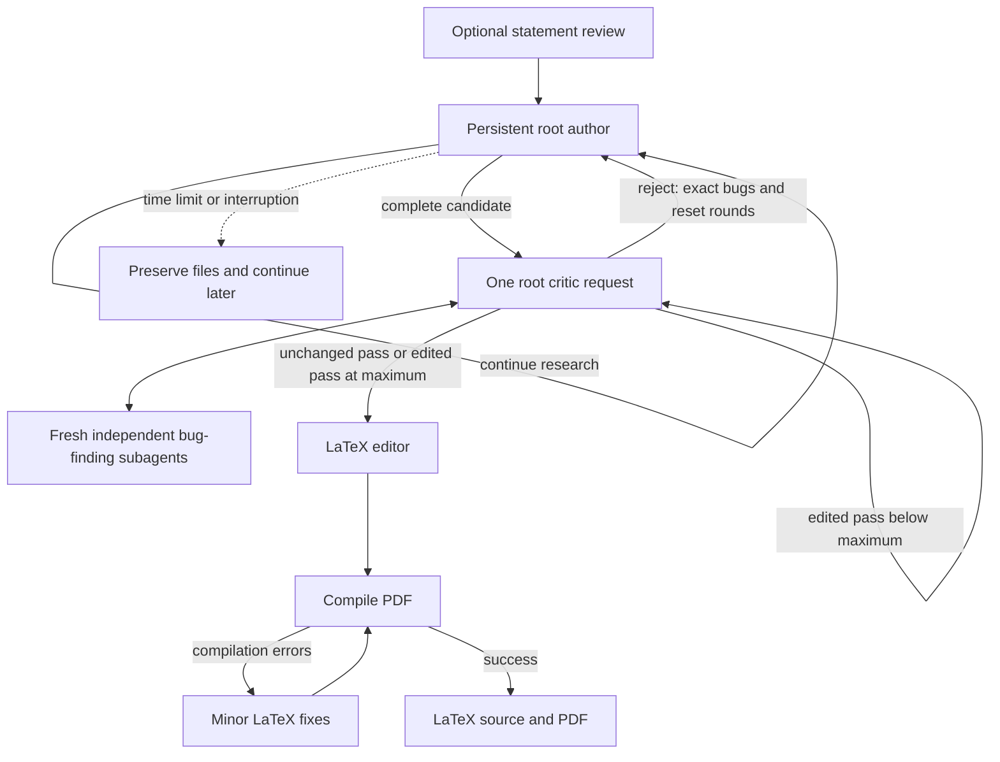

# TCS Prover

A local web UI that gives a persistent root author LLM a mathematical statement,
lets it explore approaches with independent subagents, checks its candidate
through a critic loop, and
produces a complete LaTeX document and compiled PDF.
Algorithmic tasks can be entered as statements too.

The author instructions live directly in
[`workflows/author_critic.yaml`](workflows/author_critic.yaml). The author and
its goal, continuation, compaction, resume, and repair prompts focus on proving
the exact statement, without requiring research notebooks or a file layout.
The independent proof critic and LaTeX writer verify and present the result.

On macOS and Linux, authors can submit `PROOF_FILE: proof.md` after writing a
complete proof in their working directory. Windows authors submit the complete
proof inline because secure file-reference handoff is not available there. Before review, the controller captures the file contents,
saves the actual candidate, and gives the critic `proof.md`, `statement.md`, and
a manifest with SHA-256 hashes in a fresh read-only workspace. A complete inline
proof uses the same snapshot path. Repairs capture the new candidate; a stale
author file is never substituted for a critic's edits. Historical critics and
their subagents can read the snapshot with shell tools, with external file
access, networking, native search, and MCP disabled. Missing, linked, unsafe,
non-UTF-8, empty, or larger-than-8-MiB proof files are rejected before review.

In a run, expand **Critic review inputs and decisions** (beside **Run settings**;
it appears once the critic has reviewed a submission) to read every recorded
review's exact input, full rejection reasons, and complete decision. Retries
and repeated round numbers retain separate history. The workflow rail
distinguishes rejection, active review, and approval; the search panel
distinguishes the latest request from cumulative failed requests.

Critic history groups each author's submission into a **review cycle**, with
rounds and request retries inside it. A **pass with fixes** starts another round;
a **clean pass** accepts the unchanged proof; a **pass with changes accepted at
the review limit** accepts the latest revision without another critic round.
The workflow rail, timeline, and expandable metadata show these outcomes
separately. Missing historical transition evidence is shown as unknown.

Every model runs through one of two local agent harnesses: the Codex CLI
(default) or the Claude CLI. They provide the author session and the model
calls. The author keeps the same conversation while it works; files preserve its
assignment, attempt history, and proved results across interruptions or context
compaction. GPT-6.1 Sol with Max reasoning and Standard generation are the
defaults for every role. Claude models, and API models served by your own
OpenAI- or Anthropic-format endpoint, are additional options in the same model
menus; see [Model providers](#model-providers).


## Install and run

Requires Python 3.11+, the Codex CLI, and a TeX distribution with `latexmk`
and `pdflatex` available on `PATH` (for example, TeX Live, MacTeX, or MiKTeX).
Install Codex CLI through this
[official website](https://learn.chatgpt.com/docs/codex/cli). The Claude CLI is
needed only for Claude models and Anthropic-format API models.

```bash
codex login
git clone https://github.com/yonggangjiang/tcs-prover.git
cd tcs-prover
python3.11 -m venv .venv
.venv/bin/python -m pip install -r requirements.txt
python web_ui.py
```

`web_ui.py` uses this checkout's `.venv` when present, even if `python` points
to an older system or Conda interpreter. Each checkout needs its own environment;
switching branches does not copy an environment from another worktree.

When `.experiment-control/current-run.json` selects a current batch, the same
command opens its existing dashboard. It checks the authenticated local server
before opening the browser and does not start a second owner of running jobs.
`python web_ui.py --no-browser` prints the current dashboard URL. A temporarily
unreachable controller produces an error instead of restoring duplicate jobs.
The selection contains version `1` and absolute `runsRoot`, `controllerStatus`,
and `dashboardStatus` paths; it is local machine state and is not committed.

The home page shows folders under `runs/` as batch cards, including their problem
counts, start dates, and status. Click a card to see its problems, then open a
problem to inspect its reasoning and outputs. **All batches** takes you back to
the folder cards. Jobs stored directly under `runs/` appear in their own card.

The current First Proof batch is marked **Current**:
`firstproof-batch3-search-v4`. Its ten workspaces remain under that folder.
Previous batches are available for read-only browsing; opening them does not
resume jobs or change their saved files. Batch selection is included in page
links so repeated problem names stay associated with the correct run. All run
folders remain in their original locations.

The Web UI opens locally with 6.1 Sol, Max, and Standard defaults for
the reviewer, proof author, critic, and LaTeX writer. The provider setup below
is needed only when you select Claude CLI or API models for one or more roles.

## Model providers

Each role under **Advanced settings** selects a **Source**, then a **Model**,
then its reasoning effort and other settings. Sources include **Codex CLI**,
**Claude CLI**, and each saved API-key connection. The model menu shows only
that source's models. Each model offers the reasoning levels it supports, and every launch or resume checks
locally that the selected models can start: Claude models need `claude` on
`PATH`, and API models need a saved key. `runner/providers.py` is the single
registry of model ids, harnesses, and efforts.

### Codex CLI (default)

`gpt-6.1-sol` (GPT 6.1 Sol, the default), `gpt-6-astra`, `gpt-6-sol`, and
`gpt-6-luna` use your ChatGPT login (`codex login`). They offer `low` through
`ultra`; the Luna models do not list `ultra`. **Fast** speed applies to these
models only. The older `gpt-5.6-sol`, `gpt-5.6-terra`, and `gpt-5.6-luna` ids are
still accepted for saved runs and scripts.

### Claude CLI

Install [Claude Code](https://code.claude.com/docs), run `claude` once, and log
in with your Claude subscription. The menus offer `claude-fable-5-1` (Claude
Fable 5.1), `claude-opus-5-5`, `claude-sonnet-5-5`, and `claude-haiku-5-5`, with
the efforts `low`, `medium`, `high`, `xhigh`, and `max`; a shared `ultra` choice
runs as `max`. Fast does not apply: Claude models always run at standard speed.

Every Claude process receives an explicit tool list and no MCP servers, user
settings, skills, plugins, hooks, or `CLAUDE.md`, and it never waits for a
permission prompt. The proof author's file tools are confined to its run folder,
and its shell runs in the Claude sandbox without network access (macOS, or
Linux with `bwrap` and `socat`; elsewhere the author gets file tools only). The
sandbox can neither read nor write TCS Prover's private state in `.tcs-prover/`.
The statement reviewer, critic, and LaTeX writer only read. Web-search tools follow
the job's search mode. Claude has no native goals, so the harness asks the
author to end each turn with a short structured status and continues the
conversation until it reports the goal complete; pause, resume, live
instructions, context compaction, and critic repairs work as with Codex.
With **Concise** or **Detailed** reasoning summaries, the activity log shows
Anthropic's summarized thinking; Claude has a single summary level, so both
settings show the same summaries, and **Status only** shows none.

Claude Code keeps a saved conversation for `cleanupPeriodDays` (30 days by
default) after its last activity, and any Claude Code run with default settings
deletes older ones. A Claude author paused for longer cannot resume its
conversation: **Resume** reports this, automatic retry stays off, and **Continue
proof author** continues the saved work in a new conversation from its saved public input. To keep conversations longer, set for example `"cleanupPeriodDays": 365`
in `~/.claude/settings.json`.

### API connections

**Advanced settings → API connections** saves an endpoint and API key once,
then discovers every model available through that key. Start with the base URL
and key; a request source and display name can be added later. Saving a
connection does not ask you to choose or type a model ID.

| Field | Meaning |
| --- | --- |
| Format | **OpenAI** (Responses API) or **Anthropic** (Messages API). |
| Base URL | For example `https://api.openai.com/v1` or `https://api.anthropic.com`. HTTPS is required except for `localhost`; credentials, query strings, and fragments are rejected. So that the host shown and tested is the host the CLIs contact, the URL must be plain ASCII (an international domain name in its `xn--` form) without backslashes, a percent-encoded host, an IPv4 address other than four decimal numbers, or `.`/`..` path segments. |
| API key | Stored only on this computer and never shown again. Editing a connection with an empty key keeps the saved key while the format and base URL stay the same; changing either requires entering the key again. |
| Request source | Optional client name sent as the `User-Agent` header, so routers that log it can identify your requests. Use up to 200 printable ASCII characters; the default is `TCS-Prover`. |
| Display name | Optional local source label; the default is the endpoint's host. It is not sent to the API or used as the request source. |

**Save connection** loads the endpoint's model catalog before saving. A failed
connection or empty catalog leaves the previous saved settings intact. Each
role can then select that saved key under **Source**, select one of its models,
and choose the supported effort and other settings. Roles can share one key
while using different models. **Load models** on a saved connection refreshes
its choices. Renaming a connection or reordering its catalog preserves selected
model identities; two saved keys for the same URL remain distinct sources.

Authentication is selected automatically: OpenAI-compatible endpoints receive
`Authorization: Bearer <key>`, and Anthropic endpoints receive `x-api-key: <key>`.
Existing saved custom authentication headers are replaced with the format's
standard header while retaining the key for the same endpoint. If an endpoint
reports **401 · Missing API key**, check that the format, endpoint, and key match
the service's requirements. The request source labels the client independently
of authentication, and applies to model discovery, connection tests, and model
requests.

**Test connection** loads the model catalog without generating an answer. It
uses `<base URL>/models` (OpenAI) or `<base URL without /v1>/v1/models`
(Anthropic, with `anthropic-version: 2023-06-01` and pagination). Discovery has
one 30-second deadline, follows no redirect, and shows the HTTP status, latency,
and the provider's message with the key removed. Testing unchanged saved
settings records the result on that connection. **Edit** fills the form with
its saved settings but never its key. **Remove** deletes the connection, key,
and model choices; new role menus return to the default model, while saved jobs
retain their selected IDs and show a warning until the connection is restored.
Removing a connection or changing its format is blocked while a running job
uses one of its models. Editing a tested setting marks the displayed result as
out of date. Under each role menu a chip names its CLI or API format and host.

OpenAI-format models run through the Codex CLI as an isolated custom provider
with a private Codex home under `.tcs-prover/codex-homes/`, so your ChatGPT login
is neither used nor sent to the endpoint. A `codex` launcher that replaces
`CODEX_HOME` cannot run them; put the native Codex binary on `PATH`. Their
structured roles return JSON by a prompt contract with validation, retried
until the answer is valid (see [Automatic retries](#automatic-retries)),
and live web search uses the endpoint's hosted search tool, which some endpoints
reject. Anthropic-format models run through the Claude CLI in bare mode, so your
Claude login is never read; there the author has the sandboxed shell, Read, and
Edit tools, without subagents or web tools. They show messages and tool activity
but no reasoning summaries, because a gateway may return raw reasoning, which is
never displayed. API models offer `low` through `max` and always run at standard
speed. Terminal options accept each discovered model's stable `api:<id>`
selection ID. A connection ID identifies the saved key rather than selecting a
model. Older configurations keep their original `api:<id>` model selection as
an alias, so existing jobs can continue.

The controller returns `model_sources` for source menus and `model_catalog` for
model menus; each model row carries its `sourceId`, `sourceLabel`, and wire model
name. `/api-models` lists `connections`, each with `models` containing the wire
`id`, display `label`, and stable selection `modelId`. Saving without a model
fetches the catalog on the server; client-supplied model lists are ignored.

Keys are stored in `.tcs-prover/api-models.json` in this checkout: an
owner-only file in an owner-only folder that Git ignores (`TCS_PROVER_API_MODELS`
selects another path; a relative path is resolved against this checkout). The
browser receives only a key hint such as `…abcd`. Keys never enter process
arguments, run folders, transcripts, logs, or error messages: the runner reads
the store itself and gives the key only to the CLI process, through its
environment (Codex, whose model shell commands never inherit it) or an
owner-only settings file under `.tcs-prover/claude-settings/` that is deleted
when the process exits (Claude). **Stop** interrupts the runner before ending it
(Windows ends it at once) and then removes any such file the runner left; one
left by a process killed some other way is removed when the next runner or
server starts. Every transcript record is also cleaned of the keys
the runner knows (any value of at least 8 characters), so a gateway error or a
command that echoes a key shows `[redacted]`.

Model sandboxes cannot read or write this private state: the Claude Bash sandbox
everywhere it runs and, on macOS, the Codex sandboxes of every role (through a
Codex permission profile derived from the usual read-only or workspace sandbox). The author's profile keeps the run folder's
`.codex`, `.agents`, `.git`, and `.aws` folders read-only, as Codex's own
workspace sandbox does, and applies the network access, extra writable roots,
and `/tmp` exclusions of your `[sandbox_workspace_write]` Codex settings.
Sandboxes of API models also cannot read your Codex or Claude login files. On
Linux and Windows the Codex sandboxes keep Codex's default read access to your
files, so a Codex role's shell there could read the key store; there, store API
keys only if the models you run with Codex CLI may see them. Each job records
the non-secret settings of its API models under `apiModels` in
`job-settings.json`. A connection used by a running job cannot be removed, and
its format cannot change while jobs use it. A saved job keeps its selected model.
After removing a connection, add its endpoint and key again with the same format
and base URL, exposing the job's saved model in the discovered catalog; the
controller restores its previous source and selection IDs. Its display name
may differ. A new connection never takes a saved job's source ID with another format.

### Web cutoff and removed models

Web cutoff timestamps require Codex CLI models for every proof role, because
their isolation is specific to the Codex sandbox; Claude and API models are
rejected before launch. With a timestamp cutoff, the proof roles' menus disable their
Claude CLI and API groups and flag a chosen model that cannot run. DeepSeek V4
Pro is no longer supported: a saved run that names it restores with GPT 6.1 Sol
in that role and a warning under the job title, and an error-paused run waits
for an explicit **Resume** instead of retrying automatically.

You can type your open problem into the text box and click “Check Statement.” The system will first revise the statement to remove ambiguities and handle corner cases, then ask you to approve or reject the revised version.

If you approve it, persistent reasoning will begin and continue until a solution
is found or the time limit is reached. The candidate passes through an
independent critic loop. Accepted proofs are then formatted as readable LaTeX.

Options for changing the default model, time limit, and other settings are under
**Advanced settings**. GPT-6.1 Sol (`gpt-6.1-sol`) at Max reasoning is the default for
every node.

**Advanced settings** include **Web cutoff** (labelled *Web search cutoff*), which is off for new jobs:

| Web cutoff | Cutoff value | Search behavior |
| --- | --- | --- |
| Off | Not used | Native web search enabled without a time restriction. |
| On | `-1` | Web-search tools disabled. |
| On | UTC timestamp, e.g. `2026-10-02T14:13:12Z` | Author can search and read verified archives strictly before that instant. |

A timestamp cutoff currently requires macOS; elsewhere only Off and `-1` are
available. For a timestamp cutoff, enable **Skip statement review**, use Codex CLI models for all
proof roles. Before model work, the
controller saves a separate policy and checks the native sandbox for both author
and structured roles. A failed check blocks launch. The saved search mode and
cutoff are retained on resume; changing the defaults does not change existing
runs. Older main runs without a recorded search mode retain unrestricted search; an
explicit disabled mode or historical policy always takes precedence.

`-1` removes the web-search tools; it is not the historical sandbox or a restriction
on model training knowledge. Timestamp mode also blocks shell networking and
outside-file access so the author cannot bypass the archive gate with `curl`.

The run page shows the exact statement, stage, active time, workflow limit,
local process health, model settings, and final or partial output. Its search
panel shows whether search is unrestricted, disabled, or restricted to archives.
For archive search it shows the saved cutoff, provider, author-only access, and
broker operation counts. Pending means an accepted call has no recorded terminal event; it does
not establish that the call is still running. Verified candidates are archive
checks, not the number of sources delivered to the model. These counters do not
replace the trajectory auditor or establish absence of model-training knowledge.

To update the dashboard while an older controller owns running jobs, use the
gateway without restarting that controller:

```console
python -m ui.live_gateway \
  --legacy-launch-status /absolute/path/to/launch-status.json \
  --legacy-runs /absolute/path/to/existing-runs \
  --new-runs /absolute/path/to/separate-new-runs \
  --status-file /absolute/path/to/dashboard-status.json \
  --port 8772
```

Open the `url` in the private dashboard status file. The gateway serves the new
assets, reads legacy metadata without restoring jobs, and forwards existing
job actions to their original controller. A separate controller handles new
jobs. The two run directories must not overlap. Keep the gateway running while
using it; the original controller remains responsible for the older batch.
**Advanced settings → API connections** (listing, saving, removing, testing,
and refreshing model choices) goes
to the controller that handles new jobs.
An older server without the new search capabilities cannot enable historical
search through the updated frontend. Operators can set `TCS_PROVER_UI_AUTH_HOME`
to the local Codex login directory; only its authentication file is copied.
Set `TCS_PROVER_UI_RETRIEVAL_STATE` to an existing controller's retrieval-state
directory to share host pacing across old and new historical jobs. Both are
trusted local settings and cannot be supplied by the browser.

## Run a folder from the Web UI

On the home page choose **New problem**, keep **Statement** mode (with
**Statement review only** off), click **Run a folder…**, and choose a folder
containing text statements. Any file extension or none is accepted, including
`.md`, `.txt`, and `.tex`. Each non-empty, top-level text file starts its own
parallel proof job using the current author, critic, writer, prompt, and
research-file settings. Statement review is skipped. The browser asks for
confirmation before starting the jobs, each of which uses its own quota. Files
are read as UTF-8 text. Hidden files (names starting with `.`), the system files
`Thumbs.db`, `ehthumbs.db`, and `desktop.ini`, and subfolders are ignored; empty
files and binary files (containing a NUL byte) are skipped and listed in the
confirmation.
The job list shows each source filename, including after a server restart.

A batch accepts at most 200 statements, 100,000 characters per statement, and
8 MB for the complete request. Historical batches accept at most 10 statements
and check every sandbox before starting any of them. Split larger folders into
smaller batches.

## Terminal runs from Markdown

On a server without a browser, put the complete statement in any UTF-8 Markdown
file. Paragraphs, quotes, mathematical backslashes, and line breaks can be
copied into the file without escaping. Then pass the file directly to
`web_ui.py`:

```bash
python3 web_ui.py statement.md
```

This sends the entire file directly to the proof author, exactly like enabling
**Skip statement review** in Statement mode. It does not start an HTTP server or
open a browser. With no command-line overrides, it uses the same defaults as the
web UI: a maximum of 2 consecutive edited critic passes, a 168-hour total workflow
limit, 6.1 Sol and Max for all proof
roles, the built-in role prompts, and Standard generation speed. The
activity log requests concise public reasoning summaries by default.

### Optional settings

Put overrides after the file or folder. The requested single-dash spelling,
double-dash camelCase spelling, and conventional double-dash kebab-case spelling
are all accepted. For example:

```bash
python3 web_ui.py statement.md -criticRounds 6 -thinkingHours 36
python3 web_ui.py statement.md --author-model gpt-6-astra --speed-mode standard
```

| Option | Default | Meaning |
| --- | --- | --- |
| `-criticRounds N` | `2` | Maximum consecutive edited critic passes before using the latest solution; `1` to `100`. An unchanged pass accepts immediately. Rejection returns to the author and resets the count. |
| `-thinkingHours HOURS` | `168` | Total elapsed-workflow limit in hours: `0` for unlimited, or greater than `0` and at most `168`. Bounds author, critic, and final model calls. Recorded work is retained when time runs out. |
| `-authorModel MODEL` | `gpt-6.1-sol` | Author model: Codex CLI `gpt-6.1-sol`, `gpt-6-astra`, `gpt-6-sol`, or `gpt-6-luna`; Claude CLI `claude-fable-5-1`, `claude-opus-5-5`, `claude-sonnet-5-5`, or `claude-haiku-5-5`; or a discovered model's `api:<id>` selection from **Advanced settings → API connections**. The older `gpt-5.6-sol`, `gpt-5.6-terra`, and `gpt-5.6-luna` are still accepted so saved runs and scripts keep working, but the Web UI no longer lists them. |
| `-criticModel MODEL` | `gpt-6.1-sol` | Critic model; same choices as the author. |
| `-writerModel MODEL` | `gpt-6.1-sol` | LaTeX writer model; same choices as the author. |
| `-reasoningEffort LEVEL` | `max` | Fallback effort for all three roles: `low`, `medium`, `high`, `xhigh`, `max`, or `ultra` (Max plus automatic task delegation). The Luna, Claude, and API models do not list `ultra` and run it as `max`; the Web UI offers each model only the levels it supports. |
| `-authorEffort LEVEL` | shared effort | Override only the author effort. |
| `-criticEffort LEVEL` | shared effort | Override only the critic effort. |
| `-writerEffort LEVEL` | shared effort | Override only the LaTeX writer effort. |
| `-speedMode MODE` | `standard` | `standard` for normal speed or `fast` for ChatGPT's accelerated generation (up to 2× on 6.1 Sol and Astra, 1.5× on the other models; Fast can draw credits faster). Fast applies to Codex CLI models only; Claude CLI and API models always run at standard speed. |
| `-reasoningSummary LEVEL` | `concise` | Public activity-log summaries: `none`, `concise`, or `detailed`. This never exposes private chain-of-thought. Claude CLI models show Anthropic's summarized thinking for both `concise` and `detailed`; Anthropic-format API models show no reasoning summaries. |
| `-authorPromptFile PATH` | built-in prompt | Load a UTF-8 author prompt; it must contain exactly one `[STATEMENT]`. |
| `-criticPromptFile PATH` | built-in prompt | Load a UTF-8 critic prompt. |
| `-finalPromptFile PATH` | built-in prompt | Load a UTF-8 LaTeX prompt. |

Prompt-file paths are resolved from the terminal's current working directory.
Run `python3 web_ui.py --help` to see every spelling and allowed value.

## Automatic retries

Every failed model call is retried automatically every minute (plus up to five
seconds, so that many jobs do not retry in the same instant), with no attempt
limit, so a job keeps going through provider outages without you. This covers
the statement reviewer, the proof author, the critic, the LaTeX editor and its
compilation repairs, and parallel independent requests. A failure is anything
that interrupts a call: a provider error such as "model at capacity",
overloaded, 429 or 5xx, a dropped stream, a CLI crash or non-zero exit, a CLI
that is missing for a moment (for example while it updates itself), a call
that exceeds its own request timeout, a login or usage-limit error, and an
answer that cannot be used (empty, not valid JSON, the wrong shape, or failing
a workflow `require` rule, such as a critic that returns no proof). Each
attempt of a structured call (reviewer, critic, LaTeX editor) may run 15
minutes, also when the total time limit is unlimited; after each consecutive
timeout the next attempt may run twice as long (never past the time limit), so
an answer that needs longer still arrives. The statement review's retries end
at the job's total time limit in the same way.

Failures that no retry can fix are not retried: a configuration error (for
example a missing API key, or a Claude model in a web-cutoff run), a workflow
rule that cannot be evaluated on a valid answer (a problem of the YAML, not of
the model), a safety refusal (a CLI that offers unexpected tools, ignores an API
model's private Codex home, continues a different conversation or lacks a
required tool runtime, or a changed web-cutoff policy) and programming errors.
A structured call ends the run with such an error, as before; the proof author
pauses with it. An author stopped by a safety check, or whose saved
conversation its CLI no longer has (or whose saved conversation ID is missing),
is not resumed automatically: the job says why and waits for you (**Resume**,
or **Continue proof author** for a vanished conversation).

A retry keeps everything the failed attempts knew, without piling up notes:

- Structured calls persist their CLI session (Codex without `--ephemeral`,
  Claude with `--session-id`). Once an attempt has produced model output (for
  example the critic read the proof or ran a subagent), the next attempt forks
  that session (`codex exec fork <id>`, `claude --resume <id> --fork-session`,
  with the same model, effort, sandbox, schema and settings) and adds a short
  note; after an unusable answer the note says in plain words what was wrong,
  for example "the solution field must not be empty", and quotes the model's
  own explanation. A critic that rejects without listing bugs is asked to keep
  its verdict and list them. A fork that fails before producing anything is
  deleted, and the next retry forks the same session again, so an outage adds
  nothing to the conversation. While no attempt has produced output, when the
  CLI no longer has the session, when the conversation no longer fits the
  model's context, when the critic's proof snapshot disappeared, and in
  web-cutoff runs (which never persist sessions), the retry sends the exact
  saved input again in a new conversation.
- The author's retry starts a new CLI process that reopens the same thread or
  session. An instruction the model never received is sent again; a turn that
  the model received but answered with nothing is first removed from the
  conversation (Codex `thread/revert`, Claude `--resume-session-at`) and its
  instruction sent again; after a turn in which the model worked, a short note
  asks it to continue. A retry that fails before it reopened the conversation
  keeps the thread and the pending instruction for the next one.

The structured sessions live only while their call runs: TCS Prover deletes
them when the call ends (`codex delete --force`, which also removes the threads
of subagents, or the Claude transcript files). Until then they are where each
CLI keeps its sessions: Codex under `$CODEX_HOME/sessions` and its state
database (an API model's private Codex home for OpenAI-format API models),
marked so that Codex never builds memories from them; Claude under `projects/`
in its configuration folder (`~/.claude` for Anthropic-format API models).

During the wait the job stays running, and the run page, the activity log and
the terminal say why, for example "Model call failed (model at capacity) —
retrying in 1 min (attempt 7, retrying for 6 min)" with the provider's message
(keys removed). The wait does not consume the workflow time budget, no attempt
starts after the time limit is reached, **Stop** ends a wait at once, and
**Pause** (offered while the proof author works) pauses the job instead of
retrying. Only the first retries of one call stay pinned in the activity log;
later ones stay in the recent window and in `transcript.jsonl`.

## How to use checkpoints

If a proof author still ends up paused by an error (for example when its runner
process itself ended), TCS Prover retries the saved conversation after 1 minute,
and a failed resume attempt is retried every minute; a terminal run does the
same. Retry times survive server restarts and do not require an open browser
tab. The paused job shows its next retry time; **Keep paused** cancels
automatic retries, and **Resume** retries immediately. User-requested pauses
and stops, exhausted workflow time limits, safety stops
and conversations the CLI no longer has do not trigger this error retry, and
neither does a model whose settings are incomplete (a CLI that is only missing
for a moment is retried). Saved work and the original time budget are
preserved.

TCS Prover writes durable artifacts while a job progresses. When the Web UI is
started again, it scans `runs/*/transcript.jsonl`, restores the historical job
cards, and lists every resumable critic checkpoint found in those run folders.
It also discovers prepared workspaces with `preparedRun: true` in
`job-settings.json`. **Start prepared run** opens a fresh author session in that
exact folder, using its saved prompts and workspace; no earlier session
or elapsed budget is inherited.
You do not need to keep the old browser tab open.

A saved proof candidate contains the checked statement and latest complete
argument. Continuing it starts a fresh root critic request from that candidate.
Within the request, the critic uses its own fresh independent subagents to
find bugs and then repairs the argument itself.

To continue from the Web UI:

1. Stop the old server if it is still running, then run `python3 web_ui.py`.
2. On the home page, open the job's batch and find the job by its full start/finish time.
3. Click the continuation button beside the checkpoint you want (the job's own
   page also lists it under **Continue from saved work**).
4. Confirm the action. TCS Prover creates a new job and opens it immediately.

Saved run inputs and transcripts are preserved. The new job copies the selected candidate,
role prompts, model choices, reasoning efforts, speed, critic-round maximum,
and workflow time limit. A saved role that names the removed DeepSeek V4 Pro
restores with GPT 6.1 Sol and a visible warning; an error-paused job with such a
role waits for an explicit **Resume**. A role whose API model was removed
reports it before any new request starts.

Very old runs that predate `job-settings.json` can restore only choices visible
in their transcript. A role that never ran has
no recorded model choice and therefore uses the current default when resumed.
The continuation confirmation names these unknown legacy roles before a new
paid request starts.

A checkpoint exists only after a complete artifact has been written. It cannot
restore the middle of an in-flight model response or its private reasoning. If
a process stops between two checkpoints, continuation begins from the most
recent checkpoint listed on the job card.

### Continue a manually stopped job

Jobs stopped with the Web UI's **Stop** button remain visible as **Stopped at
statement review**, **proof author**, **critic**, **LaTeX editor**, or **failure summary** after the
server is restarted. On the batch list, or under **Continue from saved work** on the job's own page,
use the stage-specific continuation button:

| Stopped stage | Button | Continuation boundary |
| --- | --- | --- |
| Statement review | **Retry statement review** | Starts a new review request from `review-input.json`, including the current statement and feedback, plus the saved prompt and role settings. Older runs without this artifact warn that only their original draft and no feedback can be recovered. |
| Proof author, repair, or interrupted failure summary | **Continue proof author** | Reuses the saved prompt, workspace, and user instructions. It resumes the author conversation when available and otherwise restarts from its saved public input. Visible partial text is not treated as a complete proof. |
| Critic | **Continue critic** | Starts a fresh critic round from the latest saved candidate. The critic requests new independent bug-finding reports. |
| LaTeX editor | **Retry LaTeX editor** | Retries the single editor call with the saved accepted solution or standalone LaTeX source. Older jobs without an exact final input fall back to their latest critic checkpoint. |

These continuation actions create a new run folder while preserving the source
job's saved inputs and transcripts. Author continuation reuses its existing
workspace. An in-flight request or inaccessible private reasoning cannot be
recovered as a completed answer. Review and final requests retry from their
exact saved public input. The author resumes its existing conversation when
available, or starts a fresh conversation from its saved public input. Historical runs created before
`manual-stop.json` are recognized from their existing `Stop requested`
transcript entry.

### Command-line fallback

Continue a stopped author in its saved workspace with a new time budget:

```bash
python3 web_ui.py --resume-research runs/YOUR_PREVIOUS_RUN
python3 web_ui.py --resume-research runs/YOUR_PREVIOUS_RUN --thinking-hours 24
```

This opens a continued browser-visible job while preserving the source job's
saved inputs and transcripts. The author updates its existing research workspace;
saved settings remain in
effect unless explicitly overridden. The full initial assignment is preserved
rather than reconstructed from a short summary. Critic and finalization
checkpoints retain their separate review artifacts.

If a run contains `SOLUTION.md` or `saved-candidate.md` but no checkpoint button
is available, open a new critic job explicitly:

```bash
python3 web_ui.py --resume-critic runs/2026-08-26_16-33-26_example
```

This loads the saved complete proof, checked statement, and role prompts into
a new browser-visible job. An unchanged pass advances to the LaTeX editor;
edited passes repeat until the configured maximum, then use the latest solution.
A critic rejection returns the exact candidate
and bug report to the normal proof-author repair loop; the harness workflow is
not shortened or replaced.

## Parallel folder runs

Passing a folder starts an independent proof for every top-level `.md` file in
that folder:

```bash
python3 web_ui.py statements/
python3 web_ui.py statements/ -criticRounds 6 -authorEffort ultra
```

The lookup is case-insensitive (`.md` and `.MD` both work), deterministic, and
non-recursive. All matching files and shared settings are validated before any
job starts. The jobs then run concurrently, and every override applies to every
file. Be aware that a large folder can therefore use many simultaneous model
jobs and credits.

Terminal output is concise by default: it reports only the current workflow
step, diagnostics, errors, and the start/finish result for each input file.
Prompts, model events, reasoning summaries, tool activity, and proof bodies are
not printed. They remain available in each proof's complete `transcript.jsonl`
and other artifacts under its separate directory in `runs/`. Pass
`--verbose-events` to restore the full public JSONL event stream; folder events
then include an `inputFile` field. A failed job does not cancel its siblings.
The exit status is `0` when every proof succeeds, `1` for invalid input or any
failed proof, and `130` after Ctrl-C. Ctrl-C stops all active folder jobs and
their subprocess trees.

## Read a transcript as a human narrative

`transcript.jsonl` is the complete machine-readable event log and is deliberately
verbose. The local browser viewer organizes workflow stages, public reasoning
summaries, model messages, subagent/tool activity, critic checks, and final or
failure results without app-server protocol noise:

```bash
python3 transcript/view_transcript.py runs/2026-08-03_16-20-24_example/
python3 transcript/view_transcript.py runs/2026-08-03_16-20-24_example/transcript.jsonl
python3 transcript/view_transcript.py                       # newest run
```

The UI provides stage and activity filters, full-text search, root-only and
compact views, expandable long entries, critic verdict cards, automatic
full-file loading with pause/resume, and live updates. It binds only to local
host and protects its local API with a random per-launch token.

For terminal or file output, use the text mode:

```bash
python3 transcript/view_transcript.py RUN --text
python3 transcript/view_transcript.py RUN --text --follow
python3 transcript/view_transcript.py RUN --output readable.txt
```

In text mode, prompt bodies are hidden by default because they are long; add
`--prompts` to show them. Use `--stage solve`, `--stage critic`, `--root-only`,
`--no-tools`, or `--max-text 0` to adjust the view. Run
`python3 transcript/view_transcript.py --help` for all options. Both views display the
public reasoning summaries retained by TCS Prover, not private chain-of-thought.
They read incrementally, so even very large transcripts do not need to fit in
memory.

Choose **Statement** to review or edit a rough problem before approval. Include
the computational model, problem description, and asymptotic goal in the
statement for algorithmic tasks. Choose **LaTeX polish** to edit an existing
theorem and proof with a single editor call.
**Advanced settings** control each node's model, reasoning effort, prompt, public activity-log
detail, time limit, and critic-round limit. The log can show status
only or request concise or detailed model-generated summaries. Under **Workflow**, **Statement review only** runs just the
reviewer, saves the checked statement and reviewer notes, and finishes without
starting the proof author, critic, or LaTeX editor. This option and **Skip
statement review** are mutually exclusive. Jobs run in parallel. **Prompts &
responses** displays the exact application prompts and returned model text.
Private records and outputs are stored under `runs/`.

New jobs read the author and critic prompts from `workflows/author_critic.yaml`
and the final editor prompt from `workflows/clean_up.yaml` at launch. YAML edits
take effect without restarting the server, even if the browser page was already
open. The prompt editor refreshes these defaults when opened. **Apply to this
job** changes only that job; prompts are never remembered in browser storage or
carried into the next new job. Continuing an existing job preserves its saved
prompt and research workspace. Use a new job for a changed author policy, or
explicitly approve a history-preserving migration of the existing instructions
and research records.

Every job card shows its full local start and finish date and time, including
seconds. Active jobs show that they have not finished yet, so repeated problem
titles remain distinguishable.

Every run shows its workflow sidebar. The run overview displays the exact checked statement, the original
wording when it differs, current stage, active time and remaining workflow
budget, local process status, recent public activity, and saved model settings.
Completed answers and preserved partial work have separate labels and a readable
output panel. A finished process without a final result is marked **Incomplete**.
After a server interruption, an unfinished author is restored as **Paused**;
**Resume** reopens its saved conversation in the same workspace and retains its
time budget. These recovered interruptions wait for Resume rather than starting
historical jobs automatically.

While a proof author or author repair is running, **Guide the running proof
author** sends a live instruction into the running author session. It does not
discard the memory files or restart the problem. The
control is intentionally unavailable during statement review,
critic review, failure summaries, and final LaTeX editing.

**Pause**, beside **Stop**, interrupts the active author turn (Codex also pauses
its native goal), preserving the saved conversation and existing research files.
It does not ask the model to produce a final answer or spend another turn
writing a summary. Wait for **Paused** before closing the UI or changing your
Codex or Claude CLI login. Then
click **Resume** on the inference page or job card: a fresh CLI process reopens
the same saved thread in the same run folder and appends to its transcript.
If that saved thread cannot be reopened, the job remains paused with an error
and can be retried; it does not silently replace the conversation. When Claude
Code no longer has the saved conversation, automatic retry stays off and the job
offers **Continue proof author**, which continues the saved work in a new
conversation. A pause before
the CLI created any thread or session starts that initial one on Resume.
Paused jobs also remain resumable after restarting the UI. Paused time does not
consume the remaining workflow time budget. Already saved conversation and file
content are retained; an interrupted response or file write may be incomplete.
Usage limits, network failures, and other model-call failures do not pause the
job: the author retries every minute in the same conversation and shows why (see
[Automatic retries](#automatic-retries)). A job that still pauses with an error
is resumed automatically after 1 minute; click Resume to retry at once.
For a reached workflow time limit, increase the existing total time limit control
while paused before clicking Resume.
**Stop** ends the job at once: it interrupts the runner and its CLI processes so
they can remove private files, and kills any that remain after three seconds.

When compilation succeeds, **Download .tex** and **Download PDF**
download that job's saved `final.tex` and `final.pdf`. Older jobs that only
contain a source file still offer the source download.

Live web search is enabled for the author, statement reviewer, critic, and
LaTeX editor, including structured retries and the configuration inherited by
subagents. The runner explicitly sets Codex's
[`web_search="live"`](https://learn.chatgpt.com/docs/config-file/config-reference)
for new and resumed sessions, and Claude CLI models receive the WebSearch and
WebFetch tools; the models decide when to search.

## Workflow



The workflow sidebar shows the active proof stage and the critic repair loop.

### 1. Statement reviewer

This node lets the user start with convenient informal language while preventing
a model from silently solving a different problem. To use it without requesting
a proof, enable **Statement review only** under **Workflow**, and submit the
statement. The completed result remains available to copy from the review page
and is saved as `checked-statement.md` in that job's run directory. Only the
reviewer model, reviewer reasoning effort, reviewer prompt, and generation speed
apply in this mode.

For example, graph-algorithm papers commonly write a bound such as
`m log² n`. A literal model may object that `m` can be smaller than `n` and call
the target impossible. The review step states the intended convention and writes
it as `(m+n) log² n` instead of letting that mismatch
derail the proof search.

### 2. One persistent author

The `author` prompt in `workflows/author_critic.yaml` asks for a complete,
rigorous proof of the supplied statement. The same author conversation continues
across interruptions, context compaction, critic rejections, and resumption.
The runner retains the conversation and operational checkpoints.
`--resume-research` continues saved author work with a fresh budget. Existing
jobs retain their saved per-job prompt and workspace when continued.

The read-only **Research files** panel preserves access to existing workspace
records and previously saved audit reports. Older `APPROACHES/index.md`,
`APPROACHES/A001-short-title.md`, `APPROACHES.md`, and `PROVED.md` files remain
readable. When approach files exist, the graph derives navigation from their
titles, parent links, status, and summaries, without changing the saved files.

### 3. Critic loop

Each round is one root critic LLM request with `multi_agent` enabled. Its prompt
tells it to launch fresh independent subagents for aggressive bug finding:
mathematical errors, omitted details, undefined terms, and other gaps. They are
instructed not to communicate with one another and to report back to the critic.
The critic considers those reports and repairs the complete argument itself.

If it cannot fix every issue, it returns the latest safely repaired candidate
and exact unresolved bugs to the author. The author continues the proof task,
and the rejection resets the consecutive critic-round count.

An unchanged pass accepts immediately. An edited pass sends the latest solution
to another fresh critic round while below the configured maximum (default 2).
At that maximum, an edited pass accepts the latest solution and proceeds to
LaTeX formatting. The setting is a maximum for consecutive edited passes, not
a requirement to obtain a fixed number of passes. Model review is not formal
proof verification.

### 4. LaTeX editing

The editor makes one LLM call with the editing prompt and accepted solution,
or the supplied `.tex` contents in standalone mode. It returns a JSON object
whose `latex` field contains the complete document. A final compilation node
runs `latexmk` with `pdflatex`, repeating TeX passes as needed to stabilize
references. Compiler errors go back to the writer for minor compilation fixes,
then the document is compiled again until it succeeds, the job is stopped,
or the existing workflow time limit is reached. Repairs preserve the mathematics
and paper structure. Shell escape and automatic latexmk configuration loading
are disabled.

Only successful compilation publishes `final.tex` and `final.pdf`. The working
source is retained as `latex-source.tex`, and compiler output is saved in
`latex-compile.log`. Missing compiler tools produce a setup error without
repeated model repair calls.

## Project structure

The root has two Python entry points. `workflow_runner.py` provides the graph
engine and model/goal transport. Workflow prompts live in YAML, and each job's
inputs, transcripts, and outputs are saved in its run folder. `web_ui.py` launches
the UI or Markdown proof jobs. Everything else lives in a package:

```text
web_ui.py                   UI and Markdown-job launcher
workflow_runner.py          Graph engine, model transport, and workflow CLI
workflows/
  author_critic.yaml        Author/critic prompts, response schema, and logic
  clean_up.yaml             LaTeX prompts, response schema, and logic
runner/
  proof_handoff.py          Verified capture of an author's PROOF_FILE
  providers.py              Model registry and the private API model store
  claude_cli.py             Claude CLI transport for structured roles and the author
ui/
  server.py                 HTTP endpoints, job state, and process management
  review.py                 Independent statement-review procedure
  cli.py                    UI startup and Markdown file/folder runs
  index.html, app.js, styles.css
transcript/
  view_transcript.py        Transcript reader, CLI, and viewer server
  transcript_ui/            Transcript viewer HTML, JavaScript, and CSS
retrieval/
  runtime.py                Search modes and fail-closed historical isolation
  historical_search.py      Historical (web cutoff) MCP broker, launched by path
  historical_*.py, scholarly_discovery.py
                            Broker transport, pacing, cache, and URL discovery
  isolated_compiler.py      Sandboxed LaTeX compilation for historical runs
  validate_historical_search.py, audit_historical_trajectory.py
                            Operator checks for historical batches
experiments/
  firstproof-batch3/        Pinned First Proof inputs and manifest
  prepare_firstproof.py, launch_firstproof.py
tests/                      Offline regression tests
```

The UI starts the root workflow runner in each job's private workspace and
passes it the appropriate YAML files. Statement review remains independent of
the workflow graphs. UI and Markdown-job artifacts still live under the
repository's `runs/` folder, regardless of the launcher's working directory.

## Workflow files and executor

Each YAML file contains `nodes` and `prompts`. Node names are arbitrary; the
first node is the entry point. `run: structured` makes a model call with a
response shape, while `run: goal` starts or resumes the persistent author
conversation. `run: command` executes a bounded command without a model call;
its `command` mapping specifies `argv`, `timeout`, and a `result` state key,
with optional `cwd`, `env`, `requires` executables, `produces` files, and `log`.
Transitions can inspect `result.status` (`pass`, `fail`, or `unavailable`) and
repairs can use `result.output` (the last 24,000 characters of command output).
Memory-file instructions are plain prompt text. The YAML defines inputs, result checks, state updates, and transitions, including the
critic's repeat limit.

A complete custom workflow can be as small as this `summarize.yaml`:

```yaml
nodes:
  summarize:
    run: structured
    prompt: summarize
    inputs:
      content: state.input
    response:
      summary: string
    after:
      - set: {output: result.summary}
    next: end
prompts:
  summarize: "Summarize this text in one sentence: {content}"
```

```bash
python3 workflow_runner.py summarize.yaml < notes.md
```

Keep custom definitions outside the bundled `workflows/` directory.

Run the graphs directly with UTF-8 input on standard input:

```bash
python3 workflow_runner.py workflows/author_critic.yaml workflows/clean_up.yaml < statement.md
python3 workflow_runner.py workflows/clean_up.yaml < theorem-and-proof.md
```

The first command runs proof search, criticism, and LaTeX cleanup; the second
runs cleanup alone. Both skip statement review. Use
`python3 workflow_runner.py --help` for model, reasoning, time-limit, critic-round,
and prompt overrides. `--model` sets the fallback model for any workflow;
`--set NAME=VALUE` supplies arbitrary named options and accepts JSON values.
Node `role` settings can use options such as `editor_model` and `editor_effort`.

The CLI initializes `state.input`, `state.statement`, and `state.source` with the
same input after trimming surrounding whitespace. Chained graphs share state,
and `state.failed` stops the chain. An optional `goal_pause_file` control path
also pauses execution when the file exists. Goal sessions pause their native
goal and interrupt the active turn without an additional model prompt. Pausing emits
`workflow_paused` with the current node and workflow state, sets `state.paused`,
and stops the chain without returning a completed proof. The UI persists this
controller checkpoint separately from the LLM-managed research notebooks.
Output is JSONL events, ending with
`workflow_result` on success and its
`output` field from `state.output`. The Python API is
`execute(path, state, options=...)` or `execute_workflows(paths, state, options)`.
All graphs are validated before a chain starts. `requirements.txt` installs
PyYAML for loading definitions and jsonschema for checking response schemas.

Run the regression suite without making model calls:

```bash
python3 -m unittest discover -s tests -v
```


## Historical web retrieval

When **Web cutoff** is on with a UTC timestamp, built-in web search is disabled
for proof roles and an independent, author-only historical retrieval service
enforces the saved cutoff. The default `codex_wayback` provider discovers candidate URLs through
a separate Codex CLI session with general web search enabled, then
returns only strictly pre-cutoff Wayback snapshots whose capture timestamp,
original URL and content digest match the archive record. Current search
snippets and page titles are never returned. Unknown dates, missing captures,
unsupported content and redirects fail closed. There is no live-content fallback.

Discovery sessions start fresh with only Codex authentication, no inherited
conversation, project instructions, skills, MCP servers, or proof workspace.
Their shell and local file tools are disabled. Candidate URLs come from completed
native web-search result rows; model-written suggestions are accepted only when
they match that URL list. All candidates remain untrusted until the archive gate
authorizes their content independently. Raw current-web traces
remain in protected controller state and never enter the proof conversation.
This uses the existing Codex login; no separate API key is needed. Current
search ranking and discovery-model selection still differ from a historical
search index.

The optional `scholarly_wayback` provider needs no API key and targets research
papers. It discards current abstracts, titles, dates, and scores; publication-date
filters only narrow discovery and never authorize content. Both APIs are explicit
sources, with partial availability reported. The optional `brave_wayback`
provider needs `BRAVE_SEARCH_API_KEY`; its value is never written to run files.
The legacy `duckduckgo_wayback` option remains available, but its public Lite page
frequently challenges automated requests. It is no longer the prepared default;
challenges are rejected without bypassing them or switching endpoints.
`--preflight` validates local configuration without a network request. A sealed
historical-corpus provider is also available
for deterministic offline validation. Current search ranking and archive
coverage differ from the original search service; this is a historically
constrained retrieval experiment, not an exact replay or a model-training
contamination guarantee.

Broker processes share controller-owned request pacing: arXiv permits one active
request and at least three seconds between starts. Wayback permits up to four
active requests, with at least three seconds between starts; slow archive responses
do not hold the shared scheduling lock. Crossref uses one active request and a
one-second interval. Transport errors and HTTP 408/429/500/502/503/504 receive at
most two retries with 5/10-second backoff and a 300-second network operation
deadline. Prepared batches examine up to six candidate URLs per search to bound
traffic across ten jobs. Individual connection failures delay only their own request. Explicit
`Retry-After` signals and HTTP 429/503 impose shared provider cooldowns.
Challenges, redirects, invalid provenance and cutoff failures
are never retried as transient errors. Unavailable services are distinguished from
valid empty results, and partial searches are marked incomplete. Verified raw
captures persist in a bounded controller-owned cache outside solver workspaces;
every read rechecks source, timestamps and both digests. This avoids repeat archive
fetches across broker restarts and jobs without relaxing any cutoff. Complete URL
discovery results also have a short-lived, bounded in-memory cache. Known archived
arXiv CAPTCHA pages and publisher redirect stubs are rejected as unusable content;
the broker tries older verified captures without following or executing redirects.

To check actual network availability through fresh MCP broker processes before
starting proof models, run harmless search/open validation after preparation and
authentication provisioning:

```console
.venv/bin/python -m retrieval.validate_historical_search \
  --policy-file .experiment-control/firstproof-batch3/P01/broker-policy.json \
  --cutoff 2026-10-02T14:13:12Z \
  --output .experiment-control/firstproof-batch3/search-validation \
  --query 'Python documentation sorting' --repeats 1
```

This searches and opens a verified result in a fresh broker process. It checks readable results, strict
cutoff compliance, matching digests and audit records, and saves the complete
evidence. The protected shared archive cache starts empty and remains enabled,
as in a fresh batch. `--concurrent10` starts ten distinct harmless queries together.
Neither mode sends a benchmark statement or starts a proof model. The Codex
discovery provider does invoke isolated discovery models. A passing check cannot
guarantee future provider availability or archive coverage. `open(url)` returns
the full verified extracted document, without a fixed character budget.
Optional `offset` and `length` request a page with `next_offset`; `find(url,
pattern)` searches the full verified document for literal text and returns
matching offsets. Find defaults to ten matches, with optional `max_matches` and
continuation; neither open nor find uses the old 20,000-character ceiling.
Transport, parser resource protections, and the model's context limits still
apply. `max_content_chars` remains a search-excerpt setting only. Pass the returned
raw-body `sha256` on later calls to pin the same capture; a changed capture fails
closed. Offsets count Unicode code points in the extracted text. Each page/find
reply retains source/capture provenance and has a broker receipt covering its
complete document content. No live-page fallback is used.
The Codex-only adaptation of
[Time Travel Benchmark](https://github.com/trivikrama-madhusudhana/time-travel-benchmark)
uses its controller-owned MCP gateway, asynchronous tool handling, and event-log
provenance checks. Its OpenReward service requires a separate key, and its shipped
GPT runner uses the Responses API. TCS Prover keeps model work in Codex CLI and
uses the Codex general-discovery/Wayback backend described above; no OpenReward or
separate OpenAI API key is needed. The
[adaptation notes](third_party/time-travel-benchmark/UPSTREAM.md) pin the reviewed
upstream revision and explain the differences. The
[Codex search configuration](https://developers.openai.com/codex/config-reference/)
does not document an arbitrary historical cutoff for native cached/live search,
so historical proof sessions disable native web search and enable it only in
the protected URL-discovery helper. Unrestricted jobs use native live search.

Each broker accepts up to four concurrent retrieval calls with independent
provider state and deadlines. Additional calls receive an immediate busy response
instead of waiting behind several five-minute searches and hitting Codex's
ten-minute tool timeout. A bounded finalization allowance lets a search return
verified partial results when its network deadline expires. Protocol control messages remain responsive. Shared
provider pacing, archive verification, and protected caching still apply across
all calls and jobs. Cancellation suppresses the response; already-started work
retains its bounded operation budget. These network limits do not limit the
overall proof effort.

Audit a running or completed batch without sending queries or invoking a model:

```console
.venv/bin/python -m retrieval.audit_historical_trajectory \
  --control-root .experiment-control/firstproof-batch3-search-v4 \
  --output .experiment-control/firstproof-batch3-search-v4/trajectory-source-audit.json
```

The auditor matches actual returned sources to that problem's broker log using
the source URL, exclusive cutoff, capture timestamp and archived-body hash. It
also identifies unexpected retrieval tools and separates failed or pending calls
from valid empty results. This checks recorded provenance, not mathematical
correctness, model-training knowledge, or an independent reconstruction of every
archived byte. The gateway performs byte verification before returning content.

### Pinned benchmark preparation

`python -m experiments.prepare_firstproof` prepares the ten pinned inputs in
`experiments/firstproof-batch3/manifest.json` without starting model work.
`python -m experiments.launch_firstproof` checks configuration, isolation and
compilation; adding `--start` releases the preparation hold and launches the jobs.
Use fresh run and controller directories for each batch; existing work is never
overwritten. Both scripts accept `--problems P09 P10` to select a subset.
Regenerate policies on each host because their paths are machine-specific.
Generated runs, controller state, credentials and virtual environments stay out
of Git. Historical search launches currently require macOS, because the isolated
LaTeX compiler has only a macOS Seatbelt adapter; the Windows MXC adapter covers
the model roles only. Launch also requires the runtime canaries to pass;
unavailable isolation blocks launch.
