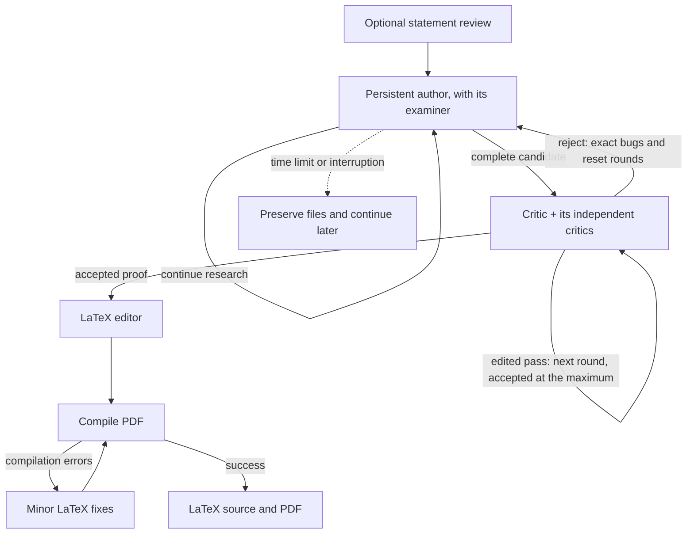

# The workflow

The New problem page has four stages: **Statement review**, **Author**,
**Critic** and **Writing & polishing**. All are on by default. Click a stage to
turn it off or on, keeping at least one; the selected stages run in that order.
A stage that is off makes no model requests and needs no model settings or
credentials.

- Only **Statement review**: check a problem without proving it.
- Only **Author**: a candidate proof. Without writing, a run returns its proof
  as text.
- Only **Critic**: check and repair a proof; put the complete candidate in your
  input.
- Only **Writing & polishing**: polish and compile a theorem and proof you
  supply. Author followed by writing also works with the critic off.

For an algorithmic task, include the computational model, the problem and the
asymptotic goal in the statement.

## Settings and prompts

**Advanced settings** on the New problem page start with
[Saved settings](saved-settings.md) (the Default settings every new problem
opens with, and settings saved under a name to load again) and the
[related works](job-page.md#related-works) for the author. Then they hold each
role's model and reasoning (see [Models and API connections](models.md)) and:

| Setting | Default | Meaning |
| --- | --- | --- |
| Parallel agents | 1 | 1 to 11: how many agents work at a time. 1: the author works alone. 2 or more: the author may also start subagents of its own, up to one fewer than this number at a time. See [the proof author](#the-author). |
| Examiner | On | About once an hour a fresh session of the author's model examines the whole run and reports to the author. See [the examiner](#the-examiner). |
| Independent critics | 3 | Fresh critics the critic starts on each proof version, 1 to 10. |
| Maximum consecutive critic rounds | 2 | Edited passes in a row, 1 to 100; at the limit the latest repaired proof is accepted. |
| Time limit in hours | 0 (none) | See [the job page](job-page.md#time-limit-and-progress-summary). |
| Generation speed | Standard | **Fast** applies to Codex CLI models only. |
| Activity log detail | Concise summaries | **Status only**, or concise or detailed public summaries of the models' reasoning. Private chain-of-thought is never shown or saved. |
| Web search cutoff | Off | See [Web search cutoff](web-cutoff.md). |

Jobs run in parallel, each in its own folder under `runs/`.

**Prompts.** Every text the workflow sends its models can be edited for the
next job: the role prompts, the author's and the coordinator's lifecycle
prompts, the [goal loop](#the-goal-loop)'s texts and the
[team](#the-authors-team)'s texts and tool descriptions. They live in
`workflows/author_critic.yaml` (the LaTeX editor's in `workflows/clean_up.yaml`,
the statement reviewer's in TCS Prover), each with a comment saying when it is
used and its placeholders. New jobs read them when they start, so an edit of the
file applies to the next job without a restart. An edit that cannot be read
leaves the last readable version in use, with a warning on the job page, until
the file is fixed.

- **Edit prompts** (also **Prompts** in the sidebar) lists every text, grouped
  by where it is used: Statement review, Author, Coordinator, Goal loop, Team,
  Team tools, Critic and Writer. **Search texts** finds a text by its name, its
  use or its wording; groups open and close, and the arrow keys move through the
  list. Each text shows when it is used, its placeholders (such as
  `{objective}`, or `[STATEMENT]` where the statement goes) and its default; an
  edited one is marked **edited**, and its group says how many are.
- **Apply to the next job** checks every edited text as TCS Prover checks it
  when a job starts, and shows a problem on its text: a text with placeholders
  may use only those, with any other brace written twice (`{{` and `}}`); a text
  with `[STATEMENT]` keeps exactly one; no text may be empty except the Codex
  compaction summary, whose empty default leaves Codex's own. The progress
  summaries (**Progress summary**, **Coordinator progress summary**) have no
  placeholders but are filled in like the others, so a brace is written twice
  there too, and **Reply to a message** has only `{message}`; any other text
  without placeholders (a tool description, **Related works**) is sent as
  written, braces included. The
  edits apply to the job you are about to start only: they are never remembered
  in the browser, carried into the next new problem or kept in
  [saved settings](saved-settings.md).
- **Each job keeps its texts.** A new job saves the whole set it runs with (the
  defaults and your edits) in its folders, and beside it which of them you
  edited, and reads its own copy every time it starts, resumes or continues, so
  later edits of the workflow files never change a job that has started.
  **Run settings → View this job's prompts** shows them, read-only, each marked
  when it differs from today's default. A job from before keeps working as it
  did: it saved only its role prompts (shown there with a note) and reads its
  other texts from the workflow files each time it starts or resumes.
- A job saved with the earlier default author prompt (the one with separate
  macOS or Linux and Windows instructions) gets the current default when it is
  resumed or continued; an author prompt you edited stays as it is.
- **Prompts & responses** on the job page shows the exact prompts sent and the
  text the models returned.

## Statement review

The reviewer lets you start from informal language without letting a model
silently solve a different problem. It removes ambiguities and handles corner
cases, then asks you to approve the revised statement (**Approve and start**) or
to revise it with your feedback (**Retry with feedback**). It also guesses what
you most likely want, and when the statement could be satisfied by its letter
without doing that, it closes the loophole and explains each change in its
notes. For example, a literal model may object that `m` can be smaller than `n`
in a bound such as `m log² n`; the review states the intended convention and
writes `(m+n) log² n`.

With only **Statement review** selected, the result is saved as
`checked-statement.md` in the job's run folder and can be copied from the review
page; only the reviewer's model, reasoning, prompt and speed apply.

A review that fails returns to the statement it revised, with the error and your
feedback filled in again (a first review returns to the draft). **Retry statement
review** on the batch list runs it again in the same job from
`review-input.json`. A review a restart interrupted starts again by itself.
Stopping a review is described under
[Stop and Continue](job-page.md#stop-and-continue).

## The author

One root author conversation (a Codex goal thread or a Claude Code
conversation) works on the statement for the whole run, across pauses,
restarts, context compaction and critic rejections. What it does depends on
**Parallel agents**, 1 to 11, default 1 (in the terminal, `-authorSubagents N`
with one fewer: the author's own subagents, 0 to 10):

- **1:** the author works on the proof alone, without a subagent tool. Its
  instructions (the `author` prompt in `workflows/author_critic.yaml`) ask it to
  prove the exact statement even when it looks like a hard or long-standing open
  problem, to keep its memory in the `memory` folder of its working directory
  (its conversation is compacted from time to time, and what is not written
  down is lost), to think deeply and to try substantially different approaches
  when one stalls. Its goal, continuation, reopen, resume and repair prompts
  repeat that it must not give up.
- **2 or more:** the same author, with the same prompt, may also hand parts of
  the work to subagents of its own: its program's subagent tool (Codex's or
  Claude Code's), limited to one fewer than the number at a time, as Codex's
  Ultra mode delegates. The `subagents` text tells it how many it may start.
  The subagents run the author's model.

The earlier team design, the [author coordinator](#the-author-coordinator), is
no longer what a new job gets: a job runs it only when it asks for it (in the
terminal, `-teamCoordinator`; in a start request, `authorMode`), and a
job that started with a coordinator keeps it when it is resumed or continued.

The number, and with it the mode (an author, or the earlier coordinator), is saved when the
job starts, shown in **Run settings**, and kept by resumes, continuations and
folder runs. With 2 or more parallel agents the `author` prompt ends with the
`subagents` text: "You may start up to N independent subagents at a time, for
example to explore other approaches or to check calculations; you do not need to
ask the user." A job saved without the number (from before the setting) runs one
author.

### The examiner

With **Examiner** on (the default), TCS Prover starts an examiner beside the
author about once an hour while the author works, from the first hour on. Each
examination is a fresh conversation of the author's model in the author's
folder, with the `author_examiner` text as its whole instruction (**Edit
prompts → Author → Examiner instructions**): it examines the whole run and
judges whether progress towards a complete proof keeps growing. Its final reply
is saved as `team/member-1/<k>-report.md` and sent into the author's running
turn, framed by `author_examiner_report` (by default `[REPORT FROM THE
EXAMINER]` and the report), the way a chat message is; the author goes on
working with it, and the activity log shows *Examiner report delivered*. Codex
and Claude Code authors both get it. **Examiner** off, or an empty
`author_examiner` text, runs the author without one.

### The goal loop

The author, or the author coordinator, works toward one goal, a checked proof of
the statement, in turns. Every new job from the New problem page runs them in
TCS Prover's goal loop; the form has no setting for it (the
[terminal](terminal.md)'s `-goalLoop codex` still chooses Codex's own goal
mode):

- TCS Prover starts every turn of a Codex CLI author itself (the Codex CLI's
  own goal mode is off). After a turn
  that did not end the goal it sends the next one, the `goal_continuation` text:
  `{continuation}` is the role's continuation prompt (placed first),
  `{objective}` the goal, `{elapsed}` the working time and `{limit}` the time
  limit and what is left of it. Its default is the Codex CLI's own continuation
  text (version 0.160), with the working time and the time limit in place of its
  token budget lines.
- The author ends the goal with TCS Prover's `update_goal` tool, whose
  description is the `goal_tool_update_goal` text (its arguments',
  `goal_tool_update_goal_status` and `goal_tool_update_goal_note`; their
  defaults are the Codex CLI's). Status *complete* hands the turn's final
  reply on as the answer when the turn ends, as before; a turn without a final
  reply, and a coordinator's reply that names no proof file (kept as a report),
  get the continuation instead. *Blocked* or *paused* is recorded
  and TCS Prover sends the continuation: it never stops a run for them. Each
  call is a **Goal status** line in the activity log, such as **Goal status ·
  blocked**, with the author's note and what TCS Prover does next.
- Everything else works as before: the time limit, Pause, Stop, Resume, live
  instructions, chat, compaction, the hand-in rules and retries every minute
  without limit.
- Claude Code has no goal mode of its own, so a Claude Code author always runs
  in TCS Prover's loop; its harness note (`claude_goal_harness`, with
  `{objective}`) is one of the editable texts.
- `codex_compact_prompt` holds the instructions the Codex CLI follows when it
  compacts a conversation; empty (the default) leaves the Codex CLI's own.
- **Codex built-in** is the Codex CLI's own goal mode with its own texts,
  unchanged. Every run with a [web cutoff](web-cutoff.md) runs it, and so do
  jobs from before TCS Prover's goal loop and jobs started with it while the
  form still offered the choice: their **Run settings** say *Codex built-in*.
- A job the form continues (its statement review sent back to the form, revised
  in place) keeps the goal loop it recorded, never another one. A job from
  before TCS Prover's goal loop also keeps, for a coordinator, the program's own
  subagents with the coordinator's model: the form shows **Same as the
  coordinator** fixed, with a note saying so.
- Anything that starts a new job runs TCS Prover's goal loop, also **Rerun with
  suggested statement** on a job that ran **Codex built-in** and settings saved
  with it before: a rerun of a job from before TCS Prover's team gets TCS
  Prover's team, as any new job does.

### The author coordinator

This is the earlier team design, which a job runs only when it asks for it (see
[the proof author](#the-author)). The coordinator does not try to prove
the statement itself. Its prompt asks it
to run the team of author subagents and check the team's health, so that
progress on the problem grows steadily with the time spent, until the team has
a complete proof. The authors do the mathematics: it gives them the original
exact statement and does not decide what each author should solve. How it
organizes the team and its memory is its own choice, and it uses the
examiner's reports and the authors' to judge whether to change that.

- **Prompts.** Its first prompt is the per-job `coordinator` prompt, in place of
  the `author` prompt (**Coordinator prompt** in **Edit prompts → Coordinator**;
  `{author_subagents}` is the number of author subagents). Its goal, continuation, reopen,
  compaction, resume, repair and summary prompts are `coordinator_goal`,
  `coordinator_continuation`, `coordinator_reopen`, `coordinator_compaction`,
  `coordinator_resume`, `coordinator_repair` and `coordinator_summary`. The goal and the continuation point
  back to the coordinator prompt in one line (Codex repeats the goal in each of
  its automatic turns); reopen, compaction, resume and repair repeat the whole
  first prompt under `ORIGINAL COORDINATOR PROMPT`. `coordinator_report`
  answers a reply that is not a hand-in (below). The chat prompts, the note on a
  refused submission and the note on related works are the same as one
  author's.
- **Author subagents.** They are [TCS Prover's team](#the-authors-team): N
  members, each running the model **Subagent models** gives it, to whom the
  coordinator hands assignments with TCS Prover's team tools. The activity log
  shows each assignment as **Author subagent started** (with the member's number
  and model, such as *Author subagent 2 (Claude Opus 5.5) started*, and the
  first line of the assignment), then **Author subagent finished** or **Author
  subagent failed** (with the reason when it is known, and the file of its
  report), with how many run then. These lines stay listed while the members'
  own events (*Subagent 2 reasoning*, *Subagent 2 tool*) leave the live window.
  With a web cutoff, and in coordinator jobs from before the team, the
  subagents are the program's own instead (see
  [the author's team](#the-authors-team)).
- **Memory.** When a coordinator run starts, TCS Prover creates a `memory/`
  folder in the author's working folder, with owner-only permissions where the
  system has them; what it already holds is never removed or overwritten.
  The coordinator keeps the team's memory there as it sees fit; its prompt asks
  it to keep a log of the team's progress in `memory/progress.md`, which the job
  page shows as the [progress log](job-page.md#progress-log).
- **Nothing on a schedule.** TCS Prover sends a working coordinator no message
  of its own at fixed times. What it examines, and when, is for its prompt to
  say. (Until 15 November 2026 it got an hourly time check with the elapsed
  time; the activity log of a job from then still shows those lines as
  **Author coordinator time check**.) The one thing TCS Prover starts by itself
  is the team's [examiner](#the-authors-team), whose report the coordinator
  collects like an author's.
- **Handing in.** A final reply that names no proof file (no `PROOF_FILE`
  pointer, see below) is not handed to the critic: the activity log shows the
  reply as the coordinator's own line, then an **Author coordinator report** line
  that says why it was not handed on (kept listed), and the coordinator gets
  `coordinator_report`: its reply was kept as a progress report, and a hand-in
  is the line `PROOF_FILE: proof.md` alone. Where
  TCS Prover cannot read a proof file (on Windows), the coordinator hands in the
  proof in its reply, as one author does.
- **No subagent tool.** With the program's own subagents (a web-cutoff run, or
  a coordinator job from before the team) and a model that gets no subagent
  tool (GPT 5.6 Luna, or an Anthropic-format API model in bare mode, see
  [API connections](models.md#api-connections)), the author of a coordinator
  job works alone with the `author` prompt instead of coordinating (its progress
  summaries too), and the activity log, **Run settings** and the place of the
  progress log say so.
- **Claude Code**, with its own subagents (a coordinator job from before the
  team), runs the subagents in the foreground: a live instruction or a chat
  message reaches a Claude coordinator when its running subagents report. With
  TCS Prover's team, `team_wait` returns as soon as one arrives.
- **Progress summaries** (at the time limit, or with **Summarize progress**) use
  `coordinator_summary`: from the team's memory, what has been verified, what
  remains open and why, and the most promising next steps. Like every reply of
  the paused author, the summary is read-only and starts no subagents.

### The author's team

An author coordinator works with a team of N members (N = **Author
subagents**), run by TCS Prover itself, rather than with the Codex CLI's or
Claude Code's own subagents.

- **Models.** **Subagent models** (in the Proof author's settings, shown with 1
  or more author subagents) is **Same as the coordinator** (the default: every
  member runs the coordinator's model and reasoning) or **Choose for each**: one
  row per member, *Subagent 1* to *Subagent N*, each with the roles' **Source**,
  **Model** and **Reasoning** menus (the Codex CLI, Claude Code or any API
  connection), so one team can mix models. Changing the number of subagents
  keeps the rows that remain and adds rows set to the coordinator's model. The
  program of each member's model counts on the [Setup page](models.md#the-setup-page)
  as a role's does.
- **Tools.** The coordinator works the team with TCS Prover's tools (its MCP
  server `tcs`): `team_members` (each member's model and what it is doing),
  `team_assign` (an assignment for an idle member, returning at once),
  `team_wait` (the next reports, waiting up to 30 minutes at a time; it returns
  early for a live instruction or a chat message),
  `team_followup` (continues a member's last assignment in the same
  conversation) and `team_stop`. Their descriptions, and their arguments', are
  the `team_tool_*` texts in **Edit prompts → Team tools**.
- **Waiting.** The Codex CLI's own instructions ask its model for a commentary
  update at least every 60 seconds and for no wait longer than 60 seconds. A
  coordinator that follows them wakes every minute while its team works, and
  each time its whole conversation goes to the model again. A Codex coordinator
  therefore also gets a short note after those instructions
  (`codex_coordinator_note` in **Edit prompts → Coordinator**), which says
  that neither applies to an unattended run; how long it waits is then its own
  choice. An empty note sends nothing. Claude Code coordinators, and
  coordinators without TCS Prover's team, get no note.
- **The examiner.** A coordinator in a long run was found to hold only part of
  what the same model finds when examining the run is its only task. The team
  therefore has one more seat, the examiner, which TCS Prover starts itself:
  when the coordinator assigns work or waits while an author is working, the
  examiner is idle, some author has reported before, and the last examination
  began at least an hour ago. Each examination is a fresh run of the
  coordinator's model, one turn long, in the same working folder; its whole
  instruction is `team_examiner` (**Edit prompts → Team**: examine the whole
  trajectory; judge whether progress towards a complete proof grows steadily
  with the time spent, what is still missing, and how that has changed since
  several hours ago and since its own earlier reports; examine the
  coordination and say what should change in how the team is run, leaving the
  mathematics to the authors; check whether earlier changes helped). The
  coordinator's prompt leaves the examination of the whole run to these
  reports. Its
  final reply is its report, saved as `team/member-<N+1>/<k>-report.md`, and
  `team_wait` returns it like an author's report, usually while the author is
  still working. The coordinator cannot assign or stop the examiner;
  `team_members` lists it last, and the description of `team_wait` says that it
  exists (`team_examiner_note`). For the examiner the team keeps
  `team/timeline.md`: every assignment with its text and every report, with
  their times. An empty `team_examiner` runs the team without an examiner. A job
  started before the examiner existed has no text of its own for it, so it
  takes the workflow file's when it is next resumed, and its timeline starts
  then. The activity log shows an examination as author subagent N+1 with the
  task *Examination of the whole run*.
- **Assignments.** Each is a fresh run of the member's model, one turn long, in
  the author's working folder (the folder the coordinator works in, with the
  author's sandbox, network rule and credentials), with no subagents of its own.
  The member receives the assignment wrapped in `team_member` (by default the
  assignment, then "Your final reply is your report to the coordinator."), and
  its final reply is its report, saved as `team/member-<n>/<k>-report.md` in
  that folder. A failed model call is retried every minute without limit; a
  setting that cannot work (a program not installed, no sign-in, an unknown
  model) comes back to the coordinator as a failed assignment with the reason.
  So does a request that a member's API connection refuses (its endpoint calls
  the request invalid, says that the model does not exist or that its key
  cannot use it, or refuses its key), with the service's words; as such a
  refusal can also be temporary, the report tells the coordinator that it may
  be a temporary problem of the service or a wrong setting, and to keep the
  work going by giving the assignment to another member, or to the same member
  again later. The member's line in the activity log says what failed and ends
  with the service's words.
  Pause, Stop, the time limit and a restart stop the members with the
  coordinator; their files stay. A paused run also keeps each author's last
  conversation with its saved state (in `pause.json`, which no model can
  write): when it resumes, the coordinator's next `team_wait` names each
  assignment that the pause or restart stopped, and `team_followup` continues
  that member's conversation with everything it did there.
- **When the coordinator cannot use its team, or does not wait for it.** The
  job is listed under **Needs your attention** while the work goes on, and the
  activity log keeps the warning, when the coordinator makes 10 model calls, or
  works 20 minutes (not counting a team tool that runs, such as a long
  `team_wait`), without calling any team tool (**Coordinator works without its
  team**: its requests may reach the model without the team tools, for example
  through a proxy that drops them; once one of its team tool calls has worked,
  answered by the team without an error, also before a failed model call
  restarted its session, its tools reach the model, and the same warning says
  what it does: while a member works on an assignment, it reads **Coordinator
  keeps checking on its team instead of waiting**: the coordinator checks on
  its members between team calls, for example by sleeping and reading their
  files, instead of waiting with `team_wait`, each check sending its whole
  conversation to the model again; while no member works, it keeps the title
  **Coordinator works without its team** and says that the coordinator is doing
  the work itself instead of giving it to a member); when Codex refuses one of
  its team tool calls ("unsupported call", **Team tool call refused**); and
  when a coordinator under TCS Prover's goal loop ends 3 turns with a reply
  that names its proof file without marking its goal complete (**Proof not
  handed in**: without `update_goal`'s "complete" the reply is not handed in).
  Each warning ends by itself, with a **Coordinator warning cleared** line: at
  the coordinator's next team call, its next team call that reaches the team,
  its next hand-in, also after a failed model call restarted the coordinator's
  session. A coordinator without TCS Prover's team (one using its program's own
  subagents) gets only the **Proof not handed in** warning.
- **The team note.** `team_note` is added to the coordinator's first prompt,
  after the related works; `{members}` lists the members, one line each (such as
  "- member 1: GPT 6.1 Sol (Codex CLI)").
- **Web cutoff.** A run with a web cutoff keeps the program's own subagents,
  which run the coordinator's model inside the same cutoff: **Subagent models**
  stays *Same as the coordinator*, and the form says *With a web cutoff, author
  subagents use the coordinator's model.* With Codex, the coordinator's
  delegation hint then asks it to start each subagent fresh with a
  self-contained assignment, to wait up to 30 minutes at a time and to close
  finished ones where it can. Coordinator jobs from before the team keep the
  program's own subagents too.

### Handing in a proof

The author writes its complete proof to `proof.md` in its working folder and
replies `PROOF_FILE: proof.md`.

- **Windows.** TCS Prover cannot read that file safely there, so the runner adds
  a short note after the author's first prompt, the continuation prompt and every
  repair prompt asking for the complete proof in the reply instead, and refuses a
  `PROOF_FILE` reply with a reason that says so. The workflow prompts are the same
  on every computer.
- **Snapshot.** Before review, TCS Prover captures the file and gives every
  critic call `proof.md`, `statement.md` and a manifest with SHA-256 hashes in a
  fresh workspace of its own. The critic's subagents only read that snapshot.
- **Refused before review:** a missing, linked, unsafe, non-UTF-8, empty or
  larger-than-8-MiB proof file, a proof larger than 8 MiB or than the critic
  model's context window (when its settings record one), and a `PROOF_FILE` in
  `related-works/`, `chat/` or another controller file. The job pauses at the
  author with a reason that names the file and the cause, never its content (for
  example `proof.md: file not found`), resumes the author after a minute, and
  asks it to submit the complete proof again. With the critic off, a proof file
  that cannot be read is refused the same way before writing.
- **Pointers.** A `PROOF_FILE` line counts only in a short message (at most
  1,500 characters without it). Next to a complete proof in the reply it is
  ignored, unless the file holds a different proof: then the handoff is refused
  and the author asked for one of the two. Clear variants are accepted, such as
  `PROOF_FILE proof.md`, Markdown emphasis, `see proof.md` or `./proof.md`.

## The critic

Each round is one critic call that starts fresh independent critics as its own
subagents and then decides. Its instructions (the `critic` prompt, where
`{count}` is the **Independent critics** setting) ask it to start exactly that
many subagents to look hard for bugs in the statement and in `proof.md`; to wait
for all their reports and decide which objections are valid; to fix every valid
bug it can, in small edits to its own writable copy of `proof.md`; and to reject
only for a critical error that a subagent found and that it confirms but cannot
rigorously fix. It runs with the critic model and reasoning.

Its answer is `{verdict, bugs, fixes}`: `bugs` is empty exactly when the verdict
is pass, and `fixes` lists what it fixed. Whether it changed the proof is decided
by comparing its copy with the captured candidate (spacing at line ends does not
count), so no answer has to hold the whole proof. An answer that breaks a rule,
or one given after some of its subagents' calls failed, is asked again with a
plain explanation, never turned into a rejection.

**Rounds.**
- An unchanged pass (a **clean pass**) accepts the proof at once.
- A **pass with fixes** sends the new version to another round with fresh
  critics, up to **Maximum consecutive critic rounds** (default 2). A pass with
  fixes in the last round accepts that repaired version ("Reached MAX (2 rounds);
  using the latest repaired proof."); the edits of that round are not reviewed
  again.
- A rejection returns the latest safely repaired candidate and the exact
  unresolved bugs to the author and resets the count. With the author off, the
  job ends as **Proof needs revision**, keeping the candidate and the objections.
  Writing never starts from a rejected proof.
- An interrupted round (a pause, **Stop**, a crash or a restart) runs again from
  its saved input as the same round, with new subagents. A continuation in a new job starts a fresh critic.
- Model review is not formal proof verification.

**Failed subagents.** Codex reports a failed subagent of version-1 models (such
as API models) in its event stream; for GPT 6.x and GPT 5.6 Sol and Terra
(version 2) TCS Prover reads it ("Agent errored") from the critic's saved Codex
session, and a Diagnostic says when that session cannot be found. Web-cutoff
runs save no session, so there such a failure is not detected and the activity
log says so.

### What you see of the critic

**Critic review inputs and decisions**, beside **Run settings**, groups each
submission of the author into a review cycle. Each round shows the critic's one
decision (**Clean pass**, **Pass with fixes** or **Rejected**), what it fixed,
the critical bugs, and for a round that changed the proof a collapsed **Show
changes to the proof** with the diff. The critic's exact input and raw decision
stay below, collapsed. (A job started before 20 Nov 2026 may also show the
verdict of its **Convention critic**, a step since removed, under the round that
accepted the proof.) The independent critics' own reports are not shown: the critic
reads them and makes the one decision.

- A round interrupted and resumed stays one round, marked **resumed**. A paused
  round says that it starts again with fresh critics on Resume.
- A diff longer than 200,000 characters is saved whole in
  `runs/.controller/<run>/critic-diffs/` and offered as a download; nothing is
  shortened.
- While a round runs, a progress line says how many critics have started and
  finished, such as "Critic 1 of 3 finished · Critic 2 of 3 working", never
  their text. For version-2 Codex models TCS Prover reads this from the saved
  session every two seconds; in a web-cutoff run, which saves no session, the line
  says only that the critic has started its critics. Claude's Task calls show
  each start and end. Extra critics show as "Critic 4 (beyond the 3 requested)".
  While a failed critic call waits to retry, the line says so; its critics start
  again with the retry. A round counts once, however many subagents and retries
  it has.
- The per-job **Critic prompt** changes the critic's instructions (keep
  `{count}`). A job saved with the earlier default prompt of controller-run
  parallel critics gets the current default when it is resumed or continued.

### Subagents: what the program enforces

Only the critic and, with **Parallel agents** 2 or more, the author (or an
author coordinator) have subagents; the statement reviewer, the LaTeX writer and the paused author's
replies have none.

An author coordinator with [TCS Prover's team](#the-authors-team) has exactly
N members, each working on one assignment at a time (`team_assign` refuses a
busy member), so at most N assignments run at once; members get no subagent
tool. The rest of this section is about the programs' own subagents: the
critic's, and an author's in a web-cutoff run or a job from before the team.
Checked with Codex 0.160 against a local stand-in for the model API:

| Codex setting | What it enforces |
| --- | --- |
| `features.multi_agent_v2.max_concurrent_threads_per_session` = N + 1 | Version-2 models (GPT 6.x, GPT 5.6 Sol and Terra): at most N subagents at once, counting subagents of subagents ("agent thread limit reached"). A call without subagents gets N = 0: with `multi_agent` off Codex still lists its collaboration tools to these models, unless `agents.enabled` is false (below). |
| `agents.max_concurrent_threads_per_session` = N, `agents.max_depth` = 1 | Version-1 models (API models and others): at most N subagents at once, and subagents get no subagent tool. |
| `features.multi_agent_v2.multi_agent_mode_hint_text` | Replaces Codex's "Do not spawn sub-agents unless the user … explicitly ask …" hint with one that allows up to N subagents without asking; the author coordinator's hint also says that delegating is its task, that waiting for its subagents is part of its work, and that each starts fresh. |
| `agents.enabled` = false | A Codex process that starts no subagent of Codex: the statement reviewer, the LaTeX writer and its repair (a `-c` flag), and the thread of an author that works alone or with TCS Prover's team. Its model is offered none of Codex's collaboration tools. |

On version-2 models the author coordinator also gets
`features.multi_agent_v2.default_wait_timeout_ms` = 1800000, so its waits for
its subagents default to 30 minutes. A web-cutoff run leaves this setting out
(its isolation check compares every agent setting, and whether Codex reports
this one has not been checked); there only the hint asks for long waits.

So the program limits how many subagents run at once, not how many in total.
Only the prompt says that the critic starts exactly that many, and (on version
2) that subagents start none of their own. For Claude Code, TCS Prover sets
Claude Code's own limits in the environment of the critic and of an author
with subagents: at most N subagents at once, none of their own, no copies of the
calling conversation, and subagents in the foreground. These are undocumented
settings of Claude Code, found in its version 2.1.289 (see
[Developers and operators](developers.md)). GPT 5.6 Luna (older) gets no
subagent tool, so with it the critic reviews alone and the author of a
coordinator job works alone; the activity log says "No subagents with this
model". In a web-cutoff run these limits are session flags of each Codex
process, and the isolation check refuses any other agent setting.

### Critics of web-cutoff runs

They read the snapshot with shell tools, with outside file access, networking,
native search and MCP turned off. There the snapshot stays read-only, and the
critic returns the complete proof in its answer.

## LaTeX writing

The LaTeX editor makes one model call with its prompt and the latest proof (or
the theorem and proof you supplied). It writes the complete document to
`latex-source.tex` in its own workspace in small steps and answers with a short
summary; in web-cutoff runs it returns the document in its answer instead.
**Compile PDF** then runs `latexmk` with `pdflatex`, with shell escape and
latexmk configuration files off.

- Compiler errors, and citations or references left undefined, go back to the
  writer for minor fixes with every error of the compile; then it compiles
  again. A repair that breaks LaTeX commands, puts a comment in place of omitted
  text, or loses more than a tenth of the text, theorem environments or labels is
  asked for again.
- A compile has 5 minutes, then up to 15 and 30 minutes before the writer is
  asked to look for an infinite loop; one that prints more than 256 MB is
  stopped at once. Of an output longer than 24,000 characters the writer reads
  the TeX errors (at most about half of that, with `[More errors omitted]` when
  some do not fit), an `[N earlier characters omitted]` marker and the end.
- When the same first error, or the same source, has failed three compiles, the
  job finishes with the source as `final.tex` and a "PDF not compiled" note
  saying why, as when the web-cutoff compiler refuses a source. If only undefined
  references remain after three compiles, the PDF is kept.
- Only a successful compile publishes `final.pdf`. The source stays in
  `latex-source.tex`, and compiler output in `latex-compile.log`, with a copy per
  attempt (`latex-compile-1.log`, …).
- When `latexmk` or `pdflatex` is missing, the run says so when it starts. TCS
  Prover also looks in the standard TeX folders (`/Library/TeX/texbin`,
  `/usr/local/texlive/*/bin/*`, TinyTeX, Homebrew). The compile step then checks
  again every minute, without model calls and without using the time budget,
  until it can run.

The time limit never stops the critic or the LaTeX steps.
