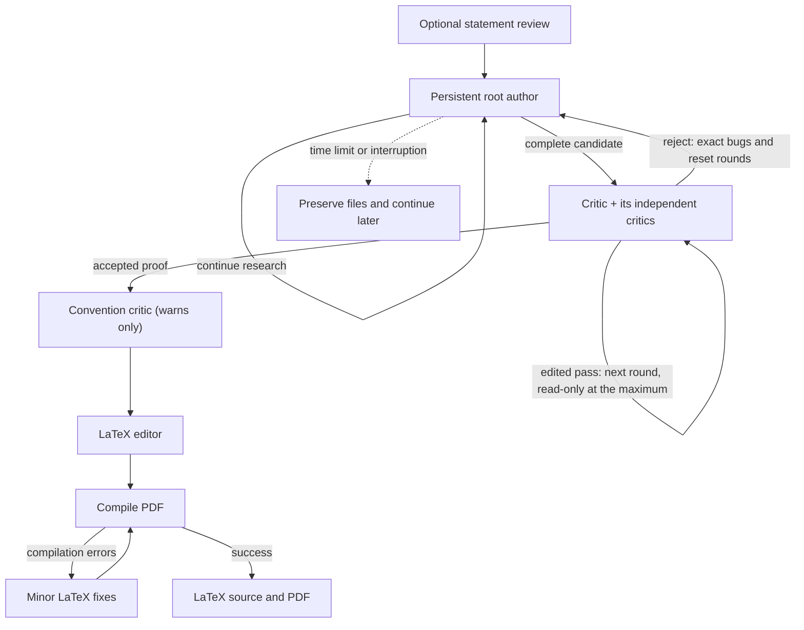

# The workflow

The New problem page has four stages: **Statement review**, **Author**,
**Critic** and **Writing & polishing**. All are on by default. Click a stage to
turn it off or on, keeping at least one; the selected stages run in that order.
A stage that is off makes no model requests and needs no model settings or
credentials.

- Only **Statement review**: check a problem without proving it.
- Only **Author**: a candidate proof. Without writing, a run returns its proof
  as text.
- Only **Critic**: check and repair a proof; put the complete candidate in your
  input.
- Only **Writing & polishing**: polish and compile a theorem and proof you
  supply. Author followed by writing also works with the critic off.

For an algorithmic task, include the computational model, the problem and the
asymptotic goal in the statement.

## Settings and prompts

**Advanced settings** on the New problem page hold each role's model and
reasoning (see [Models and API connections](models.md)) and:

| Setting | Default | Meaning |
| --- | --- | --- |
| Author subagents | 0 | Subagents the author may start at a time, 0 to 10. 0 gives it no subagent tool. |
| Independent critics | 3 | Fresh critics the critic starts on each proof version, 1 to 10. |
| Maximum consecutive critic rounds | 2 | Edited passes in a row before the final check, 1 to 100. |
| Time limit in hours | 0 (none) | See [the job page](job-page.md#time-limit-and-progress-summary). |
| Generation speed | Standard | **Fast** applies to Codex CLI models only. |
| Activity log detail | Concise summaries | **Status only**, or concise or detailed public summaries of the models' reasoning. Private chain-of-thought is never shown or saved. |
| Web search cutoff | Off | See [Web search cutoff](web-cutoff.md). |

Jobs run in parallel, each in its own folder under `runs/`.

**Prompts.** New jobs read the author, critic and convention critic prompts from
`workflows/author_critic.yaml` and the LaTeX editor's prompt from
`workflows/clean_up.yaml` when they start, so an edit applies to the next job
without a restart. An edit that cannot be read leaves the last readable version
in use, with a warning on the job page, until the file is fixed.

- **Edit prompts** (also **Prompts** in the sidebar) shows the current defaults
  for the reviewer, author, critic, convention critic and final writer. **Apply
  to this job** changes only the job you are about to start; prompts are never
  remembered in the browser, carried into the next job or kept in
  [saved settings](saved-settings.md).
- Continuing a job keeps its saved prompts and workspace. A job saved with the
  earlier default author prompt (the one with separate macOS or Linux and
  Windows instructions) gets the current default when it is resumed or
  continued; an author prompt you edited stays as it is. Other changes to an
  existing job's instructions need a new job (or an explicitly approved
  migration of its instructions and records).
- **Prompts & responses** on the job page shows the exact prompts sent and the
  text the models returned.

## Statement review

The reviewer lets you start from informal language without letting a model
silently solve a different problem. It removes ambiguities and handles corner
cases, then asks you to approve the revised statement (**Approve and start**) or
to revise it with your feedback (**Retry with feedback**). It also guesses what
you most likely want, and when the statement could be satisfied by its letter
without doing that, it closes the loophole and explains each change in its
notes. For example, a literal model may object that `m` can be smaller than `n`
in a bound such as `m log² n`; the review states the intended convention and
writes `(m+n) log² n`.

With only **Statement review** selected, the result is saved as
`checked-statement.md` in the job's run folder and can be copied from the review
page; only the reviewer's model, reasoning, prompt and speed apply.

A review that fails returns to the statement it revised, with the error and your
feedback filled in again (a first review returns to the draft). **Retry statement
review** on the batch list runs it again in the same job from
`review-input.json`. A review a restart interrupted starts again by itself.
Stopping a review is described under
[Stop and Continue](job-page.md#stop-and-continue).

## The author

One root author conversation works on the statement for the whole run, across
pauses, restarts, context compaction and critic rejections. Its instructions (the
`author` prompt in `workflows/author_critic.yaml`) ask it to prove the exact
statement even when it looks like a hard or long-standing open problem, to think
deeply and to try substantially different approaches when one stalls. Its goal,
continuation, reopen, resume and repair prompts repeat that it must not give up.
None of them asks for research notebooks or a file layout.

**Author subagents** (`-authorSubagents N` in the terminal) is how many
subagents the author may start at a time, 0 to 10, default 0. With 1 or more it
gets a subagent tool limited to that many, and its first prompt ends with "You
may start up to N independent subagents at a time, for example to explore other
approaches or to check calculations; you do not need to ask the user." The
setting is saved with the job, shown in **Run settings**, and kept by resumes,
continuations and folder runs.

### Handing in a proof

The author writes its complete proof to `proof.md` in its working folder and
replies `PROOF_FILE: proof.md`.

- **Windows.** TCS Prover cannot read that file safely there, so the runner adds
  a short note after the author's first prompt, the continuation prompt and every
  repair prompt asking for the complete proof in the reply instead, and refuses a
  `PROOF_FILE` reply with a reason that says so. The workflow prompts are the same
  on every computer.
- **Snapshot.** Before review, TCS Prover captures the file and gives every
  critic call `proof.md`, `statement.md` and a manifest with SHA-256 hashes in a
  fresh workspace of its own. The critic's subagents and the convention critic
  only read that snapshot.
- **Refused before review:** a missing, linked, unsafe, non-UTF-8, empty or
  larger-than-8-MiB proof file, a proof larger than 8 MiB or than the critic
  model's context window (when its settings record one), and a `PROOF_FILE` in
  `related-works/`, `chat/` or another controller file. The job pauses at the
  author with a reason that names the file and the cause, never its content (for
  example `proof.md: file not found`), resumes the author after a minute, and
  asks it to submit the complete proof again. With the critic off, a proof file
  that cannot be read is refused the same way before writing.
- **Pointers.** A `PROOF_FILE` line counts only in a short message (at most
  1,500 characters without it). Next to a complete proof in the reply it is
  ignored, unless the file holds a different proof: then the handoff is refused
  and the author asked for one of the two. Clear variants are accepted, such as
  `PROOF_FILE proof.md`, Markdown emphasis, `see proof.md` or `./proof.md`.

## The critic

Each round is one critic call that starts fresh independent critics as its own
subagents and then decides. Its instructions (the `critic` prompt, where
`{count}` is the **Independent critics** setting) ask it to start exactly that
many subagents to look hard for bugs in the statement and in `proof.md`; to wait
for all their reports and decide which objections are valid; to fix every valid
bug it can, in small edits to its own writable copy of `proof.md`; and to reject
only for a critical error that a subagent found and that it confirms but cannot
rigorously fix. It runs with the critic model and reasoning.

Its answer is `{verdict, bugs, fixes}`: `bugs` is empty exactly when the verdict
is pass, and `fixes` lists what it fixed. Whether it changed the proof is decided
by comparing its copy with the captured candidate (spacing at line ends does not
count), so no answer has to hold the whole proof. An answer that breaks a rule,
or one given after some of its subagents' calls failed, is asked again with a
plain explanation, never turned into a rejection.

**Rounds.**
- An unchanged pass (a **clean pass**) accepts the proof at once.
- A **pass with fixes** sends the new version to another round with fresh
  critics, up to **Maximum consecutive critic rounds** (default 2). At that
  maximum, one more round reviews the latest version read-only (the **final
  check**): it passes it unchanged or rejects it. Unreviewed edits are never
  accepted.
- A rejection returns the latest safely repaired candidate and the exact
  unresolved bugs to the author and resets the count. With the author off, the
  job ends as **Proof needs revision**, keeping the candidate and the objections.
  Writing never starts from a rejected proof.
- An interrupted round (a pause, **Stop**, a crash or a restart) runs again from
  its saved input as the same round, with new subagents; an interrupted final
  check stays read-only. A continuation in a new job starts a fresh critic.
- Model review is not formal proof verification.

**Failed subagents.** Codex reports a failed subagent of version-1 models (such
as API models) in its event stream; for GPT 6.x and GPT 5.6 Sol and Terra
(version 2) TCS Prover reads it ("Agent errored") from the critic's saved Codex
session, and a Diagnostic says when that session cannot be found. Web-cutoff
runs save no session, so there such a failure is not detected and the activity
log says so.

### What you see of the critic

**Critic review inputs and decisions**, beside **Run settings**, groups each
submission of the author into a review cycle. Each round shows the critic's one
decision (**Clean pass**, **Pass with fixes** or **Rejected**), what it fixed,
the critical bugs, and for a round that changed the proof a collapsed **Show
changes to the proof** with the diff. The round that accepted the proof also
shows the **Convention critic**. The critic's exact input and raw decision stay
below, collapsed. The independent critics' own reports are not shown: the critic
reads them and makes the one decision.

- A round interrupted and resumed stays one round, marked **resumed**. A paused
  round says that it starts again with fresh critics on Resume.
- A diff longer than 200,000 characters is saved whole in
  `runs/.controller/<run>/critic-diffs/` and offered as a download; nothing is
  shortened.
- While a round runs, a progress line says how many critics have started and
  finished, such as "Critic 1 of 3 finished · Critic 2 of 3 working", never
  their text. For version-2 Codex models TCS Prover reads this from the saved
  session every two seconds; in a web-cutoff run, which saves no session, the line
  says only that the critic has started its critics. Claude's Task calls show
  each start and end. Extra critics show as "Critic 4 (beyond the 3 requested)".
  While a failed critic call waits to retry, the line says so; its critics start
  again with the retry. A round counts once, however many subagents and retries
  it has.
- The per-job **Critic prompt** changes the critic's instructions (keep
  `{count}`). A job saved with the earlier default prompt of controller-run
  parallel critics gets the current default when it is resumed or continued.

### Subagents: what the program enforces

Only the critic and, with **Author subagents** 1 or more, the author have
subagents; the statement reviewer, the convention critic, the LaTeX writer and
the paused author's replies have none. Checked with Codex 0.160 against a local
stand-in for the model API:

| Codex setting | What it enforces |
| --- | --- |
| `features.multi_agent_v2.max_concurrent_threads_per_session` = N + 1 | Version-2 models (GPT 6.x, GPT 5.6 Sol and Terra): at most N subagents at once, counting subagents of subagents ("agent thread limit reached"). A call without subagents gets N = 0, since Codex lists its collaboration tools to these models anyway. |
| `agents.max_concurrent_threads_per_session` = N, `agents.max_depth` = 1 | Version-1 models (API models and others): at most N subagents at once, and subagents get no subagent tool. |
| `features.multi_agent_v2.multi_agent_mode_hint_text` | Replaces Codex's "Do not spawn sub-agents unless the user … explicitly ask …" hint with one that allows up to N subagents without asking. |

So the program limits how many subagents run at once, not how many in total.
Only the prompt says that the critic starts exactly that many, and (on version
2) that subagents start none of their own. Claude Code has no such setting: the
number is in the prompt only. GPT 5.6 Luna (older) gets no subagent tool, so with
it the critic reviews alone and **Author subagents** has no effect; the activity
log says "No subagents with this model". In a web-cutoff run these limits are
session flags of each Codex process, and the isolation check refuses any other
agent setting.

### Critics of web-cutoff runs

They read the snapshot with shell tools, with outside file access, networking,
native search and MCP turned off. There the snapshot stays read-only, and the
critic returns the complete proof in its answer.

## The convention critic

Once the critic has accepted a proof and the run is about to hand it to
**Writing & polishing** (or, without writing, just before the run ends), the
convention critic checks the accepted proof once, exactly what the writer
receives, together with the statement. Rejected rounds and passes that go on to
another round never run it.

It guesses what a conventional mathematician or theoretical computer science
researcher wants from the statement, and judges whether the proof does that or
"cheats" by exploiting a loophole in the problem description, such as a
brute-force construction that stores all answers. It is its own workflow step
(`convention` in `workflows/author_critic.yaml`): a read-only call with the
critic's model and reasoning and the critic's sandbox, network and web-cutoff
rules, without subagents. Its prompt is `convention_critic`; the prompt editor's
**Convention critic** tab changes it for one job.

Its verdict never changes the route: the run continues to writing, or to the
end, once it has answered. A failed call is retried every minute, and a run
paused or interrupted in this step runs it again on resume.

- **loophole**: a warning at the top of the job page says how the proof exploits
  the statement and suggests a statement (with **Copy**). **Rerun with suggested
  statement** opens the New problem page with that statement and this job's
  settings, with the **Author** stage on, in the job's batch while that batch
  takes problems; it starts nothing. **Ignore** dismisses the warning. Until then
  the job list tags the job **Loophole warning**.
- **faithful**: shown only in the critic review history, under the round that
  accepted the proof. A faithful verdict on a later accepted proof closes an
  earlier warning.

The latest verdict, its round and whether it was ignored survive restarts; a
saved (read-only) batch shows them too, without **Ignore**.

## LaTeX writing

The LaTeX editor makes one model call with its prompt and the latest proof (or
the theorem and proof you supplied). It writes the complete document to
`latex-source.tex` in its own workspace in small steps and answers with a short
summary; in web-cutoff runs it returns the document in its answer instead.
**Compile PDF** then runs `latexmk` with `pdflatex`, with shell escape and
latexmk configuration files off.

- Compiler errors, and citations or references left undefined, go back to the
  writer for minor fixes with every error of the compile; then it compiles
  again. A repair that breaks LaTeX commands, puts a comment in place of omitted
  text, or loses more than a tenth of the text, theorem environments or labels is
  asked for again.
- A compile has 5 minutes, then up to 15 and 30 minutes before the writer is
  asked to look for an infinite loop; one that prints more than 256 MB is
  stopped at once. Of an output longer than 24,000 characters the writer reads
  the TeX errors (at most about half of that, with `[More errors omitted]` when
  some do not fit), an `[N earlier characters omitted]` marker and the end.
- When the same first error, or the same source, has failed three compiles, the
  job finishes with the source as `final.tex` and a "PDF not compiled" note
  saying why, as when the web-cutoff compiler refuses a source. If only undefined
  references remain after three compiles, the PDF is kept.
- Only a successful compile publishes `final.pdf`. The source stays in
  `latex-source.tex`, and compiler output in `latex-compile.log`, with a copy per
  attempt (`latex-compile-1.log`, …).
- When `latexmk` or `pdflatex` is missing, the run says so when it starts. TCS
  Prover also looks in the standard TeX folders (`/Library/TeX/texbin`,
  `/usr/local/texlive/*/bin/*`, TinyTeX, Homebrew). The compile step then checks
  again every minute, without model calls and without using the time budget,
  until it can run.

The time limit never stops the critic or the LaTeX steps.
